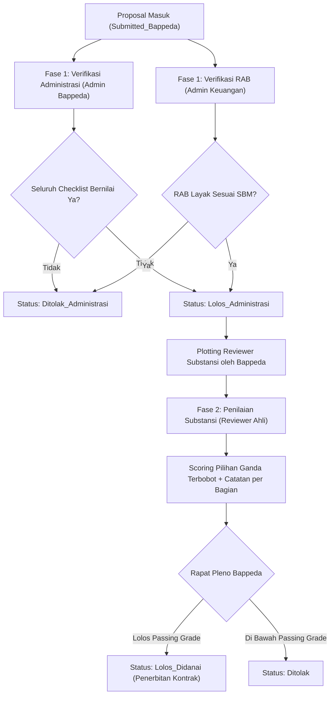
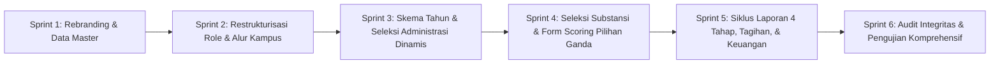

# Cetak Biru Revisi — Spesifikasi Sistem E-Jarlit Bappeda Kota Yogyakarta

> Sumber Rujukan: Catatan Rapat 23 Oktober 2026 & Keputusan Final 24 Oktober 2026  
> Status Dokumen: FINAL SPECIFICATION (Baseline Disetujui)  
> Tagline Sistem: "For Yogyakarta Research"  
> Institusi Pengelola: Badan Perencanaan Pembangunan Daerah (Bappeda) Kota Yogyakarta  

---

## 1. Analisa Eksekutif & Ringkasan Perubahan

Sistem mengalami transformasi menyeluruh dari kerangka internal multi-kampus PTMA Muhammadiyah menjadi sistem riset terintegrasi pemerintah daerah: **E-Jarlit Bappeda Kota Yogyakarta**.

Perubahan mendasar berpusat pada empat pilar:
1. **Rebranding Total & Identitas Daerah**: Pembersihan menyeluruh atribut PTMA Muhammadiyah, penerapan logo resmi Pemerintah Kota Yogyakarta, tagline *"For Yogyakarta Research"*, dan identitas resmi kantor Bappeda Kota Yogyakarta.
2. **Penyelarasan Struktur Peran (RBAC) & Verifikasi Kampus Mitra**: 
   - Penyatuan role Admin Pengelola ke dalam Super Admin Bappeda (Admin Pusat).
   - Penempatan role Admin Keuangan secara eksklusif pada Bappeda (bukan kampus).
   - Pengkhususan role Admin Kampus sebagai verifikator/approval awal usulan proposal dari dosen/peneliti di perguruan tinggi masing-masing di wilayah Kota Yogyakarta.
   - Konsolidasi peran peneliti (menghapus role User generic dan menonaktifkan modul jurnal).
3. **Restrukturisasi Dua Fase Seleksi & Spesialisasi Tiga Penilai**:
   - **Fase 1 (Seleksi Administrasi & Keuangan)**: Verifikasi checklist kelayakan administratif dinamis (Ya/Tidak, syarat kelulusan 100% Ya) oleh Admin Bappeda, serta penelaahan kepatuhan RAB oleh Admin Keuangan.
   - **Fase 2 (Seleksi Substansi)**: Penilaian ilmiah oleh Reviewer Ahli/Eksternal menggunakan instrumen pilihan ganda diskret terbobot (tanpa slider) dengan justifikasi komentar per indikator.
4. **Siklus Pelaporan Bertahap, Tagihan, & Gatekeeper Keuangan**:
   - Monitoring dan Evaluasi (Monev) mendukung 4 kategori laporan: Pendahuluan, Bulanan, Antara (Kemajuan), dan Akhir.
   - Penyerahan laporan disertai berkas naskah laporan, bahan tayang presentasi, dan dokumen tagihan termin (invoice/kuitansi).
   - Admin Keuangan memegang kendali penuh verifikasi RAB awal, persetujuan tagihan termin, dan validasi laporan pertanggungjawaban keuangan (SPJ).

---

## 2. Rincian Rencana Tindakan per Modul

### A. Branding, Aset Visual & Identitas Daerah

Pembersihan menyeluruh seluruh sisa string lama dan penggantian identitas visual:

- [ ] **Pembersihan Referensi Lama**: Hapus seluruh referensi "PTMA", "Muhammadiyah", "Majelis Diktilitbang" dari antarmuka React, template surel, seeder, dan dokumentasi.
- [ ] **Aset Visual Resmi Pemkot Yogyakarta**:
  - Ganti `public/logo.svg`, `public/logo_dark.png`, `public/favicon.svg`, `public/apple-touch-icon.png` dengan logo resmi Pemerintah Kota Yogyakarta.
- [ ] **Pemberian Tagline & Narasi**: Terapkan *"For Yogyakarta Research"* pada halaman Welcome, header login, dan metadata aplikasi.
- [ ] **Informasi Kontak & Alamat Resmi Bappeda**:
  - Tampilkan alamat resmi pada footer antarmuka publik:
    *Badan Perencanaan Pembangunan Daerah (Bappeda) Kota Yogyakarta*  
    *Kompleks Balai Kota Yogyakarta, Jl. Kenari No. 56, Muja Muju, Kec. Umbulharjo, Kota Yogyakarta, D.I. Yogyakarta 55165*  
    *Surel: bappeda@jogjakota.go.id | Telepon: (0274) 515865*

**Prioritas: P1 (Cepat, penyelarasan tampilan visual).**

---

### B. Struktur Peran Pengguna (RBAC) & Alur Otorisasi

Matriks peran yang berlaku pasca-konsolidasi:

| Peran Sistem | Posisi / Lembaga | Wewenang Utama | Hak Akses Antarmuka |
|---|---|---|---|
| **Super Admin / Admin Bappeda** | Pusat (Bappeda) | Tata kelola master skema per tahun, seleksi administrasi dinamis, penugasan reviewer substansi, penetapan kontrak dan SKTS, manajemen seluruh user. | Akses penuh dashboard administrator, manajemen skema, plot reviewer, keputusan pendanaan. |
| **Admin Keuangan** | Pusat (Bappeda) | Menetapkan master standar biaya, memverifikasi kelayakan RAB proposal (Review Keuangan), menyetujui pencairan termin, memvalidasi laporan keuangan peneliti. | Modul Keuangan (`/finance`), verifikasi RAB, daftar tagihan pencairan, laporan keuangan riset. |
| **Admin Kampus** | Perguruan Tinggi Mitra (Kota Yogyakarta) | Approval usulan dosen internal sebelum diajukan ke Bappeda, memantau riwayat proposal, tahapan seleksi, dan laporan riset sivitas kampusnya. | Antarmuka monitoring kampus, antrean persetujuan proposal internal, rekapitulasi data riset kampus. |
| **Reviewer** | Tenaga Ahli / Akademisi Independen | Menilai kualitas keilmuan dan metodologi usulan riset pada Fase 2 (Substansi) yang ditugaskan secara spesifik. | Antarmuka telaah proposal yang ditugaskan, lembar scoring pilihan ganda terbobot per bagian. |
| **Peneliti** | Dosen Perguruan Tinggi Kota Yogyakarta | Mengajukan proposal riset di bawah skema aktif, mengunggah laporan berkala (4 tahap), berkas presentasi, dokumen tagihan, serta luaran penelitian. | Dashboard peneliti, penyusunan usulan, pengunggahan laporan bertahap dan tagihan termin. |

#### Alur Kerja Approval Kampus (Keputusan Final: Opsi A)
1. Peneliti menyusun proposal dengan memilih Perguruan Tinggi afiliasinya di Kota Yogyakarta (`university_id`).
2. Saat tombol "Kirim Usulan" ditekan, status proposal menjadi `Submitted_Kampus`.
3. Admin Kampus memeriksa keabsahan peneliti dan kelayakan internal institusi:
   - Jika disetujui: Status proposal berubah menjadi `Approved_Kampus` dan diteruskan secara otomatis ke antrean Bappeda (`Submitted_Bappeda`).
   - Jika ditolak: Status kembali menjadi `Draft` disertai catatan perbaikan dari Admin Kampus.
4. Admin Kampus bertindak sebagai gerbang pertama (*pre-screening gate*) dan tidak dapat memodifikasi isi substansi proposal.

#### Konsolidasi & Eliminasi Peran Lama
- [ ] Hapus role `User` generik dan alihkan seluruh akun dosen/peneliti ke role resmi `Peneliti`.
- [ ] Nonaktifkan role `Pengelola Jurnal` serta shelve seluruh kontroler dan halaman terkait modul jurnal (`PembinaanController`, `CopyeditingController`, `AssessmentController`).
- [ ] Bersihkan pengkondisian role majemuk pada `app/Http/Controllers/DashboardController.php`, `app/Models/User.php`, dan `app/Policies/UserPolicy.php`.
- [ ] Tampilkan seluruh daftar role aktif pada halaman master pengguna Administrator.

**Prioritas: P1 (Prasyarat otorisasi alur kerja sistem).**

---

### C. Pengelolaan Skema Riset & Proposal Berbasis Tahun Anggaran

- [ ] **Skema Riset Berbasis Tahun Anggaran**:
  - Tambahkan kolom `tahun_anggaran` (`YEAR` / `INT`) pada tabel `research_schemas`.
  - Formulir pembuatan skema mewajibkan input tahun anggaran (misal: 2026, 2027).
- [ ] **Filter & Pengurutan Proposal Berbasis Tahun**:
  - Pada daftar proposal (sisi Admin Bappeda, Admin Keuangan, Admin Kampus, dan Peneliti), sediakan filter tahun anggaran aktif dan pengurutan kronologis.
- [ ] **Status Mesin Proposal E-Jarlit**:
  - `Draft`: Draf usulan sedang disusun oleh peneliti.
  - `Submitted_Kampus`: Menunggu verifikasi kelayakan oleh Admin Kampus.
  - `Submitted_Bappeda`: Telah disahkan kampus dan masuk antrean seleksi Bappeda.
  - `Lolos_Administrasi`: Lolos seleksi administrasi dan kelayakan keuangan (Fase 1).
  - `Ditolak_Administrasi`: Gugur pada kelengkapan berkas atau keuangan.
  - `Dalam_Penilaian_Substansi`: Sedang dinilai oleh Reviewer Ahli (Fase 2).
  - `Lolos_Didanai`: Ditetapkan sebagai penerima hibah riset Bappeda Kota Yogyakarta.
  - `Ditolak`: Tidak memenuhi batas passing grade penilaian substansi.

**Prioritas: P2 (Struktur data dan antarmuka usulan).**

---

### D. Restrukturisasi Dua Fase Seleksi & Evaluasi Reviewer

#### Alur Dua Fase Seleksi (Keputusan Final: Opsi A)

#### Spesifikasi Instrumen Penilaian
1. **Seleksi Administrasi Dinamis**:
   - Administrator Bappeda dapat mengonfigurasi butir-butir syarat administratif pada menu kriteria (misal: "Kesesuaian Format Proposal", "Surat Pernyataan Bebas Plagiasi", "Kesesuaian Bidang Prioritas Kota Yogyakarta").
   - Pada antarmuka penelaahan, Admin Bappeda menjawab opsi biner **Ya / Tidak**.
   - Aturan mutlak: Proposal **wajib memenuhi seluruh checklist (100% Ya)** untuk melangkah ke Fase 2.
2. **Seleksi Kelayakan Keuangan**:
   - Admin Keuangan memverifikasi kesesuaian anggaran usulan terhadap Standar Biaya Masukan (SBM) Kota Yogyakarta.
   - Pilihan verifikasi: Rekomendasi Disetujui Penuh atau Penyesuaian Anggaran Plafon.
3. **Seleksi Substansi (Pilihan Ganda & Justifikasi Terstruktur)**:
   - Evaluasi substansi menghapus penggunaan slider demi objektivitas penilaian.
   - Setiap indikator kriteria menyediakan opsi skala penilaian diskret (misalnya Skala 1 - 5 dengan rubrik deskriptif yang jelas: 1=Sangat Kurang, 2=Kurang, 3=Cukup, 4=Baik, 5=Sangat Baik).
   - Setiap bagian indikator penilaian wajib disertai field textarea `komentar_indikator` sebagai pertanggungjawaban evaluasi reviewer.
4. **Sub-Navigasi Antarmuka Reviewer**:
   - Antarmuka penilai menyediakan navigasi tab yang memisahkan rekapitulasi checklist administrasi/keuangan dengan lembar evaluasi substansi.

**Prioritas: P2-P3 (Logika seleksi dan komponen form dinamis).**

---

### E. Siklus Pelaporan Bertahap (Monev) & Berkas Presentasi

Sistem mendukung pemantauan riset melalui 4 tahapan pelaporan yang terstruktur:

1. **Laporan Pendahuluan**:
   - Diserahkan pada awal pelaksanaan riset.
   - Memuat: Naskah operasional riset, jadwal pelaksanaan lapangan, dan penyempurnaan instrumen pengumpulan data.
2. **Laporan Bulanan (Monthly Progress / Logbook)**:
   - Pelaporan ringkas berkala mengenai kemajuan harian/mingguan dan kendala lapangan.
3. **Laporan Antara (Mid-Term Progress Report)**:
   - Diserahkan pada pertengahan periode kontrak riset.
   - Dokumen wajib yang diunggah peneliti:
     - Berkas naskah Laporan Kemajuan riset (PDF).
     - Berkas bahan tayang Presentasi Monev (PDF / PPT).
     - Berkas Tagihan Termin 2 (Kuitansi / Berita Acara Pembayaran).
     - Berkas catatan harian (Logbook).
   - Menjadi basis evaluasi visitasi/seminar monev oleh tim penilai.
4. **Laporan Akhir (Final Report)**:
   - Diserahkan pada penutupan kontrak riset.
   - Dokumen wajib: Naskah Laporan Akhir lengkap, naskah publikasi luaran (jurnal/buku/HKI), bahan tayang presentasi seminar hasil, serta Surat Pernyataan Tanggung Jawab Belanja (SPTB/SPJ) final.

**Prioritas: P2 (Struktur tabel pelaporan dan antarmuka unggah berkas).**

---

### F. Siklus Keuangan & Pencairan Bertahap (Fokus Admin Keuangan)

Admin Keuangan Bappeda memegang kendali penuh pada seluruh siklus moneter:

1. **Master Standar Komponen Keuangan**:
   - Admin Keuangan menetapkan komponen mata anggaran yang sah (misal: Belanja Bahan/ATK, Honor Pembantu Peneliti/Surveyor, Transportasi Lokal, Biaya Publikasi/Seminar).
2. **Verifikasi RAB Proposal Awal**:
   - Melakukan audit kelayakan usulan biaya sebelum proposal disetujui didanai.
3. **Pencairan Termin Bertahap**:
   - **Termin 1 (70%)**: Dicairkan setelah penandatanganan kontrak penelitian (`Signed`). Peneliti mengunggah tanda terima kuitansi dan rekening bank aktif.
   - **Termin 2 (30%)**: Terkunci secara mutlak (*Monev Gatekeeper Lock*). Syarat pencairan: Laporan Antara dan bahan presentasi disetujui oleh Reviewer Monev, serta laporan realisasi penggunaan dana Termin 1 diverifikasi oleh Admin Keuangan.
4. **Laporan Pertanggungjawaban Keuangan (SPJ)**:
   - Modul pelaporan realisasi keuangan mandiri bagi Admin Keuangan untuk memantau serapan anggaran hibah penelitian per tahun anggaran Bappeda.

**Prioritas: P2 (Integrasi kontrak, pencairan dana, dan audit keuangan).**

---

## 3. Strategi Migrasi Data (Keputusan Final: Opsi A)

- **Pembersihan Bersih (Clean Reset)**:
  - Mengingat sistem beralih peruntukan ke Bappeda Pemkot Yogyakarta, seluruh data *testing/dummy* riset era PTMA Muhammadiyah dibersihkan (*clean migration reset*).
  - Skema basis data diperbarui sesuai kamus data bersih E-Jarlit 2026.
  - Seeder baru disiapkan untuk data master:
    - Master Akun Super Admin Bappeda & Admin Keuangan Bappeda.
    - Master Daftar Perguruan Tinggi di wilayah Kota Yogyakarta (UGM, UNY, UAD, UMY, UIN Sunan Kalijaga, UST, ISI, dsb.) beserta akun Admin Kampus perdana.
    - Master Skema Penelitian Bappeda Tahun Anggaran 2026.
    - Master Kriteria Checklist Administrasi dan Rubrik Substansi Pilihan Ganda.

---

## 4. Tahapan Pelaksanaan & Rencana Kerja (Sprint Breakdown)

| Urutan | Blok Kerja | Ruang Lingkup Implementasi | File & Modul Utama Terkait |
|:---:|---|---|---|
| **1** | **Branding & Identitas** | Penggantian logo Pemkot Yogyakarta, footer alamat Bappeda, tagline "For Yogyakarta Research", dan pembersihan string legacy. | `public/logo.svg`, `resources/js/pages/welcome.tsx`, `resources/js/components/app-sidebar.tsx`, `resources/js/lang/` |
| **2** | **Struktur Role & Approval Kampus** | Penyatuan Admin ke Super Admin Bappeda, penguncian Admin Keuangan ke pusat, pembatasan kampus Yogyakarta, dan alur approval usulan internal kampus. | `app/Models/Role.php`, `app/Models/User.php`, `app/Http/Controllers/ProposalController.php`, `routes/web.php` |
| **3** | **Skema Tahun & Seleksi Administrasi Dinamis** | Penambahan tahun anggaran pada skema, filter usulan per tahun, dan modul kriteria checklist administrasi dinamis Ya/Tidak. | `database/migrations/`, `app/Models/ResearchSchema.php`, `app/Models/AssessmentCriteria.php`, `resources/js/pages/Admin/Criteria/` |
| **4** | **Seleksi Substansi & Reviewer Ahli** | Lembar penilaian pilihan ganda diskret terbobot (tanpa slider), input komentar per butir kriteria, dan pembagian sub-navigasi reviewer. | `app/Models/Review.php`, `app/Http/Controllers/ReviewController.php`, `resources/js/pages/Reviewer/` |
| **5** | **Pelaporan Bertahap & Tagihan Keuangan** | Fitur 4 tahap laporan (Pendahuluan, Bulanan, Antara, Akhir), upload presentasi & tagihan, serta verifikasi SPJ dan pencairan oleh Admin Keuangan. | `app/Models/ProgressReport.php`, `app/Models/Funding.php`, `resources/js/pages/Progress/`, `resources/js/pages/Finance/` |
| **6** | **Verifikasi & Penjaminan Mutu** | Pengujian end-to-end alur pendaftaran usulan hingga penetapan pemenang, verifikasi permission, dan audit bebas emoji. | Test Suite PHPUnit, pengujian browser, validasi build TypeScript. |
