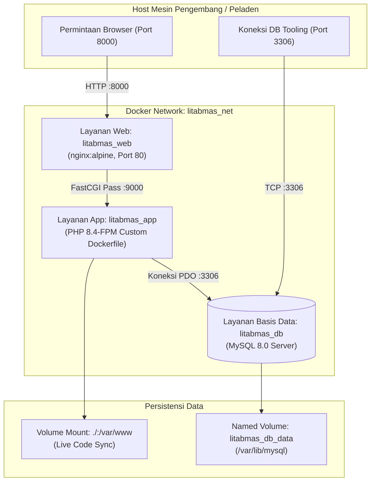
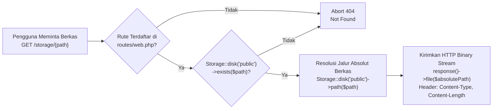
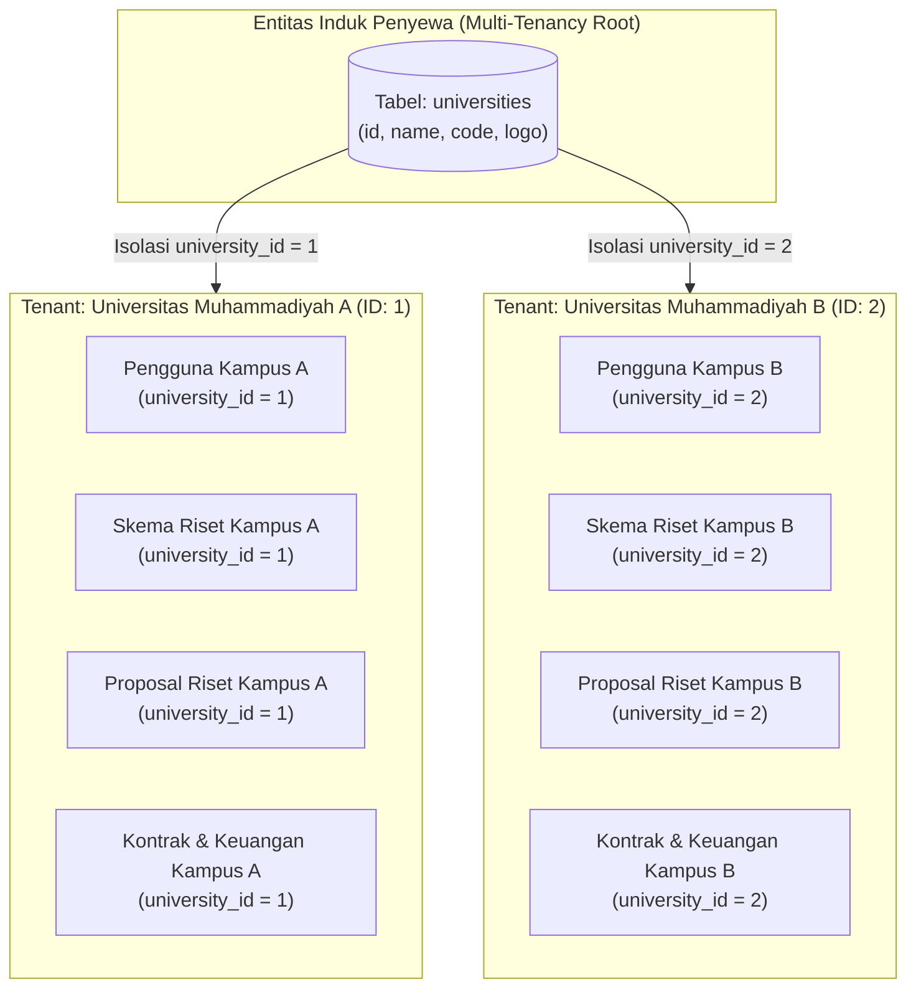
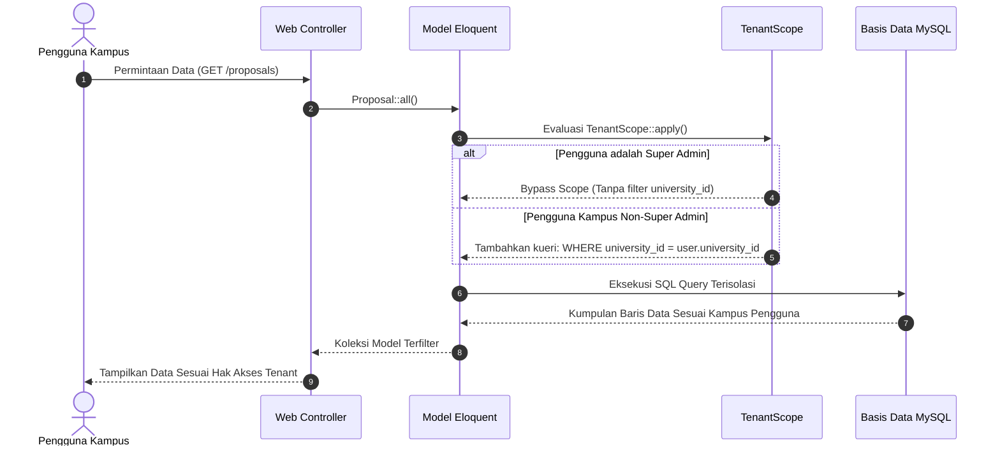
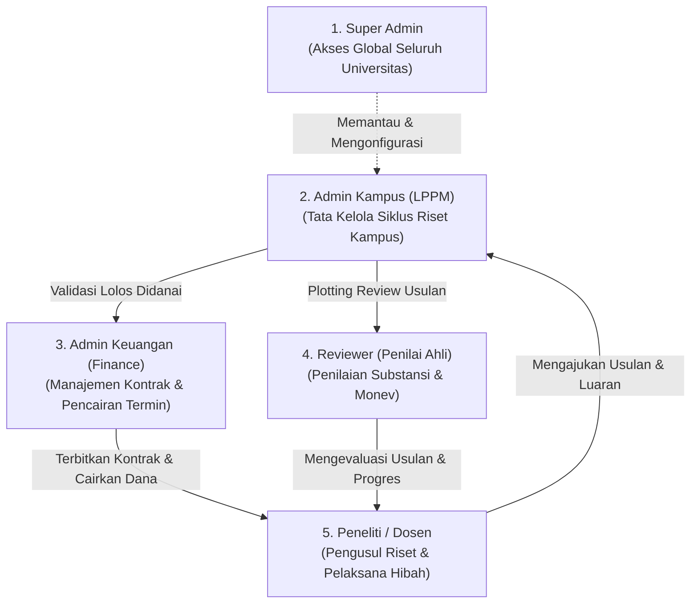
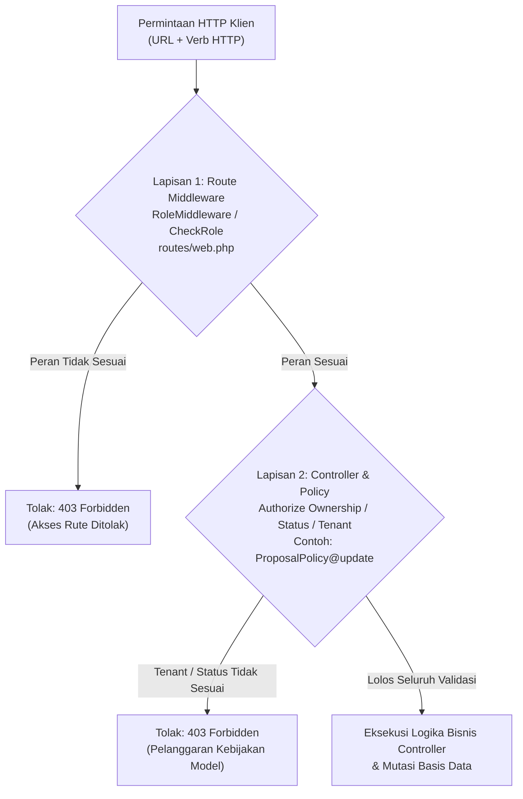
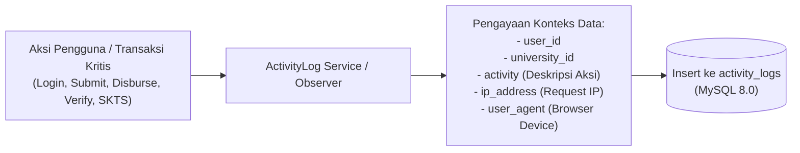

# Cetak Biru Arsitektur Sistem: Sistem Penelitian Terintegrasi Standalone

## 1. Informasi Sistem & Dekopling Mandiri

### 1.1 Metadata Dokumen & Identitas Sistem

- **Nama Sistem**: Sistem Penelitian Terintegrasi Multi-Kampus (*Multi-Institution Research Management System* / SIM-Penelitian)
- **Versi Sistem**: 2.0.0-STANDALONE
- **Status Dokumen**: Disetujui (Approved Baseline)
- **Tanggal Efektif**: 15 Oktober 2026
- **Klasifikasi Arsitektur**: Modern Monolithic Single-Page Application (Laravel 12 + Inertia.js 2.0 + React 19)
- **Model Isolasi Tenant**: *Shared Database, Separate Tenancy* berbasis entitas `universities`
- **Dokumen Referensi Utama**: [Product Requirement Document (PRD) Standalone](../PRD_Sistem_Penelitian_Terintegrasi_Standalone.md)

---

### 1.2 Latar Belakang & Rasional Dekopling Total

Sebelum implementasi versi 2.0.0-STANDALONE, repositori pengembangan memuat tiga domain fungsional yang digabungkan dalam satu basis kode monolitik warisan:
1. **Modul Warisan JurnalMu**: Sistem evaluasi akreditasi jurnal nasional dan pembinaan tata kelola berkala ilmiah Kementerian Pendidikan Tinggi.
2. **Modul Kelas G (Submission System OJS)**: Sistem alur penerbitan naskah artikel jurnal ilmiah bergaya Open Journal Systems (Author Submission Wizard, Editorial Desk, Peer-Review Ronde Naskah, Copyediting, dan Galley Production).
3. **Modul Kelas B (SIM-Penelitian)**: Sistem tata kelola siklus penelitian dan hibah internal Lembaga Penelitian dan Pengabdian kepada Masyarakat (LPPM) perguruan tinggi.

Pencampuran ketiga domain tersebut menghadirkan tantangan teknis serius:
- **Kerusakan Kode (*Code Rot*)**: Modul pembinaan warisan menyisakan puluhan tabel relasional dan controller yang tidak lagi terpakai, memperlambat proses migrasi dan analisis struktur basis data.
- **Ambiguitas Otorisasi Pengguna**: Tumpang tindih peran operasional (misalnya peran Reviewer pada artikel jurnal OJS bercampur dengan peran Reviewer proposal hibah penelitian LPPM).
- **Redundansi Tabel & Dependensi Bersilang**: Penggunaan tabel-tabel perantara yang memperumit integritas referensial dan meningkatkan risiko inkonsistensi data antar-modul.
- **Beban Kompilasi Aset Frontend**: Penumpukan pustaka JavaScript, komponen wizard naskah OJS, dan modul visualisasi yang memperlambat waktu kompilasi Vite dan meningkatkan ukuran bundel klien (*client bundle size*).

Melalui inisiatif dekopling mandiri (*standalone decoupling*):
- Seluruh modul Submission OJS (Kelas G) dipertahankan pada repositori asal (`RPL-2026`).
- Repositori ini didedikasikan secara penuh dan eksklusif untuk **Sistem Penelitian Terintegrasi (Kelas B)**. Seluruh artefak kode, controller, model Eloquent, rute, komponen React, dan tabel migrasi milik JurnalMu serta OJS dihapus secara tuntas (*clean purge*).
- Sistem ditransformasikan menjadi platform mandiri multi-institusi yang berfokus penuh pada keunggulan tata kelola hibah riset universitas.

---

### 1.3 Ruang Lingkup Tata Kelola 6 Fase Siklus Hidup Riset

Sistem Penelitian Terintegrasi Standalone dirancang khusus untuk memfasilitasi seluruh siklus manajemen penelitian institusi pendidikan tinggi secara terstruktur, akuntabel, dan transparan melalui 6 fase inti:

1. **Fase 1: Pengelolaan Skema & Pengajuan Proposal**
   - Penerbitan skema pendanaan tahun anggaran aktif oleh LPPM dengan ketentuan plafon anggaran dan rentang waktu pengajuan.
   - Pengajuan berkas usulan riset oleh ketua peneliti, pencatatan anggota tim dosen, penyusunan anggaran biaya (*Rencana Anggaran Biaya / RAB*), dan pengunggahan dokumen proposal berformat PDF (maksimal 10MB).
   - Verifikasi administratif kelayakan usulan oleh operator LPPM sebelum dialokasikan ke tahap penilaian substansi.
2. **Fase 2: Penugasan Reviewer & Penilaian Kriteria Substansi**
   - Alokasi penilai ahli (*peer-reviewer*) secara obyektif (1 hingga 2 penilai independen per usulan riset).
   - Penerapan proteksi pencegahan konflik kepentingan (*Conflict of Interest Guard*) untuk menggagalkan penunjukan reviewer yang terlibat dalam proposal terkait.
   - Evaluasi usulan menggunakan instrumen rubrik penilaian berbobot standar (skala akumulasi 0 - 100).
   - Rekomendasi putusan hasil telaah: *Diterima (Lolos_Didanai)*, *Revisi*, atau *Ditolak*.
3. **Fase 3: Penerbitan Kontrak & Pencairan Dana Bertahap**
   - Penerbitan surat kontrak penelitian formal berpenomoran unik institusional bagi usulan yang disetujui untuk didanai.
   - Penetapan nominal dana final yang disetujui (*dana_disetujui*) pasca-penyesuaian anggaran (*budget cut*).
   - Pembagian komitmen pendanaan bertahap: Termin 1 sebesar 70% dan Termin 2 sebesar 30%.
   - Pencairan dana Termin 1 oleh Admin Keuangan disertai pengunggahan bukti transfer bank resmi.
4. **Fase 4: Monitoring dan Evaluasi (Monev) Pelaksanaan Riset**
   - Penjadwalan periode pelaksanaan monev berkala oleh LPPM.
   - Pengunggahan berkas laporan kemajuan riset berformat PDF, pencatatan persentase progres capaian riil (1% - 100%), dan pengisian buku catatan harian (*logbook*).
   - Penilaian dan visitasi lapangan oleh reviewer monev.
   - Mekanisme gerbang pengunci monev (*Monev Gatekeeper Lock*): pencairan Termin 2 diblokir secara otomatis oleh sistem sebelum laporan kemajuan disetujui (*Approved*).
5. **Fase 5: Pelaporan & Validasi Luaran Ilmiah (Research Output)**
   - Pelaporan bukti luaran riset yang dikelompokkan ke dalam 4 kategori terstruktur:
     - Publikasi Artikel Jurnal Ilmiah (indeksasi Scopus, Sinta 1-4, DOI aktif, ISSN).
     - Buku Ilmiah / Monograf / Buku Ajar (ISBN terverifikasi, penerbit, tahun terbit).
     - Hak Kekayaan Intelektual / HKI (Hak Cipta, Paten, Desain Industri, nomor pendaftaran/sertifikat).
     - Produk Teknologi Terapan (Tingkat Kesiapan Teknologi / TKT 1-9, berkas spesifikasi).
   - Penegakan pemenuhan minimal 1 luaran berstatus *Wajib*.
   - Verifikasi keabsahan bukti fisik/digital oleh LPPM dan pencegahan klaim luaran ganda lintas proposal berbasis keunikan DOI, ISBN, atau nomor sertifikat.
6. **Fase 6: Evaluasi Akhir Penelitian, Penutupan Kontrak, & Penerbitan SKTS**
   - Penilaian laporan akhir komprehensif (100%) dan rekapitulasi capaian seluruh target luaran penelitian.
   - Penetapan predikat kelulusan akhir oleh evaluator: *Lulus_Memuaskan*, *Lulus_Cukup*, atau *Tidak_Lulus*.
   - Penerbitan Surat Keterangan Tanda Selesai (SKTS) berpenomoran unik institusi sebagai bukti formal penutupan kontrak hibah.
   - Penerapan mekanisme penguncian berkas permanen (*Read-Only Archive Lock*) yang menghentikan segala bentuk modifikasi data proposal, dokumen, dan kontrak setelah SKTS diterbitkan.

---

## 2. Spesifikasi Stack Teknologi & Infrastruktur

### 2.1 Ringkasan Komponen Stack Teknologi

Sistem mengadopsi arsitektur monolit modern terintegrasi yang menggabungkan keandalan komputasi backend berbasis Laravel dengan fleksibilitas antarmuka reaktif React via Inertia.js:

| Lapisan Sistem | Teknologi Terpilih | Versi | Rincian Konfigurasi & Peran Arsitektural |
|---|---|---|---|
| **Backend Runtime** | PHP | 8.4 (Docker) / 8.2+ (Host) | Strict Type Hints, JIT enabled, ekstensi pdo_mysql, zip, gd, mbstring, bcmath |
| **Backend Framework** | Laravel Framework | 12.x | Monolith application core, Eloquent ORM, Service Layer, FormRequest validation |
| **Frontend Framework** | React | 19.x | Component-based UI, TypeScript, functional components, custom hooks |
| **Monolith Connector** | Inertia.js (React Adapter) | 2.0.x (`@inertiajs/react`) | Client-side routing, shared page props, flash messages, form state helper |
| **Bahasa Frontend** | TypeScript | 5.x | Strict type checking, interfaces data models, zero any assertion |
| **CSS Engine** | Tailwind CSS | 4.x (`@tailwindcss/vite`) | Utility-first styling, CSS variables modern, sub-second HMR |
| **Pustaka Komponen** | shadcn/ui (Radix UI) | Kompatibel React 19 | Komponen aksesibel (dialog, dropdown, form, tabs, popover, alert-dialog) |
| **Ikonografi Visual** | Lucide React | ^0.475.0 | SVG stroke 1.5px-2.0px, konsisten, standar baku pengganti simbol emoji |
| **Bundler & Tooling** | Vite | 6.x (`laravel-vite-plugin`) | Hot Module Replacement (HMR), tree-shaking, chunk optimization |
| **Basis Data Relasional** | MySQL | 8.0+ / MariaDB 10.4+ | InnoDB engine, charset utf8mb4_unicode_ci, ACID compliant |
| **Kontainerisasi** | Docker & Docker Compose | Compose Spec v2 | Layanan terisolasi: Nginx Alpine, PHP 8.4-FPM, MySQL 8.0 Container |
| **Penyimpanan Berkas** | Laravel Storage Streaming | Local / Public Disk | Streaming controller `/storage/{path}`, proteksi hak akses, portabel lintas OS |

---

### 2.2 Arsitektur Monolit Modern: Laravel 12 + Inertia.js 2.0 + React 19

Arsitektur monolit modern menghilangkan kebutuhan pembangunan API RESTful terpisah yang redundan untuk konsumsi internal, tanpa mengorbankan pengalaman pengguna aplikasi laman tunggal (*Single Page Application* / SPA):

```mermaid
flowchart LR
    subgraph Klien["Frontend (Browser Klien)"]
        ReactView["React 19 Views\n(TypeScript + Tailwind 4)"]
        InertiaRouter["Inertia.js 2.0 Router\n(Page Props & State)"]
    end

    subgraph Server["Backend (Laravel 12 Application)"]
        WebRoutes["Web Routes\n(routes/web.php)"]
        MiddlewareStack["Middleware Stack\n(Auth, Role, Tenant, Active)"]
        ControllerPolicy["Controllers & Policies\n(FormRequest + Eloquent)"]
        DatabaseEngine[("MySQL 8.0 Database\n(21 Clean Tables)")]
    end

    ReactView -->|Interaksi Pengguna / Submit| InertiaRouter
    InertiaRouter -->|XHR Request (JSON)| WebRoutes
    WebRoutes --> MiddlewareStack
    MiddlewareStack --> ControllerPolicy
    ControllerPolicy --> DatabaseEngine
    DatabaseEngine --> ControllerPolicy
    ControllerPolicy -->|Inertia::render(Component, Props)| InertiaRouter
    InertiaRouter -->|Virtual DOM Diff & Re-render| ReactView
```

#### Keunggulan Pola Arsitektur Ini:
1. **Peniadaan Duplikasi Skema API**: Backend Laravel langsung meneruskan data terstruktur ke komponen React melalui metode `Inertia::render('PageName', ['data' => $data])`. Pengembang tidak perlu merancang endpoint JSON eksternal, serialisasi token terpisah, atau state management klien yang rumit seperti Redux.
2. **Keamanan Bawaan Transaksi**: Seluruh permintaan mutasi data secara otomatis dilindungi token Anti-CSRF Laravel tanpa konfigurasi manual pada setiap formulir.
3. **Penyelarasan Tipe Data (*Type Sharing*)**: Definisi tipe data entitas di backend (PHP model attributes) dapat langsung dipetakan ke interface TypeScript di frontend (`resources/js/types/`), memastikan keamanan tipe data (*type safety*) dari basis data hingga rendering antarmuka.

---

### 2.3 Kontainerisasi & Lingkungan Eksekusi (Docker Compose)

Sistem menyediakan konfigurasi kontainer Docker siap pakai melalui `docker-compose.yml` untuk menjamin konsistensi lingkungan eksekusi antara stasiun kerja pengembang (*local development*) dan peladen produksi (*production server*):



#### Rincian Layanan Kontainer:
1. **Layanan `app` (`litabmas_app`)**:
   - Berbasis PHP 8.4-FPM yang dikompilasi menggunakan `docker/Dockerfile`.
   - Menjalankan ekstensi PHP lengkap: `pdo_mysql`, `mbstring`, `exif`, `pcntl`, `bcmath`, `gd`, `zip`.
   - Menggunakan konfigurasi kustom `docker/php/local.ini` (batas memori `memory_limit = 512M`, batas unggah `upload_max_filesize = 20M`, `post_max_size = 25M`).
2. **Layanan `web` (`litabmas_web`)**:
   - Menggunakan citra resmi `nginx:alpine` yang memetakan porta 8000 pada host ke porta 80 kontainer.
   - Konfigurasi `docker/nginx/default.conf` meneruskan seluruh berkas dinamis ke peladen aplikasi FastCGI `app:9000` dan mengalirkan berkas statis secara efisien.
3. **Layanan `db` (`litabmas_db`)**:
   - Menggunakan basis data resmi `mysql:8.0` dengan variabel lingkungan `MYSQL_DATABASE=litabmas`.
   - Dilengkapi healthcheck periodik (`mysqladmin ping`) dengan interval 5 detik untuk memastikan ketersediaan koneksi sebelum layanan aplikasi dijalankan.
   - Seluruh data tabel dipersistensikan secara aman pada volume Docker bernama `litabmas_db_data`.

---

### 2.4 Arsitektur Penyimpanan & Aliran Berkas Riset (File Storage & Streaming)

Dalam manajemen penelitian, integritas berkas usulan proposal, naskah kontrak kerja, kuitansi transfer dana, dan dokumen luaran merupakan aset intelektual bernilai hukum tinggi. Sistem menerapkan mekanisme penyajian berkas khusus melalui rute streaming controller:



#### Rasional Desain Streaming Berkas:
1. **Portabilitas Lintas Sistem Operasi**:
   Pada sistem operasi Windows (lingkungan pengembang lokal), perintah tautan simbolis bawaan `php artisan storage:link` kerap kali gagal dieksekusi tanpa hak istimewa administrator (*Run as Administrator*), atau tautan simbolis tersebut menjadi tidak valid ketika dipetakan ke dalam kontainer Linux Docker. Dengan mengimplementasikan rute streaming:
   ```php
   Route::get('/storage/{path}', function (string $path) {
       if (! Storage::disk('public')->exists($path)) {
           abort(404, 'Berkas tidak ditemukan.');
       }
       return response()->file(Storage::disk('public')->path($path));
   })->where('path', '.+')->name('storage.serve');
   ```
   sistem dapat menyajikan berkas secara konsisten pada lingkungan Windows host, lingkungan Docker, maupun peladen Linux tanpa ketergantungan pada symlink berkas OS.
2. **Titik Kontrol Keamanan Terpusat**:
   Rute streaming memungkinkan penyisipan verifikasi hak akses (*authorization gate*) di masa mendatang untuk berkas-berkas sensitif (seperti draf proposal yang belum dipublikasikan atau bukti transfer bank internal), sehingga akses berkas tidak terbuka secara liar sebagai berkas statis publik Nginx.
3. **Standar Validasi Berkas**:
   - Seluruh unggahan dokumen proposal, draf kontrak, laporan kemajuan, dan laporan akhir diwajibkan berekstensi `.pdf`.
   - Ukuran berkas dibatasi maksimal 10MB (10.240 KB).
   - Validasi MIME-type ketat (`application/pdf`) diberlakukan pada level backend FormRequest untuk mengeliminasi risiko eksekusi skrip berbahaya (*malicious file execution*).

---

## 3. Model Multi-Institusi (Multi-Tenancy Isolation Architecture)

### 3.1 Pola Tenancy: Shared Database, Separate Tenancy

Sistem mengadopsi model multi-penyewa hibrida berbiaya efisien namun berkeamanan tinggi: **Shared Database, Separate Tenancy**. Dalam pola ini:
- Seluruh institusi perguruan tinggi berbagi satu basis data MySQL fisik dan satu skema tabel terpadu.
- Isolasi logis data antar-kampus ditegakkan secara absolut melalui relasi foreign key pada tabel induk `universities`.
- Setiap institusi perguruan tinggi memiliki identitas unik berupa kode institusi (`code`), nama resmi (`name`), alamat, serta logo institusional yang dipersonalisasi pada kop dokumen dan antarmuka pengguna.



---

### 3.2 Penegakan Kolom `university_id` pada Entitas Utama

Untuk memastikan integritas batas data (*data perimeter boundary*), kolom `university_id` disematkan secara eksplisit pada seluruh tabel transaksi utama:
1. `users`: Mengikat akun dosen, reviewer, dan admin pada satu institusi perguruan tinggi asal.
2. `research_schemas`: Membatasi penerbitan program hibah agar hanya dapat diakses oleh peneliti dari kampus yang menerbitkan skema tersebut.
3. `proposals`: Menjamin bahwa rekapitulasi proposal riset terisolasi penuh pada repositori kampus bersangkutan.
4. `contracts`: Memastikan dokumen perjanjian kerjasama hukum dan komitmen dana terikat pada entitas perguruan tinggi terkait.
5. `monev_schedules`: Menjaga jadwal monitoring dan evaluasi terikat pada kalender operasional LPPM masing-masing kampus.
6. `activity_logs`: Mengaudit jejak transaksi per institusi untuk kemudahan rekapitulasi kepatuhan tata kelola.

Tabel turunan lainnya (`proposal_documents`, `reviews`, `fundings`, `progress_reports`, `research_outputs`, `evaluations`) mewarisi kepemilikan tenant melalui relasi kunci asing (*foreign key cascade*) menuju proposal atau kontrak induk.

---

### 3.3 Mekanisme Eloquent Tenant Scope (`TenantScope`)

Untuk mengeliminasi risiko kelalaian pengembang dalam menuliskan klausul `where('university_id', ...)` secara manual pada setiap kueri, sistem memanfaatkan fitur **Global Scope Eloquent** yang diintegrasikan melalui trait `BelongsToTenant`:



#### Implementasi Teknis Trait `BelongsToTenant`:
```php
namespace App\Models\Traits;

use App\Models\Scopes\TenantScope;
use App\Models\University;
use Illuminate\Database\Eloquent\Relations\BelongsTo;
use Illuminate\Support\Facades\Auth;

trait BelongsToTenant
{
    /**
     * Boot trait untuk mendaftarkan global scope dan event model.
     */
    protected static function bootBelongsToTenant(): void
    {
        // Daftarkan TenantScope secara otomatis
        static::addGlobalScope(new TenantScope());

        // Otomatisasi pengisian university_id saat pembuatan entitas baru
        static::creating(function ($model) {
            if (Auth::check() && ! $model->university_id && ! Auth::user()->isSuperAdmin()) {
                $model->university_id = Auth::user()->university_id;
            }
        });
    }

    /**
     * Relasi balik ke model institusi Universitas.
     */
    public function university(): BelongsTo
    {
        return $this->belongsTo(University::class, 'university_id');
    }
}
```

#### Implementasi Teknis `TenantScope`:
```php
namespace App\Models\Scopes;

use Illuminate\Database\Eloquent\Builder;
use Illuminate\Database\Eloquent\Model;
use Illuminate\Database\Eloquent\Scope;
use Illuminate\Support\Facades\Auth;

class TenantScope implements Scope
{
    /**
     * Terapkan penyaringan tenant pada pembangun kueri Eloquent.
     */
    public function apply(Builder $builder, Model $model): void
    {
        if (Auth::check()) {
            $user = Auth::user();

            // Pengecualian Super Admin untuk keperluan pemantauan global
            if ($user->isSuperAdmin()) {
                return;
            }

            // Terapkan penyaringan ketat berdasarkan university_id pengguna aktif
            if ($user->university_id) {
                $builder->where($model->getTable() . '.university_id', $user->university_id);
            } else {
                // Jika pengguna tidak terafiliasi dengan universitas mana pun, blokir akses
                $builder->whereRaw('1 = 0');
            }
        }
    }
}
```

---

### 3.4 Pengecualian Super Admin & Pertahanan Terhadap IDOR

1. **Akses Global Super Admin**:
   Pengguna dengan peran `Super Admin` dibebaskan dari penyaringan `TenantScope` secara terdesain (*by design*). Super Admin memiliki wewenang untuk:
   - Mengelola master data universitas (`/admin/universities`).
   - Mendaftarkan dan meninjau akun penanggung jawab LPPM kampus.
   - Memantau aktivitas audit transaksi lintas kampus secara menyeluruh (`/admin/logs`).
   - Melakukan inspeksi khusus dengan menonaktifkan scope via `Model::withoutGlobalScope(TenantScope::class)->find($id)`.

2. **Pertahanan Terhadap Serangan IDOR (*Insecure Direct Object Reference*)**:
   Jika pengguna nakal dari Universitas A mencoba memanipulasi parameter URL (contoh: mengakses `GET /proposals/888` milik Universitas B), sistem menggagalkan serangan tersebut melalui tiga lapisan pertahanan bertingkat:
   - **Lapisan 1 (TenantScope)**: Kueri `Proposal::findOrFail(888)` diterjemahkan menjadi `SELECT * FROM proposals WHERE id = 888 AND university_id = 1`. Karena data tersebut ber-`university_id = 2`, kueri mengembalikan baris kosong dan Laravel secara otomatis memunculkan galat `404 Not Found`.
   - **Lapisan 2 (Route Middleware `CheckUniversity`)**: Memeriksa kesesuaian parameter rute `{university}` dengan atribut `auth()->user()->university_id`. Jika terjadi diskrepansi, request dibatalkan dengan respons `403 Forbidden`.
   - **Lapisan 3 (Controller Authorization Policy)**: Metode kebijakan memeriksa `$user->university_id === $proposal->university_id` sebelum mengizinkan aksi pembaruan atau penghapusan berkas.

---

## 4. Arsitektur Otorisasi & Hierarki Peran (RBAC)

### 4.1 Definisi 5 Peran Operasional Sistem

Platform menerapkan prinsip hak akses terendah (*Principle of Least Privilege*) melalui pembagian 5 peran operasional penelitian:



1. **Super Admin**:
   - Ruang Lingkup: Global (Lintas Perguruan Tinggi).
   - Tanggung Jawab: Pendaftaran entitas perguruan tinggi baru, penonaktifan akses institusi bermasalah, pemantauan log aktivitas transaksi global, dan konfigurasi sistem peladen.
2. **Admin Kampus (LPPM)**:
   - Ruang Lingkup: Lokal Kampus Terdaftar.
   - Tanggung Jawab: Pembukaan dan konfigurasi skema pendanaan, verifikasi berkas administrasi proposal dosen, penugasan reviewer (*reviewer assignment*), penyusunan jadwal monev, verifikasi keabsahan dokumen luaran penelitian, evaluasi akhir, dan penerbitan sertifikat SKTS resmi.
3. **Admin Keuangan (Finance)**:
   - Ruang Lingkup: Lokal Kampus Terdaftar.
   - Tanggung Jawab: Pembuatan draf kontrak penelitian, penetapan jadwal termin pencairan, verifikasi kuitansi dan bukti transfer bank, pencairan dana Termin 1 (70%) dan Termin 2 (30%), serta penyusunan laporan pertanggungjawaban realisasi keuangan hibah.
4. **Reviewer (Penilai Ahli)**:
   - Ruang Lingkup: Penugasan Usulan pada Kampus Terkait.
   - Tanggung Jawab: Menilai proposal berdasarkan instrumen rubrik penilaian berbobot, memberikan catatan telaah kualitatif, mengevaluasi laporan kemajuan dan logbook pada tahap monev, serta memberikan rekomendasi kelulusan akhir.
5. **Peneliti (Dosen Pengusul)**:
   - Ruang Lingkup: Personal Dosen pada Kampus Terdaftar.
   - Tanggung Jawab: Mengunggah proposal usulan riset, merevisi proposal sesuai masukan reviewer, menandatangani draf kontrak, mengunggah laporan kemajuan dan catatan logbook, mendaftarkan bukti luaran riset yang dicapai, mengunggah laporan akhir 100%, serta mengunduh sertifikat SKTS.

---

### 4.2 Model Pengguna Hibrida (Kompatibilitas `role_id` & `role_user`)

Untuk menjaga stabilitas basis data yang telah berjalan sekaligus mendukung fleksibilitas multi-peran di masa mendatang, sistem menggunakan arsitektur peran hibrida (*Hybrid Role Model*):

1. **Kolom `role_id` pada Tabel `users`**:
   Digunakan sebagai peran utama (*primary role*) pengguna untuk kompatibilitas data bawaan (*legacy backwards compatibility*) dan penentuan tata letak dasbor default saat login.
2. **Tabel Pivot `role_user`**:
   Menyimpan relasi many-to-many antara `users` dan `roles` untuk mendukung pengguna yang mengemban lebih dari satu peran (misalnya seorang Dosen/Peneliti yang juga diangkat sebagai Reviewer internal kampus).
3. **Sinkronisasi Otomatis pada Model Lifecycle**:
   Model `User` mengimplementasikan method hook `booted()` yang secara otomatis menyinkronkan nilai `role_id` ke tabel pivot `role_user`, serta mengaitkan peran `Reviewer` secara otomatis jika kolom `is_reviewer` bernilai true.
4. **Invarian Pemeriksaan Peran**:
   Pengembang **DILARANG KERAS** memanggil relasi kueri pivot secara langsung seperti `$user->roles()->where(...)` tanpa memeriksa `role_id` primer, karena seeder dan operasi autentikasi legacy kerap kali hanya menginisialisasi `role_id`. Seluruh pengecekan peran wajib memanfaatkan helper method terstandarisasi:
   - `$user->hasRole(string $roleName): bool`
   - `$user->hasAnyRole(array $roleNames): bool`
   - `$user->hasAllRoles(array $roleNames): bool`

---

### 4.3 Perlindungan Ganda Otorisasi (Dual-Layer Authorization Guard)

Sistem memberlakukan arsitektur keamanan dua lapis pada seluruh siklus interaksi data:



#### Lapisan 1: Rute Middleware Laravel (`routes/web.php`)
Setiap grup rute dikelilingi oleh middleware `role:XXX` atau `CheckRole` yang memvalidasi bahwa sesi pengguna yang sedang terautentikasi memiliki peran yang sesuai:
```php
// Grup rute khusus pengusul riset
Route::middleware(['auth', 'verified', 'active', 'role:Peneliti'])->group(function () {
    Route::resource('proposals', ProposalController::class);
    Route::post('progress', [ProgressController::class, 'store'])->name('progress.store');
    Route::post('outputs', [OutputController::class, 'store'])->name('outputs.store');
});

// Grup rute khusus administrasi LPPM
Route::middleware(['auth', 'verified', 'active', 'role:Admin Kampus'])->prefix('admin')->group(function () {
    Route::post('proposals/{id}/verify', [AdminProposalController::class, 'approve'])->name('admin.proposals.verify');
    Route::post('assign', [AdminAssignController::class, 'assign'])->name('admin.assign');
    Route::post('output/{id}/verify', [AdminOutputController::class, 'verify'])->name('admin.output.verify');
    Route::post('evaluations/{id}/certify', [EvaluationController::class, 'generateSkts'])->name('admin.evaluations.certify');
});
```

#### Lapisan 2: Kebijakan Model Controller (*Eloquent Policies & Gates*)
Middleware rute hanya memeriksa jenis peran pengguna, namun tidak mengetahui detail hak kepemilikan objek data. Oleh karena itu, method controller wajib mengeksekusi pemeriksaan kebijakan model:
```php
public function update(UpdateProposalRequest $request, Proposal $proposal)
{
    // Memeriksa kepemilikan (hanya pengusul yang boleh mengedit)
    // dan status proposal (hanya draf / revisi yang boleh diedit)
    $this->authorize('update', $proposal);

    $proposal->update($request->validated());
    return redirect()->route('proposals.show', $proposal->id);
}
```

---

### 4.4 Matriks Hak Akses Berbasis Peran (RBAC Matrix)

Tabel berikut menetapkan matriks hak akses operasi (*Create, Read, Update, Delete, Verify*) untuk kelima peran pada setiap modul sistem:

| Modul & Entitas Data | Super Admin | Admin Kampus (LPPM) | Admin Keuangan | Reviewer | Peneliti / Dosen |
|---|---|---|---|---|---|
| **Master Universitas (`universities`)** | CRUD | R (Kampus Sendiri) | R (Kampus Sendiri) | R (Kampus Sendiri) | R (Kampus Sendiri) |
| **Pengguna & Peran (`users`, `role_user`)** | CRUD | CRUD (Kampus Sendiri) | R (Profil Sendiri) | R (Profil Sendiri) | R (Profil Sendiri) |
| **Skema Riset (`research_schemas`)** | R | CRUD | R | R | R (Skema Aktif) |
| **Proposal Riset (`proposals`, `documents`)** | R | R, Verify, Plotting | R (Hanya Lolos Didanai) | R (Proposal Ditugaskan) | CRUD (Proposal Milik Sendiri) |
| **Penilaian Rubrik (`reviews`, `criteria`)** | R | R, Manage Criteria | - | CRU (Review Ditugaskan) | R (Hanya Hasil/Catatan) |
| **Kontrak Riset (`contracts`)** | R | R | CRUD | R (Terkait Proposal) | R, Sign (Kontrak Sendiri) |
| **Pencairan Dana (`fundings`)** | R | R | CRUD, Upload Bukti | - | R (Status Pencairan) |
| **Jadwal Monev (`monev_schedules`)** | R | CRUD | R | R | R |
| **Laporan Kemajuan (`progress_reports`)** | R | R | R (Verifikasi Syarat) | R, Nilai Progres | CRU (Laporan Milik Sendiri) |
| **Luaran Riset (`research_outputs`, detail)**| R | R, Verify Dokumen | - | R | CRUD (Luaran Milik Sendiri) |
| **Evaluasi Akhir & SKTS (`evaluations`)** | R | R, Terbitkan SKTS | R (Arsip Keuangan) | R, Nilai Akhir | CR (Lapor Akhir & Unduh SKTS)|
| **Log Audit Sistem (`activity_logs`)** | R (Global) | R (Kampus Sendiri) | - | - | - |

*Keterangan Simbol*: `C` (Create), `R` (Read), `U` (Update), `D` (Delete), `Verify` (Verifikasi Berkas Administrasi/Substansi), `-` (Tidak Ada Akses).

---

## 5. Diagram Alur Siklus Hidup Penelitian (Lifecycle Data Flow)

### 5.1 Diagram Alur Transaksional End-to-End

Berikut adalah visualisasi aliran data transaksi 6 fase penelitian dari pembukaan skema hingga penutupan arsip SKTS:

```mermaid
flowchart TD
    %% Fase 1: Skema & Proposal
    subgraph F1["FASE 1: SKEMA & PENGAJUAN PROPOSAL"]
        A1["Admin LPPM Terbitkan Skema Riset\n(research_schemas, status: Active)"] --> A2["Dosen Isi Usulan & Unggah PDF\n(proposals, status: Draft)"]
        A2 --> A3["Dosen Kirim Proposal Final\n(status: Submitted)"]
        A3 --> A4{"Admin LPPM Verifikasi\nAdministrasi"}
        A4 -->|Tidak Lengkap| A5["Kembalikan ke Dosen\n(status: Ditolak / Revisi Admin)"]
        A5 -.->|Perbaiki Berkas| A2
        A4 -->|Memenuhi Syarat| A6["Proposal Lolos Administrasi\n(status: Administrasi_Valid)"]
    end

    %% Fase 2: Review & Penilaian
    subgraph F2["FASE 2: PENUGASAN REVIEWER & PENILAIAN SUBSTANSI"]
        A6 --> B1["Admin LPPM Plotting 1-2 Reviewer\n(reviews, status_review: Assigned)\nGuard: id_reviewer != id_pengusul"]
        B1 --> B2["Reviewer Isi Rubrik Penilaian\n(reviews, skor_total: 0-100)\nPutusan: Diterima / Ditolak / Revisi"]
        B2 --> B3{"Pleno LPPM:\nKeputusan Pendanaan"}
        B3 -->|Skor Rendah / Ditolak| B4["Proposal Ditolak\n(status: Ditolak)"]
        B3 -->|Perlu Perbaikan| B5["Dosen Revisi Proposal\n(status: Revisi)"]
        B5 -.->|Unggah Revisi| B2
        B3 -->|Direkomendasikan Lolos| B6["Proposal Disetujui Didanai\n(status: Lolos_Didanai)"]
    end

    %% Fase 3: Kontrak & Pencairan Termin 1
    subgraph F3["FASE 3: PENERBITAN KONTRAK & PENCAIRAN TERMIN 1"]
        B6 --> C1["Admin Keuangan Terbitkan Kontrak\n(contracts, status_kontrak: Draft)\nNominal: dana_disetujui"]
        C1 --> C2["Penandatanganan Kontrak\n(status_kontrak: Signed -> Active)"]
        C2 --> C3["Jadwalkan Termin Pendanaan\n(Termin 1: 70%, Termin 2: 30%)"]
        C3 --> C4["Pencairan Dana Termin 1\n(fundings termin 1, status: Disbursed)\nLampiran: Bukti Transfer Bank"]
    end

    %% Fase 4: Pelaksanaan & Monev
    subgraph F4["FASE 4: PELAKSANAAN RISET, MONEV & TERMIN 2"]
        C4 --> D1["Dosen Laksanakan Riset &\nUnggah Logbook + Laporan Kemajuan\n(progress_reports, status: Submitted)"]
        D1 --> D2["Reviewer Monev Nilai Progres Riset\n(progress_reports, skor_monev)\nKeputusan: Approved / Revision"]
        D2 -->|Perlu Revisi Logbook| D3["Dosen Perbaiki Laporan Progres"]
        D3 -.->|Kirim Ulang| D2
        D2 -->|Monev Lolos / Approved| D4["Monev Gatekeeper Terbuka\n(Monev Gatekeeper Lock Unlocked)"]
        D4 --> D5["Admin Keuangan Cairkan Termin 2 (30%)\n(fundings termin 2, status: Disbursed)\nLampiran: Bukti Transfer Bank"]
    end

    %% Fase 5: Pelaporan Luaran
    subgraph F5["FASE 5: PELAPORAN & VALIDASI LUARAN"]
        D5 --> E1["Dosen Daftarkan Bukti Luaran\n(research_outputs, target: Wajib / Tambahan)\nKategori: Jurnal / Buku / HKI / Produk"]
        E1 --> E2{"Admin LPPM Verifikasi Bukti\nFisik/Digital Luaran"}
        E2 -->|Data Kurang Valid| E3["Luaran Ditolak / Perlu Perbaikan\n(status_verifikasi: Rejected)"]
        E3 -.->|Unggah Bukti Valid| E1
        E2 -->|Bukti Sah & Valid| E4["Luaran Sah Terverifikasi\n(status_verifikasi: Verified)\nValidasi: Minimal 1 Luaran Wajib Terpenuhi"]
    end

    %% Fase 6: Evaluasi Akhir & SKTS
    subgraph F6["FASE 6: EVALUASI AKHIR, KELULUSAN & SKTS"]
        E4 --> F1A["Dosen Unggah Laporan Akhir 100%\n(evaluations, file_laporan_akhir)"]
        F1A --> F2A["Evaluator Nilai Laporan Akhir\nPredikat: Lulus_Memuaskan / Lulus_Cukup / Tidak_Lulus"]
        F2A --> F3A{"Hasil Evaluasi Kelulusan"}
        F3A -->|Tidak Lulus / Gagal| F4A["Penelitian Gagal\n(status_penelitian: Gagal)\nAudit Pengembalian Dana"]
        F3A -->|Lulus| F5A["Admin LPPM Terbitkan SKTS Resmi\n(evaluations, nomor_skts, file_skts_path)\nStatus Penelitian: Selesai"]
        F5A --> F6A["Penguncian Permanen Berkas\n(Read-Only Archive Lock)\nProposal, Kontrak, & Berkas Dikunci"]
    end
```



---

### 5.2 Tabel Transisi Status Entitas Transaksional

Sistem mengelola konsistensi state machine melalui transisi status berikut:

| Entitas Model | Nama Kolom Status | Nilai Status yang Diizinkan | Kondisi / Pemicu Perubahan Status |
|---|---|---|---|
| `proposals` | `status_proposal` | `Draft` | Inisialisasi awal formulir usulan oleh dosen. |
| | | `Submitted` | Dosen menekan tombol submit (berkas dikunci dari pengeditan). |
| | | `Administrasi_Valid` | Admin LPPM memverifikasi kelengkapan berkas administrasi. |
| | | `Ditolak` | Gagal verifikasi administrasi atau ditolak pasca-review substansi. |
| | | `Lolos_Didanai` | Rapat pleno LPPM menyetujui pendanaan berdasarkan skor reviewer. |
| `reviews` | `status_review` | `Assigned` | Reviewer berhasil diplot oleh Admin LPPM. |
| | | `In_Progress` | Reviewer mulai membuka instrumen rubrik penilaian. |
| | | `Completed` | Reviewer menyimpan nilai total dan putusan rekomendasi final. |
| `contracts` | `status_kontrak` | `Draft` | Admin Keuangan menyusun draf kontrak hibah. |
| | | `Signed` | Kontrak ditandatangani oleh pimpinan LPPM dan ketua peneliti. |
| | | `Active` | Dana Termin 1 telah dicairkan dan riset resmi berjalan. |
| | | `Closed` | Evaluasi akhir selesai dan SKTS diterbitkan (*Archived*). |
| `fundings` | `status_pencairan` | `Pending` | Jadwal termin dibuat, menunggu antrean pembayaran kas kampus. |
| | | `Disbursed` | Bendahara mentransfer dana dan mengunggah bukti transfer bank. |
| | | `Verified` | Dosen peneliti mengonfirmasi penerimaan dana di rekening. |
| `progress_reports`| `status_laporan` | `Submitted` | Dosen mengunggah draf laporan kemajuan dan logbook. |
| | | `Revision` | Reviewer monev meminta perbaikan catatan kegiatan riset. |
| | | `Approved` | Reviewer monev menyetujui kemajuan (*membuka kunci Termin 2*). |
| `research_outputs`| `status_verifikasi`| `Draft` | Dosen menginput data awal naskah/buku/HKI. |
| | | `Submitted` | Dosen mengajukan luaran untuk diperiksa operator LPPM. |
| | | `Verified` | Dokumen bukti fisik/DOI/sertifikat disetujui oleh LPPM. |
| | | `Rejected` | Bukti luaran ditolak karena klaim ganda atau naskah tidak sah. |
| `evaluations` | `status_penelitian`| `Dalam_Evaluasi` | Laporan akhir diajukan, menunggu telaah dewan penilai. |
| | | `Selesai` | Dinyatakan lulus dan SKTS resmi diterbitkan LPPM. |
| | | `Gagal` | Tidak memenuhi luaran wajib atau terjadi *force majeure*. |

---

## 6. Mekanisme Audit Trail & Observabilitas

### 6.1 Pencatatan Jejak Audit Terpusat (`activity_logs`)

Untuk memastikan akuntabilitas hukum dan kepatuhan audit internal perguruan tinggi, setiap mutasi data penting dicatat ke dalam tabel terpusat `activity_logs`:



#### Struktur Data Tabel `activity_logs`:
- `id`: Primary key bertipe `BIGINT UNSIGNED AUTO_INCREMENT`.
- `user_id`: ID pengguna pelaku transaksi (FK -> `users.id`, aksi `ON DELETE SET NULL` agar riwayat log tidak hilang jika akun pengguna dihapus).
- `university_id`: ID institusi perguruan tinggi asal (FK -> `universities.id`, aksi `ON DELETE SET NULL`).
- `activity`: Uraian tekstual aktivitas transaksi (contoh: *"Admin LPPM memverifikasi berkas proposal ID: 45"* atau *"Admin Keuangan mencairkan Termin 1 Kontrak: KTR/2026/001"*).
- `ip_address`: Alamat IP klien (tipe `VARCHAR(45)` mendukung IPv4 dan IPv6).
- `user_agent`: Informasi peramban web dan sistem operasi pengguna.
- `created_at`: Waktu pencatatan transaksi secara presisi.

#### Titik Pemicu Audit Log Otomatis:
1. **Autentikasi Pengguna**: Login berhasil, login gagal, dan logout.
2. **Pengajuan Usulan Riset**: Perubahan status proposal dari `Draft` menjadi `Submitted`.
3. **Penilaian Peer-Reviewer**: Pengisian rubrik dan submit putusan rekomendasi pendanaan.
4. **Transaksi Keuangan**: Pencairan dana termin hibah beserta unggahan bukti transfer perbankan.
5. **Validasi Dokumen Luaran**: Perubahan status verifikasi bukti luaran publikasi atau sertifikat HKI.
6. **Penerbitan SKTS**: Pengesahan sertifikat tanda selesai dan penutupan arsip penelitian.

---

### 6.2 Sistem Notifikasi Transaksional Terpusat (`notifications`)

Sistem menyediakan mekanisme notifikasi berbasis basis data internal untuk memberikan pembaruan seketika kepada pemangku kepentingan penelitian:

- **Tabel `notifications`**:
  - `id`: `BIGINT UNSIGNED AUTO_INCREMENT PRIMARY KEY`.
  - `user_id`: Pengguna penerima notifikasi (FK -> `users.id`, `ON DELETE CASCADE`).
  - `title`: Judul ringkas pemberitahuan (`VARCHAR(255)`).
  - `message`: Uraian pesan instruksi atau informasi transaksional (`TEXT`).
  - `data`: Muatan data JSON fleksibel (`url_tujuan`, `id_referensi`, `tipe_event`).
  - `is_read`: Penanda status baca (`BOOLEAN`, default `FALSE`).
  - `created_at`: Waktu pengiriman notifikasi.

#### Skenario Notifikasi Utama:
- Notifikasi ke Dosen: *"Proposal Anda dengan judul [X] dinyatakan Lolos Didanai. Silakan lengkapi penandatanganan kontrak."*
- Notifikasi ke Reviewer: *"Anda ditugaskan untuk menilai 2 proposal baru skema Hibah Terapan 2026. Batas waktu review: 30 November 2026."*
- Notifikasi ke Admin Keuangan: *"Laporan kemajuan proposal [X] telah disetujui oleh Reviewer. Termin 2 (30%) siap dicairkan."*
- Notifikasi Peringatan: *"Diskrepansi Skor Ekstrem terdeteksi pada usulan ID: 78 (Selisih 35 poin). Diperlukan penunjukan Reviewer ke-3."*

---

### 6.3 Observabilitas Sistem & Pemantauan Performa

1. **Pencatatan Galat Aplikasi (*Error Logging*)**:
   - Seluruh kegagalan eksekusi backend dicatat secara otomatis ke dalam `storage/logs/laravel.log`.
   - Konfigurasi log rotasi harian (*daily rotation*) diterapkan untuk mencegah pembengkakan ukuran berkas log di peladen.
   - Pengecualian HTTP standar (seperti `403 Forbidden` pada pelanggaran tenant atau `422 Unprocessable Content` pada validasi form) ditangani secara terstruktur via `bootstrap/app.php` untuk mengembalikan respons JSON ramah pengguna kepada klien Inertia.js.
2. **Deteksi Permasalahan N+1 Kueri Basis Data**:
   - Seluruh relasi Eloquent yang dimuat ke antarmuka Inertia diwajibkan menggunakan teknik *Eager Loading* via `with(['user', 'schema', 'documents'])`.
   - Pada lingkungan pengembang (`APP_ENV=local`), fitur proteksi `Model::preventLazyLoading(! app()->isProduction())` diaktifkan untuk segera memunculkan galat saat terjadi kueri lazy loading yang tidak efisien.
3. **Indeks Komposit Performa Tinggi**:
   - Basis data dilengkapi indeks komposit khusus untuk mempercepat kueri berfrekuensi tinggi yang melibatkan isolasi tenant, seperti `(university_id, status_proposal)` pada tabel `proposals` dan `(id_proposal, status_laporan)` pada tabel `progress_reports`.
4. **Strategi Cadangan Data (*Backup & Recovery Strategy*)**:
   - Mekanisme snapshot harian basis data MySQL (`mysqldump`) dengan enkripsi berkas cadangan.
   - Sinkronisasi direktori berkas bukti dokumen riset (`storage/app/public/`) ke media penyimpanan terpisah yang terproteksi.
