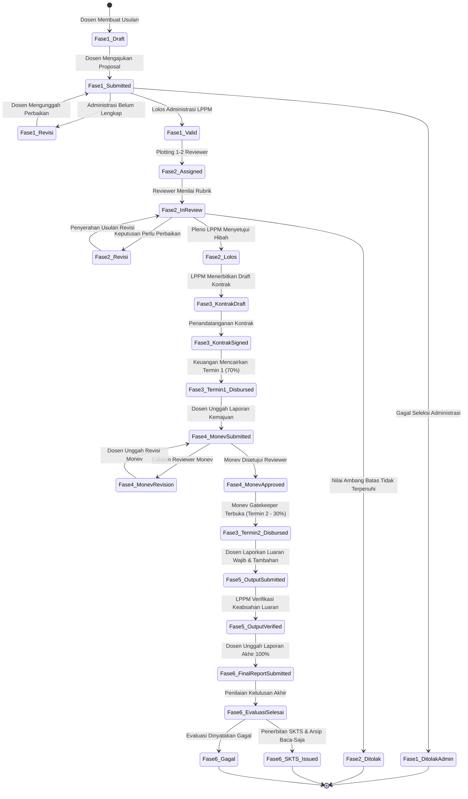
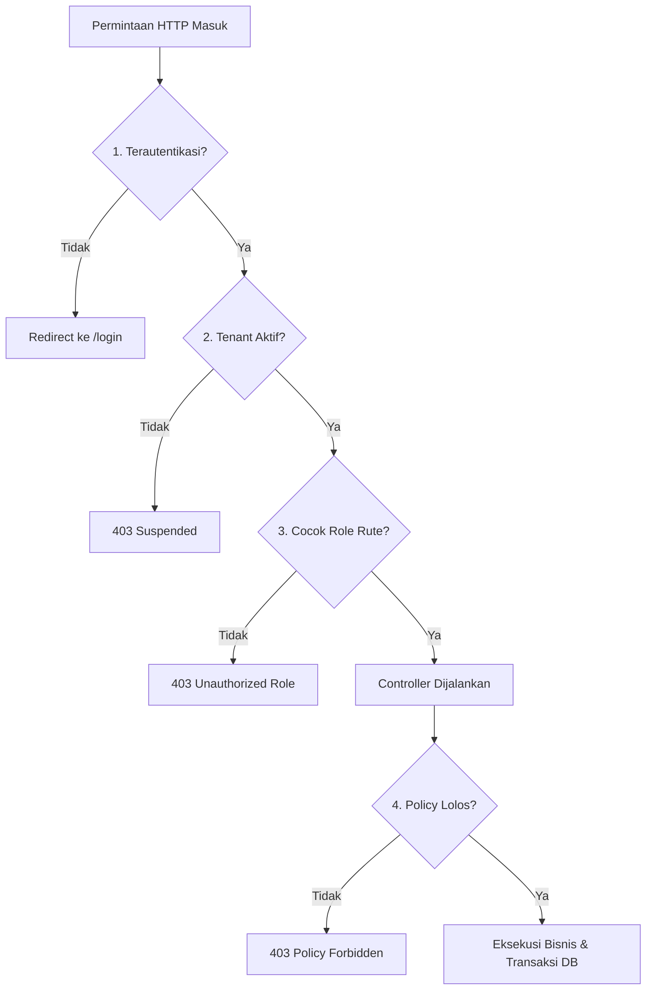

# Panduan Operasional Teknis & Aturan Bisnis: Sistem Penelitian Terintegrasi Standalone
**Aturan Bisnis Transaksional, Penanganan Kasus Batas Kritis, Invarian Keamanan, dan Standar Mutu Koding**

---

## 1. Informasi Dokumen & Metadata Sistem

### 1.1 Metadata Dokumen & Kerangka Acuan

- **Nama Sistem**: Sistem Penelitian Terintegrasi Multi-Kampus (*Multi-Institution Research Management System* / SIM-Penelitian)
- **Nama Dokumen**: Spesifikasi Aturan Bisnis, Penanganan Kasus Batas, Invarian Keamanan, dan Standar Mutu Koding (*Business Rules, Edge Cases, Security Invariants, & Quality Gates*)
- **Versi Sistem**: 2.0.0-STANDALONE
- **Status Dokumen**: Disetujui (Approved Baseline)
- **Tanggal Efektif**: 15 Oktober 2026
- **Klasifikasi Dokumen**: Panduan Rekayasa Teknis & Pertahanan Sistem Tingkat Operasional
- **Dokumen Referensi Terkait**:
  - [Product Requirement Document (PRD) Standalone](../PRD_Sistem_Penelitian_Terintegrasi_Standalone.md) (Bab 5, Bab 9, Bab 10)
  - [Cetak Biru Arsitektur Sistem](./architecture.md)
  - [Kamus Data & Skema Basis Data Relasional](./schema.md)
  - [Cetak Biru Sistem Desain UI/UX: Hybrid Scholarly Enterprise](./design.md)
  - [Project Rules for RPL-2026](../../.agents/AGENTS.md)

---

### 1.2 Tujuan Dokumen & Filosofi Pertahanan Sistem (Defense-in-Depth)

Dokumen ini disusun sebagai kitab panduan operasional teknis (*operational bible*) yang mengikat seluruh perekayasa perangkat lunak (*software engineers*), analis kualitas (*QA engineers*), dan pengelola infrastruktur (*DevOps*) yang berkontribusi pada pengembangan Sistem Penelitian Terintegrasi Standalone. 

Pengelolaan dana hibah penelitian pada institusi perguruan tinggi melibatkan transaksi keuangan negara dan institusi yang bernilai tinggi, akuntabilitas audit hukum, serta hak kekayaan intelektual akademisi. Oleh karena itu, sistem ini dirancang dengan prinsip **Pertahanan Berlapis (*Defense-in-Depth*)**, di mana setiap transaksi divalidasi pada tiga tingkatan independen:
1. **Lapisan Antarmuka Klien (Frontend Boundary)**: Pengendalian status interaktif, pencegahan klik ganda, dan validasi visual awal.
2. **Lapisan Logika Aplikasi (Application & Business Policy Boundary)**: Validasi ketat melalui *FormRequest*, otorisasi peran ganda (*dual-layer authorization guard*), kepatuhan *state machine*, dan *domain policy*.
3. **Lapisan Persistensi Basis Data (Database Invariant Boundary)**: Kunci unik komposit (*composite unique constraints*), integritas referensial kunci asing (*foreign key constraints*), dan isolasi *tenant* global (*tenant-scoped queries*).

Dokumen ini menguraikan secara komprehensif aturan bisnis transaksional 6 fase riset, mekanisme pertahanan teknis untuk 11 kasus batas kritis operasional, invarian keamanan sistem, serta standar mutu koding dan pengujian otomatis tanpa toleransi terhadap celah data (*zero-tolerance data corruption*).

---

## 2. Bab 1: Aturan Bisnis Transaksional 6 Fase Siklus Hidup Penelitian

### 2.1 State Machine Siklus Hidup Riset & Prinsip Ketat Transisi

Siklus tata kelola penelitian pada Sistem Penelitian Terintegrasi Standalone mengadopsi model *Deterministic Finite State Machine (FSM)*. Suatu penelitian tidak dapat melompati fase atau berpindah ke status lanjutan tanpa memenuhi seluruh kondisi prasyarat (*invariants*) pada fase sebelumnya.



#### Matriks Transisi Status Antar Entitas Utama

| Entitas Basis Data | Kolom Status | Nilai Status Legal | Kondisi Prasyarat Transisi | Peran Pengubah Status |
| :--- | :--- | :--- | :--- | :--- |
| `proposals` | `status_proposal` | `Draft` | Pengisian awal usulan oleh dosen pengusul | `Peneliti` |
| `proposals` | `status_proposal` | `Submitted` | Dokumen PDF terunggah, anggota tim terdaftar, jadwal skema aktif | `Peneliti` |
| `proposals` | `status_proposal` | `Administrasi_Valid` | Berkas lengkap, lolos verifikasi format LPPM | `Admin Kampus` |
| `proposals` | `status_proposal` | `Ditolak` | Berkas tidak memenuhi format atau tidak lolos substansi | `Admin Kampus` |
| `proposals` | `status_proposal` | `Lolos_Didanai` | Penilaian reviewer tuntas, kuota pagu terpenuhi, SK penetapan dibuat | `Admin Kampus` |
| `reviews` | `status_review` | `Assigned` | Reviewer ditunjuk oleh LPPM (tidak memiliki konflik kepentingan) | `Admin Kampus` |
| `reviews` | `status_review` | `In_Progress` | Reviewer mulai mengisi rubrik penilaian | `Reviewer` |
| `reviews` | `status_review` | `Completed` | Seluruh butir rubrik terisi (skor 0-100) dan rekomendasi terpilih | `Reviewer` |
| `contracts` | `status_kontrak` | `Draft` | Proposal berstatus `Lolos_Didanai`, nomor kontrak terbit | `Admin Kampus` / `Admin Keuangan` |
| `contracts` | `status_kontrak` | `Signed` | Dokumen kontrak bermeterai diunggah kedua pihak | `Admin Kampus` / `Peneliti` |
| `contracts` | `status_kontrak` | `Active` | Dana Termin 1 telah dicairkan | `Admin Keuangan` |
| `contracts` | `status_kontrak` | `Closed` | SKTS terbit atau status penelitian ditutup | `Admin Kampus` |
| `fundings` | `status_pencairan` | `Pending` | Kontrak terbit, menunggu proses transfer perbankan | Sistem |
| `fundings` | `status_pencairan` | `Disbursed` | Bukti transfer bank diunggah dan nomor referensi tercatat | `Admin Keuangan` |
| `fundings` | `status_pencairan` | `Verified` | Konfirmasi penerimaan dana oleh ketua peneliti | `Peneliti` |
| `progress_reports` | `status_laporan` | `Submitted` | Berkas kemajuan PDF dan logbook terunggah dalam jadwal Monev | `Peneliti` |
| `progress_reports` | `status_laporan` | `Approved` | Reviewer memberikan skor Monev dan menyetujui capaian | `Reviewer` |
| `progress_reports` | `status_laporan` | `Revision` | Reviewer meminta perbaikan logbook / berkas kemajuan | `Reviewer` |
| `research_outputs` | `status_verifikasi`| `Draft` | Data luaran disimpan sementara oleh peneliti | `Peneliti` |
| `research_outputs` | `status_verifikasi`| `Submitted` | Berkas bukti publikasi/sertifikat terunggah lengkap | `Peneliti` |
| `research_outputs` | `status_verifikasi`| `Verified` | LPPM memvalidasi keabsahan nomor registrasi dan bukti riil | `Admin Kampus` |
| `research_outputs` | `status_verifikasi`| `Rejected` | Bukti luaran tidak absah atau terindikasi klaim ganda | `Admin Kampus` |
| `evaluations` | `status_penelitian`| `Dalam_Evaluasi` | Laporan akhir terunggah 100%, menunggu evaluasi penilai | `Peneliti` |
| `evaluations` | `status_penelitian`| `Selesai` | Lulus evaluasi akhir, SKTS terbit dengan nomor unik | `Admin Kampus` |
| `evaluations` | `status_penelitian`| `Gagal` | Tidak memenuhi luaran wajib, batas waktu berakhir, atau force majeure | `Admin Kampus` |

---

### 2.2 Fase 1: Pengajuan Usulan & Seleksi Administrasi

Fase 1 mengatur gerbang awal penerimaan gagasan ilmiah dari para dosen pengusul ke dalam sistem:

1. **Batasan Isolasi Tenant Skema Penelitian (`university_id`)**:
   - Skema penelitian pada tabel `research_schemas` terikat mutlak pada kolom `university_id`.
   - Dosen pengusul hanya diizinkan memilih dan mengajukan usulan pada skema yang diselenggarakan oleh perguruan tinggi tempat dirinya terdaftar (`auth()->user()->university_id == research_schemas.university_id`).
   - Sistem menolak secara otomatis setiap upaya injeksi skema lintas perguruan tinggi dengan kode galat HTTP 403 (*Forbidden*).

2. **Keunikan Judul Usulan per Pengusul per Tahun Anggaran**:
   - Dosen ketua pengusul dilarang mengajukan usulan dengan judul yang sama pada tahun anggaran berjalan.
   - Integritas ini ditegakkan melalui indeks unik komposit pada tabel `proposals`: `(id_pengusul, id_skema_pendanaan, judul_penelitian)`.
   - Jika terjadi duplikasi judul oleh dosen yang sama pada skema di tahun yang sama, sistem mengembalikan galat validasi: *"Anda telah mengajukan proposal dengan judul yang sama pada skema dan tahun anggaran ini."*

3. **Penguncian Permanen Mutasi Data Proposal Saat Berstatus `Submitted`**:
   - Proposal yang masih berstatus `Draft` atau dikembalikan dengan status `Revisi` dapat dimutasi (diedit atau dihapus) secara bebas oleh dosen pengusul.
   - Begitu dosen menekan tombol *"Ajukan Proposal"* dan status berubah menjadi `Submitted`, seluruh operasi mutasi data (`PUT`, `PATCH`, `DELETE`) dikunci secara permanen di tingkat *ProposalPolicy*.
   - Dosen dilarang mengubah judul, anggaran, susunan tim, maupun berkas dokumen selama tahap seleksi administrasi dan telaah substansi berlangsung.

4. **Penegakan Batas Waktu Penerimaan Usulan (*Deadline Enforcement*)**:
   - Pengajuan usulan hanya sah jika timestamp pengajuan memenuhi ketentuan: `now() <= research_schemas.tanggal_selesai`.
   - Batas waktu dihitung sampai detik terakhir (pukul 23:59:59 zona waktu lokal kampus terkait).
   - Validasi sisi server pada `StoreProposalRequest` melakukan pengecekan waktu nyata (*real-time comparison*), menolak segala bentuk bypass melalui manipulasi jam perangkat klien.

5. **Spesifikasi Berkas Dokumen Proposal**:
   - Berkas proposal wajib berformat dokumen PDF tunggal.
   - Ukuran berkas maksimum yang diizinkan adalah **10 MB (10.485.760 bytes)**.
   - Sistem melakukan inspeksi terhadap *magic bytes* berkas (`%PDF-`) untuk mencegah penggantian ekstensi palsu dari berkas biner berbahaya.

6. **Seleksi Administrasi oleh Operator LPPM**:
   - Operator LPPM melakukan verifikasi berkas terhadap kesesuaian format panduan, batas usia, jabatan fungsional ketua, dan kelengkapan lembar pengesahan.
   - Putusan administrasi:
     - Jika lolos: status berubah menjadi `Administrasi_Valid` dan siap dialokasikan ke reviewer.
     - Jika tidak lolos: status berubah menjadi `Ditolak`, dan kolom `catatan_administrasi` **wajib diisi** dengan alasan penolakan yang jelas.
     - Jika terdapat kekurangan minor: operator dapat mengembalikan ke status `Revisi` disertai tenggat waktu perbaikan administratif.

---

### 2.3 Fase 2: Penugasan Reviewer & Penilaian Kriteria Substansi

Fase 2 mengatur penelaahan obyektif dan independen terhadap kelayakan akademik usulan riset:

1. **Alokasi Reviewer Independen (1 hingga 2 Penilai per Usulan)**:
   - Admin LPPM (`role:Admin Kampus`) menugaskan minimal 1 (satu) dan maksimal 2 (dua) orang penilai ahli (*reviewer*) untuk setiap proposal yang lolos administrasi.
   - Data penugasan dicatat pada tabel `reviews` dengan status awal `Assigned`.

2. **Aturan Pencegahan Konflik Kepentingan (*Conflict of Interest / CoI Guard*)**:
   - Sistem menerapkan aturan validasi mutlak untuk mencegah manipulasi penugasan:
     - `reviews.id_reviewer != proposals.id_pengusul` (Reviewer tidak boleh menjadi ketua pengusul).
     - Reviewer tidak boleh terdaftar sebagai anggota tim peneliti pada proposal yang bersangkutan.
     - Penugasan yang melanggar ketentuan ini digagalkan seketika oleh controller dengan melempar galat HTTP 422: *"Reviewer memiliki konflik kepentingan langsung dengan usulan penelitian ini."*

3. **Rubrik Penilaian Terbobot (Skala Skor 0 - 100)**:
   - Instrumen penilaian diambil dari tabel `assessment_criteria` yang dikonfigurasi aktif oleh universitas.
   - Setiap kriteria memiliki nilai bobot persentase, di mana total bobot seluruh kriteria bernilai tepat 100%.
   - Reviewer mengisi nilai butir (0 - 100) pada formulir evaluasi. Sistem menghitung skor total terbobot secara otomatis:
     $$\text{skor\_total} = \sum_{i=1}^{n} \left( \frac{\text{skor\_butir}_i \times \text{bobot}_i}{100} \right)$$
   - Komponen rincian nilai disimpan ke dalam kolom JSON `reviews.komponen_penilaian`.

4. **Opsi Rekomendasi Putusan Reviewer**:
   - Setiap reviewer wajib memilih satu dari 3 rekomendasi resmi:
     - `Diterima`: Usulan layak didanai tanpa perubahan substansi mendasar.
     - `Revisi`: Usulan memiliki potensi akademik tinggi namun memerlukan perbaikan metodologi, anggaran, atau instrumen.
     - `Ditolak`: Usulan tidak memenuhi standar kelayakan ilmiah atau melanggar etika riset.
   - Reviewer wajib memberikan catatan evaluasi naratif pada kolom `catatan_evaluasi` minimal 50 karakter sebelum telaah dapat dinyatakan `Completed`.

5. **Protokol Revisi Usulan & Rekam Jejak Audit**:
   - Jika rapat pleno LPPM memutuskan status usulan `Revisi`, sistem membuka kembali akses edit bagi dosen pengusul selama jangka waktu tertentu (standar: 7 hari kalender).
   - Seluruh riwayat catatan reviewer dari ronde penilaian sebelumnya dibekukan sebagai jejak audit (*immutable audit trail*) dan tidak dapat diubah atau dihapus oleh pihak mana pun.

6. **Transisi Kelolosan Akhir**:
   - Admin LPPM mengesahkan status akhir proposal berdasarkan nilai agregat reviewer:
     - Jika disetujui: status proposal diperbarui menjadi `Lolos_Didanai`.
     - Jika ditolak: status diperbarui menjadi `Ditolak`.

---

### 2.4 Fase 3: Kontrak Hibah & Manajemen Pencairan Dana Bertahap

Fase 3 mengatur perikatan hukum dan akuntabilitas aliran dana penelitian:

1. **Prasyarat Penerbitan Kontrak Penelitian**:
   - Kontrak penelitian (`contracts`) **hanya dapat diterbitkan** untuk proposal yang memiliki status `status_proposal = 'Lolos_Didanai'`.
   - Upaya pembuatan kontrak pada proposal yang berstatus `Draft`, `Submitted`, `Administrasi_Valid`, atau `Ditolak` ditolak mutlak oleh sistem dengan galat HTTP 422.
   - Kolom `nomor_kontrak` wajib unik di seluruh basis data institusi (`nomor_kontrak` UNIQUE).

2. **Pencatatan Nilai Realisasi `dana_disetujui`**:
   - Nilai anggaran yang dicatat pada kontrak adalah `dana_disetujui`, yaitu nominal riil hasil evaluasi tim reviewer dan persetujuan LPPM.
   - Nominal `dana_disetujui` dapat bernilai sama atau lebih kecil daripada `biaya_yang_diusulkan` oleh dosen, namun tidak boleh melebihi plafon pagu maksimal skema pendanaan (`research_schemas.anggaran_maksimal`).

3. **Skema Pembagian Termin Dana Tepat 100% (Rasio 70 : 30)**:
   - Sistem menerapkan skema pembagian termin pendanaan standar yang terbagi menjadi dua catatan pada tabel `fundings`:
     - **Termin 1**: `termin_ke = 1`, `persentase_dana = 70`, dengan nominal:
       $$\text{nominal\_dana}_1 = \text{dana\_disetujui} \times 0.70$$
     - **Termin 2**: `termin_ke = 2`, `persentase_dana = 30`, dengan nominal:
       $$\text{nominal\_dana}_2 = \text{dana\_disetujui} \times 0.30$$
   - Penjumlahan persentase termin wajib bernilai tepat 100% dan akumulasi nominal tepat menyamai `dana_disetujui` tanpa adanya selisih pembulatan.

4. **Pengunci Gerbang Monev (*Monev Gatekeeper Lock*)**:
   - **Aturan Absolut**: Pencairan dana Termin 2 (`termin_ke = 2`) diblokir secara absolut di level backend sebelum laporan kemajuan penelitian terkait berstatus `status_laporan = 'Approved'`.
   - Permintaan pencairan Termin 2 oleh Admin Keuangan saat Monev belum berstatus disetujui akan diinterupsi oleh `FundingPolicy` dan melempar galat HTTP 422: *"Pencairan dana Termin 2 diblokir sampai Laporan Kemajuan Monev disetujui oleh Reviewer."*

5. **Syarat Kelengkapan Eksekusi Pencairan Dana**:
   - Status pencairan pada tabel `fundings` hanya dapat diubah dari `Pending` menjadi `Disbursed` jika:
     - Tanggal pencairan (`tanggal_pencairan`) telah ditentukan.
     - Berkas bukti transfer bank resmi (`bukti_transfer_path`) dalam format PDF atau gambar telah diunggah ke penyimpanan terproteksi.
     - Catatan referensi perbankan / nomor transaksi telah diinput pada kolom `catatan_keuangan`.

---

### 2.5 Fase 4: Monitoring dan Evaluasi (Monev) Pelaksanaan Riset

Fase 4 mengawal kepatuhan jadwal pelaksanaan riset dan capaian riil di lapangan:

1. **Keterikatan dengan Rentang Jadwal Monev Aktif**:
   - Pelaporan kemajuan hanya dapat diunggah dan disimpan jika tanggal pengunggahan berada dalam rentang jadwal monev aktif yang ditentukan oleh LPPM:
     $$\text{monev\_schedules.tanggal\_mulai} \le \text{today}() \le \text{monev\_schedules.tanggal\_selesai}$$
     serta memenuhi kondisi `monev_schedules.is_active = true`.
   - Pengunggahan di luar rentang jadwal aktif dicegat oleh sistem dengan pesan galat: *"Periode unggah laporan kemajuan untuk tahap ini belum dibuka atau telah berakhir."*

2. **Kelengkapan Berkas Pelaporan Kemajuan Wajib**:
   - Peneliti wajib mengunggah:
     - Berkas Laporan Kemajuan format PDF (maksimal 10MB).
     - Berkas Catatan Harian / Logbook Kegiatan format PDF (maksimal 10MB).
     - Nilai persentase kemajuan riil pada kolom `persentase_kemajuan` dengan rentang angka bulat antara **1% hingga 100%**.
     - Ringkasan capaian aktivitas (`ringkasan_progres`) dan kendala lapangan (`catatan_kendala`).

3. **Instrumen Evaluasi Monev oleh Reviewer**:
   - Reviewer monev melakukan verifikasi terhadap logbook, laporan kemajuan, dan wawancara visitasi.
   - Reviewer menginput skor monev (`skor_monev` skala 0 - 100), catatan evaluasi monev, dan putusan:
     - `Approved`: Laporan kemajuan disetujui, capaian dinilai memuaskan, dan pengunci gerbang pencairan Termin 2 secara resmi dibuka.
     - `Revision`: Terdapat kekurangan data dukung atau capaian di bawah target; peneliti diberikan tenggat perbaikan maksimal 5 hari kerja sebelum dievaluasi ulang.

---

### 2.6 Fase 5: Pelaporan & Verifikasi Luaran Ilmiah (Research Output)

Fase 5 memastikan akuntabilitas luaran akademik dan hilirisasi produk riset:

1. **Kewajiban Pemenuhan Minimal 1 Luaran Berkategori `Wajib`**:
   - Setiap usulan penelitian yang telah menandatangani kontrak diwajibkan mendaftarkan minimal 1 (satu) luaran dengan target status `target_status = 'Wajib'`.
   - Luaran wajib harus sesuai dengan kriteria luaran minimal yang ditetapkan pada skema penelitian terkait (misalnya artikel jurnal terindeks Sinta 2 atau publikasi internasional bereputasi).
   - Peneliti dapat menambahkan luaran lainnya dengan target status `target_status = 'Tambahan'`.

2. **Spesifikasi 4 Klaster Luaran Ilmiah**:
   Sistem mendukung 4 klaster luaran dengan atribut spesifik:
   - **Klaster 1: Publikasi Artikel Jurnal (`journal_outputs`)**:
     - Atribut: Nama jurnal, judul artikel, ISSN/e-ISSN, klasifikasi indeksasi (`Scopus`, `Sinta_1`, `Sinta_2`, `Sinta_3`, `Sinta_4`, `Internasional`, `Nasional`), status publikasi (`Submitted`, `Accepted`, `Published`), URL DOI resmi, dan berkas naskah PDF.
   - **Klaster 2: Buku Ber-ISBN (`book_outputs`)**:
     - Atribut: Judul buku, nomor ISBN valid (10 atau 13 digit), nama penerbit bereputasi, tahun terbit, jumlah halaman, dan berkas scan cover beserta lembar redaksi/katalog dalam terbitan (KDT) format PDF.
   - **Klaster 3: Hak Kekayaan Intelektual (`hki_outputs`)**:
     - Atribut: Judul ciptaan/invensi, jenis HKI (`Hak_Cipta`, `Paten`, `Desain_Industri`), nomor permohonan pendaftaran resmi DJKI, nomor sertifikat resmi (jika sudah terbit), dan berkas sertifikat atau bukti permohonan format PDF.
   - **Klaster 4: Produk Teknologi Terapan (`product_outputs`)**:
     - Atribut: Nama produk/prototipe, deskripsi spesifikasi fungsional, Tingkat Kesiapan Teknologi (TKT / TRL skala 1 - 9), dan berkas dokumentasi pengujian atau foto produk format PDF.

3. **Verifikasi Administratif & Substansi oleh Admin LPPM**:
   - Luaran yang dilaporkan oleh peneliti berstatus awal `Submitted`.
   - Admin LPPM melakukan uji silang keabsahan bukti digital (misal: verifikasi live tautan DOI ke Crossref, pencarian nomor ISBN di Perpusnas, atau pengecekan pangkalan data DJKI).
   - Putusan verifikasi:
     - `Verified`: Luaran diakui sah memenuhi kontrak penelitian.
     - `Rejected`: Luaran ditolak karena bukti tidak valid, tautan broken, atau pelanggaran klaim ganda, disertai pengisian `catatan_verifikasi`.

4. **Pencegahan Klaim Luaran Ganda (*Duplicate Output Claim Guard*)**:
   - Sistem memberlakukan validasi keunikan ketat terhadap nomor pengenal permanen:
     - Nomor DOI artikel jurnal (`doi_url`) dilarang didaftarkan lebih dari satu kali di seluruh sistem.
     - Nomor ISBN buku (`isbn`) dilarang digunakan untuk klaim luaran pada proposal atau tahun anggaran yang berbeda.
     - Nomor pendaftaran atau sertifikat HKI (`nomor_pendaftaran`, `nomor_sertifikat`) dilarang diduplikasi.

---

### 2.7 Fase 6: Evaluasi Akhir, Penutupan Riset, & Penerbitan SKTS

Fase 6 mengakhiri siklus hidup penelitian melalui evaluasi komprehensif dan pengarsipan hukum permanen:

1. **Prasyarat Pengajuan Evaluasi Akhir**:
   - Peneliti hanya dapat mengajukan permohonan evaluasi akhir jika memenuhi seluruh syarat kumulatif berikut:
     1. Berkas Laporan Akhir Penelitian lengkap (PDF maks 10MB) telah terunggah.
     2. Ringkasan hasil penelitian komprehensif (`ringkasan_hasil`) telah diisi.
     3. Seluruh luaran penelitian yang berstatus `target_status = 'Wajib'` telah berstatus `status_verifikasi = 'Verified'`.
   - Apabila terdapat luaran wajib yang masih berstatus `Draft`, `Submitted`, atau `Rejected`, tombol pengajuan evaluasi akhir dinonaktifkan dan controller menolak mutasi dengan galat HTTP 422.

2. **Kategori Rekomendasi Kelulusan Akhir**:
   - Penilai akhir / komite LPPM menetapkan status kelulusan pada tabel `evaluations`:
     - `Lulus_Memuaskan`: Seluruh luaran wajib terverifikasi, skor akhir substansi $\ge 80$, dan kualitas capaian melebihi ekspektasi kontrak.
     - `Lulus_Cukup`: Seluruh luaran wajib terverifikasi dan skor akhir substansi berada pada rentang $60 \le \text{skor} < 80$.
     - `Tidak_Lulus`: Terdapat kegagalan substansi atau skor akhir $< 60$.

3. **Penerbitan Surat Keterangan Tanda Selesai (SKTS)**:
   - Bagi penelitian yang dinyatakan lulus (`Lulus_Memuaskan` atau `Lulus_Cukup`), Admin LPPM menerbitkan Surat Keterangan Tanda Selesai (SKTS).
   - Sistem men-generate `nomor_skts` unik dengan format standar institusi:
     $$\text{SKTS}/\{\text{KODE\_KAMPUS}\}/\{\text{TAHUN}\}/\{\text{ID\_PROPOSAL}\}$$
   - Berkas sertifikat SKTS resmi bertanda tangan digital disimpan ke `file_skts_path` dan status penelitian berubah menjadi `status_penelitian = 'Selesai'`.

4. **Penguncian Berkas Arsip Baca-Saja (*Read-Only Archive Lock*)**:
   - **Invarian Hukum Mutlak**: Penerbitan SKTS dan penutupan status penelitian menjadi `Selesai` secara otomatis mengaktifkan status arsip permanen (*Read-Only Archive*).
   - Seluruh entitas anak yang berelasi dengan proposal tersebut (`proposals`, `proposal_documents`, `contracts`, `fundings`, `progress_reports`, `research_outputs`, `evaluations`) dikunci secara permanen dari segala bentuk modifikasi data (`UPDATE`) maupun penghapusan (`DELETE`).
   - Peneliti, Admin LPPM, maupun Reviewer hanya memiliki izin baca (*read-only access*) untuk keperluan penjaminan mutu, akreditasi, dan audit eksternal.

---

## 3. Bab 2: Penanganan Defensif 11 Kasus Batas Kritis (Edge Cases Handling Bab 9 PRD)

Sistem dirancang tangguh (*fault-tolerant*) dan tahan manipulasi dalam mengantisipasi 11 skenario kasus batas operasional kritis. Subbab berikut menguraikan skenario kasus, dampak teknis, mekanisme pertahanan, serta contoh implementasi kode pertahanan.

```
+---------------------------------------------------------------------------------------------------+
|                            PETA 11 KASUS BATAS KRITIS OPERASIONAL                                 |
+------------------------------------+--------------------------------------------------------------+
| [KASUS 01] IDOR Lintas Kampus      | Manipulasi ID URL untuk mencuri proposal universitas lain     |
| [KASUS 02] Konflik Reviewer (CoI)  | Reviewer menilai usulan diri sendiri atau timnya             |
| [KASUS 03] Universitas Suspensi    | Kampus dinonaktifkan namun civitas tetap login & mutasi data |
| [KASUS 04] Deadline Race Condition | Submit tepat di detik penutupan saat skema sudah expired     |
| [KASUS 05] Double Submission       | Spamming submit akibat latensi jaringan                      |
| [KASUS 06] Reviewer Abandonment    | Reviewer ghosting / mangkir hingga tenggat review berakhir  |
| [KASUS 07] Disparitas Skor Ekstrem | Selisih skor antar 2 reviewer > 30 poin                      |
| [KASUS 08] Budget Cut Adjustment   | Nominal persetujuan LPPM lebih rendah dari ajuan awal        |
| [KASUS 09] Termin 2 Monev Blocker  | Permintaan pencairan termin 2 sebelum Monev Approved         |
| [KASUS 10] Duplicate Output Claim  | Klaim DOI/ISBN/HKI yang sama pada proposal berbeda           |
| [KASUS 11] Force Majeure Riset     | Riset gagal tuntas akibat bencana/kondisi darurat            |
+------------------------------------+--------------------------------------------------------------+
```

---

### 3.1 Kasus Batas 1: Manipulasi Akses Lintas Kampus (IDOR via URL Parameter)

- **Skenario Kasus**:
  Pengguna dengan peran `Peneliti` atau `Admin Kampus` dari Universitas A mencoba mengakses atau mengubah sumber daya proposal milik Universitas B dengan memanipulasi parameter ID numerik pada URL (misalnya: mengirimkan `GET /proposals/892` atau `PUT /proposals/892` di mana proposal ID 892 milik Universitas B).
- **Analisis Dampak & Risiko**:
  Risiko kebocoran data riset berhak cipta (*intellectual property breach*), pelanggaran privasi dosen, serta potensi kerusakan data antar-kampus dalam basis data bersama (*shared database*).
- **Mekanisme Pertahanan Teknis**:
  1. **Tingkat Model Eloquent**: Penerapan `TenantScope` global pada seluruh kueri model domain yang secara otomatis menyisipkan klausa `WHERE university_id = ?` berdasarkan konteks autentikasi pengguna.
  2. **Tingkat Otorisasi Policy**: `ProposalPolicy` melakukan validasi ganda terhadap identitas institusi:
     `$user->university_id === $proposal->university_id`.
  3. **Respon Sistem**: Jika terjadi ketidakcocokan, sistem langsung menghentikan eksekusi dengan `abort(404)` (agar penyerang tidak dapat melakukan *resource enumeration*) atau `abort(403)`.
- **Implementasi Kode Pertahanan**:

```php
<?php

declare(strict_types=1);

namespace App\Models\Scopes;

use Illuminate\Database\Eloquent\Builder;
use Illuminate\Database\Eloquent\Model;
use Illuminate\Database\Eloquent\Scope;
use Illuminate\Support\Facades\Auth;

class TenantScope implements Scope
{
    public function apply(Builder $builder, Model $model): void
    {
        $user = Auth::user();

        // Super Admin memiliki hak lintas tenant untuk master data
        if ($user && ! $user->isSuperAdmin()) {
            $builder->where($model->getTable() . '.university_id', '=', $user->university_id);
        }
    }
}
```

```php
// app/Policies/ProposalPolicy.php
public function update(User $user, Proposal $proposal): bool
{
    // Cek kecocokan tenant
    if ($user->university_id !== $proposal->university_id) {
        return false;
    }

    // Hanya pemilik usulan yang dapat mengubah
    if ($user->id !== $proposal->id_pengusul) {
        return false;
    }

    // Hanya usulan berstatus Draft atau Revisi yang dapat diubah
    return in_array($proposal->status_proposal, ['Draft', 'Revisi'], true);
}
```

---

### 3.2 Kasus Batas 2: Konflik Kepentingan Reviewer (*Conflict of Interest / CoI*)

- **Skenario Kasus**:
  Admin LPPM secara sengaja atau tidak sengaja menugaskan seorang dosen sebagai reviewer pada proposal di mana dosen tersebut bertindak sebagai ketua pengusul, atau dosen tersebut tercatat sebagai salah satu anggota tim peneliti usulan tersebut.
- **Analisis Dampak & Risiko**:
  Kompromi integritas akademik (*moral hazard*), ketidakadilan kompetisi hibah, penilaian subyektif yang menguntungkan diri sendiri, serta pembatalan status hibah saat diaudit secara eksternal.
- **Mekanisme Pertahanan Teknis**:
  1. **Validasi FormRequest**: `AssignReviewerRequest` memeriksa keterkaitan calon reviewer dengan usulan target sebelum perintah dieksekusi.
  2. **Pengecekan Relasional Ganda**:
     - Memeriksa apakah `id_reviewer === proposal.id_pengusul`.
     - Memeriksa apakah `id_reviewer` ada di dalam relasi anggota tim peneliti (`proposal_members`).
  3. **Penyaringan Antarmuka Dinamis**: Dropdown penugasan reviewer pada antarmuka admin secara otomatis memfilter dan mengecualikan akun dosen yang berafiliasi dengan proposal tersebut.
- **Implementasi Kode Pertahanan**:

```php
<?php

declare(strict_types=1);

namespace App\Http\Requests\Admin;

use App\Models\Proposal;
use Illuminate\Foundation\Http\FormRequest;
use Illuminate\Validation\Validator;

class AssignReviewerRequest extends FormRequest
{
    public function authorize(): bool
    {
        return $this->user()->isAdminKampus() || $this->user()->isSuperAdmin();
    }

    public function rules(): array
    {
        return [
            'id_proposal' => ['required', 'integer', 'exists:proposals,id'],
            'id_reviewer' => ['required', 'integer', 'exists:users,id'],
            'tanggal_mulai_review' => ['required', 'date', 'after_or_equal:today'],
            'tanggal_selesai_review' => ['required', 'date', 'after:tanggal_mulai_review'],
        ];
    }

    public function withValidator(Validator $validator): void
    {
        $validator->after(function ($validator) {
            $proposal = Proposal::with('members')->find($this->id_proposal);
            if (! $proposal) {
                return;
            }

            // Invarian CoI 1: Reviewer tidak boleh ketua pengusul
            if ((int) $this->id_reviewer === (int) $proposal->id_pengusul) {
                $validator->errors()->add('id_reviewer', '[KRITIS] Reviewer tidak boleh menjadi ketua pengusul pada usulan yang dinilai.');
            }

            // Invarian CoI 2: Reviewer tidak boleh menjadi anggota tim
            $isTeamMember = $proposal->members->contains('user_id', (int) $this->id_reviewer);
            if ($isTeamMember) {
                $validator->errors()->add('id_reviewer', '[KRITIS] Reviewer terdaftar sebagai anggota tim peneliti pada usulan ini.');
            }
        });
    }
}
```

---

### 3.3 Kasus Batas 3: Universitas Dinonaktifkan (*Tenant Suspension*)

- **Skenario Kasus**:
  Super Admin menonaktifkan akun institusi perguruan tinggi (`universities.is_active = false`) karena berakhirnya kontrak lisensi sistem atau sanksi administratif kementerian. Namun, sesi login civitas kampus tersebut masih aktif di peramban mereka.
- **Analisis Dampak & Risiko**:
  Aktivitas mutasi ilegal oleh pengguna dari institusi yang disuspensi, ketidaksesuaian data tagihan lisensi, dan pelanggaran isolasi status sistem.
- **Mekanisme Pertahanan Teknis**:
  1. **Global Authentication Middleware**: `CheckTenantActive` diinjeksikan pada seluruh grup rute yang memerlukan autentikasi (`auth:sanctum` / `web`).
  2. **Inspeksi Status Institusi pada Setiap Permintaan**: Middleware memeriksa status `user->university->is_active` secara langsung dari basis data atau memori terdistribusi (*Redis cache*).
  3. **Terminasi Sesi Seketika**: Jika universitas berstatus nonaktif, sesi pengguna dihanguskan (`Auth::logout()`, `session()->invalidate()`), token dihapus, dan pengguna dialihkan ke halaman pemberitahuan suspensi resmi dengan kode status HTTP 403.
- **Implementasi Kode Pertahanan**:

```php
<?php

declare(strict_types=1);

namespace App\Http\Middleware;

use Closure;
use Illuminate\Http\Request;
use Illuminate\Support\Facades\Auth;
use Symfony\Component\HttpFoundation\Response;

class CheckTenantActive
{
    public function handle(Request $request, Closure $next): Response
    {
        $user = $request->user();

        if ($user && ! $user->isSuperAdmin()) {
            $university = $user->university;

            if (! $university || ! $university->is_active) {
                Auth::guard('web')->logout();
                $request->session()->invalidate();
                $request->session()->regenerateToken();

                if ($request->wantsJson()) {
                    return response()->json([
                        'message' => '[BLOKIR] Akses institusi Anda saat ini dinonaktifkan. Silakan hubungi Administrator.',
                    ], 403);
                }

                return redirect()->route('login')->withErrors([
                    'email' => '[BLOKIR] Akses institusi universitas Anda saat ini sedang disuspensi oleh Administrator Sistem.',
                ]);
            }
        }

        return $next($request);
    }
}
```

---

### 3.4 Kasus Batas 4: Batas Waktu Skema Berakhir Saat Mengisi Formulir (*Deadline Race Condition*)

- **Skenario Kasus**:
  Dosen membuka wizard pengajuan usulan pada pukul 23:50 (10 menit sebelum tenggat waktu skema berakhir pukul 23:59:59). Dosen baru menekan tombol simpan dan ajukan pada pukul 00:03 ketika tanggal skema secara hukum telah ditutup.
- **Analisis Dampak & Risiko**:
  Pelanggaran asas keadilan kompetisi proposal, komplain legal dari pengusul lain yang taat batas waktu, serta kecurangan data penanggalan penerimaan hibah.
- **Mekanisme Pertahanan Teknis**:
  1. **Pengecekan Waktu Riil Server**: Backend tidak mempercayai tanggal yang dikirimkan oleh peramban klien. Tanggal dibandingkan menggunakan jam atom server NTP dengan timezone resmi universitas (`$university->timezone` atau `Asia/Jakarta`).
  2. **Validasi Waktu di `StoreProposalRequest`**: Pengecekan `now() <= schema.tanggal_selesai` dieksekusi di dalam transaksi basis data.
  3. **Pemberitahuan Informatif**: Jika waktu telah terlewati, usulan disimpan hanya sebagai arsip `Draft` kadaluwarsa, namun ditolak untuk diubah menjadi `Submitted` dengan pesan: *"Batas waktu penerimaan proposal untuk skema ini telah berakhir pada [TANGGAL/JAM]."*
- **Implementasi Kode Pertahanan**:

```php
<?php

declare(strict_types=1);

namespace App\Http\Requests;

use App\Models\ResearchSchema;
use Carbon\Carbon;
use Illuminate\Foundation\Http\FormRequest;
use Illuminate\Validation\Validator;

class StoreProposalRequest extends FormRequest
{
    public function rules(): array
    {
        return [
            'id_skema_pendanaan' => ['required', 'integer', 'exists:research_schemas,id'],
            'judul_penelitian' => ['required', 'string', 'max:255'],
            'abstrak' => ['required', 'string', 'min:100'],
            'biaya_yang_diusulkan' => ['required', 'numeric', 'min:1000000'],
        ];
    }

    public function withValidator(Validator $validator): void
    {
        $validator->after(function ($validator) {
            $schema = ResearchSchema::find($this->id_skema_pendanaan);
            if (! $schema) {
                return;
            }

            // Ambil batas akhir jam 23:59:59 di hari penutupan
            $deadline = Carbon::parse($schema->tanggal_selesai)->endOfDay();

            if (now()->greaterThan($deadline)) {
                $validator->errors()->add(
                    'id_skema_pendanaan',
                    '[TENGGAT_LEWAT] Batas waktu penerimaan usulan untuk skema ini telah berakhir pada ' . $deadline->format('d/m/Y H:i:s')
                );
            }
        });
    }
}
```

---

### 3.5 Kasus Batas 5: Pengiriman Ganda Akibat Jaringan Lemah (*Double Submission / Idempotency*)

- **Skenario Kasus**:
  Koneksi internet dosen mengalami gangguan latensi tinggi (*high latency / packet drop*). Karena halaman tampak tidak merespons, dosen menekan tombol *"Simpan Proposal"* berkali-kali secara cepat.
- **Analisis Dampak & Risiko**:
  Terciptanya duplikasi catatan proposal di basis data (*ghost records*), kerancuan alokasi penomoran, pemborosan kapasitas penyimpanan dokumen, dan galat transaksi perbankan.
- **Mekanisme Pertahanan Teknis**:
  1. **Pengendalian Frontend Inertia**: Komponen tombol submit otomatis dinonaktifkan (`disabled={form.processing}`) dan menampilkan indikator loading status segera setelah tombol ditekan pertama kali.
  2. **Indeks Unik Komposit Basis Data**: Penguncian unik pada tingkat skema SQL `(id_pengusul, id_skema_pendanaan, judul_penelitian)`.
  3. **Idempotency Lock di Lapisan Cache**: Backend memanfaatkan atomic lock berbasis Redis / Cache selama 10 detik per kombinasi pengguna dan tindakan: `Cache::lock('submit-proposal:' . $userId, 10)->get()`.
- **Implementasi Kode Pertahanan**:

```tsx
// Frontend: resources/js/Components/SubmitButton.tsx
import React from 'react';
import { Loader2 } from 'lucide-react';

interface Props extends React.ButtonHTMLAttributes<HTMLButtonElement> {
    isProcessing: boolean;
    children: React.ReactNode;
}

export const SubmitButton: React.FC<Props> = ({ isProcessing, children, ...props }) => {
    return (
        <button
            {...props}
            disabled={isProcessing || props.disabled}
            className="inline-flex items-center justify-center px-4 py-2 text-sm font-medium text-white bg-brand-primary rounded-lg disabled:opacity-50 disabled:cursor-not-allowed transition-colors"
        >
            {isProcessing && <Loader2 className="w-4 h-4 mr-2 animate-spin" />}
            {children}
        </button>
    );
};
```

```php
// Backend: ProposalController@store
public function store(StoreProposalRequest $request): RedirectResponse
{
    $lockKey = 'proposal_store_' . $request->user()->id;
    $lock = Cache::lock($lockKey, 10);

    if (! $lock->get()) {
        return back()->withErrors([
            'error' => '[PERINGATAN] Permintaan Anda sedang diproses. Mohon tunggu beberapa saat.',
        ]);
    }

    try {
        $proposal = DB::transaction(function () use ($request) {
            return Proposal::create($request->validated());
        });

        return redirect()->route('proposals.show', $proposal->id)
            ->with('success', '[SUKSES] Usulan penelitian berhasil diajukan.');
    } finally {
        $lock->release();
    }
}
```

---

### 3.6 Kasus Batas 6: Reviewer Menghilang / Mangkir (*Reviewer Abandonment / Ghosting*)

- **Skenario Kasus**:
  Reviewer yang telah diplot oleh LPPM tidak kunjung mengisi instrumen penilaian atau meninggalkan sistem tanpa kabar hingga melewati tanggal `tanggal_selesai_review`.
- **Analisis Dampak & Risiko**:
  Terhambatnya penetapan kelolosan skema hibah, tertundanya pencairan dana bagi peneliti, ketidakpastian kalender akademik riset.
- **Mekanisme Pertahanan Teknis**:
  1. **Deteksi Lencana Keterlambatan Otomatis (*Overdue Badge*)**: Sistem menandai penugasan yang melewati batas dengan lencana visual `[OVERDUE]` pada dasbor LPPM jika `now() > tanggal_selesai_review` dan `status_review != 'Completed'`.
  2. **Prosedur Pencabutan & Pengalihan Tugas (*Re-assignment Workflow*)**: Admin LPPM diberikan wewenang mencabut penugasan (*revoke*) dari reviewer mangkir tanpa menghapus atau merusak berkas usulan proposal awal.
  3. **Pencatatan Audit Trail**: Sistem mencatat alasan pencabutan pada `activity_logs` untuk evaluasi kinerja reviewer di masa mendatang.
- **Implementasi Kode Pertahanan**:

```php
// app/Http/Controllers/Admin/ReviewAssignmentController.php
public function reassign(ReassignReviewerRequest $request, int $reviewId): RedirectResponse
{
    DB::transaction(function () use ($request, $reviewId) {
        $oldReview = Review::findOrFail($reviewId);

        // Pastikan review lama belum diselesaikan
        if ($oldReview->status_review === 'Completed') {
            abort(422, '[GAGAL] Review yang telah selesai tidak dapat dibatalkan atau dialihkan.');
        }

        // Catat jejak audit pencabutan
        ActivityLog::create([
            'user_id' => Auth::id(),
            'action' => 'REVOKE_REVIEWER',
            'description' => sprintf(
                'Mencabut penugasan reviewer ID %d dari proposal ID %d karena batas waktu telaah terlampaui. Alasan: %s',
                $oldReview->id_reviewer,
                $oldReview->id_proposal,
                $request->input('alasan_pencabutan')
            ),
        ]);

        // Perbarui reviewer dengan reviewer baru yang dipilih
        $oldReview->update([
            'id_reviewer' => $request->input('id_reviewer_baru'),
            'tanggal_mulai_review' => now(),
            'tanggal_selesai_review' => $request->input('tanggal_selesai_baru'),
            'status_review' => 'Assigned',
            'komponen_penilaian' => null,
            'skor_total' => 0,
        ]);
    });

    return back()->with('success', '[SUKSES] Penugasan reviewer berhasil dialihkan ke penilai baru.');
}
```

---

### 3.7 Kasus Batas 7: Perbedaan Skor Ekstrem Antara Dua Reviewer (Selisih > 30 Poin)

- **Skenario Kasus**:
  Proposal dinilai oleh dua orang penilai independen: Reviewer 1 memberikan skor 92 (*Sangat Layak / Lolos*), sedangkan Reviewer 2 memberikan skor 55 (*Tidak Layak / Ditolak*). Selisih skor kedua penilai mencapai 37 poin ($> 30$).
- **Analisis Dampak & Risiko**:
  Ketidakadilan penilaian akibat disparitas standar penilaian antar-reviewer (*reviewer bias / harsh grading*), hilangnya peluang riset potensial, atau risiko pendanaan usulan berkualitas rendah.
- **Mekanisme Pertahanan Teknis**:
  1. **Kalkulasi Otomatis Disparitas**: Sistem menghitung selisih mutlak nilai ketika kedua reviewer menyelesaikan penilaian:
     $$\Delta\text{skor} = |\text{skor\_total}_1 - \text{skor\_total}_2|$$
  2. **Notifikasi Visual Discrepancy Warning**: Jika $\Delta\text{skor} > 30$, sistem memunculkan lencana peringatan `[DISCREPANCY WARNING]` pada konsol Admin LPPM.
  3. **Penunjukan Penilai Penentu (*Tie-Breaker Reviewer*)**: Admin LPPM diwajibkan menunjuk Reviewer ke-3 sebagai penilai penengah. Skor akhir proposal dihitung dengan mengambil rata-rata dari dua skor terdekat, atau rata-rata terbobot ketiga reviewer sesuai kebijakan institusi.
- **Implementasi Kode Pertahanan**:

```php
// app/Services/ReviewAggregationService.php
public function calculateFinalScore(int $proposalId): array
{
    $reviews = Review::where('id_proposal', $proposalId)
        ->where('status_review', 'Completed')
        ->get();

    if ($reviews->count() === 2) {
        $score1 = (float) $reviews[0]->skor_total;
        $score2 = (float) $reviews[1]->skor_total;
        $disparity = abs($score1 - $score2);

        if ($disparity > 30.0) {
            return [
                'status' => 'DISCREPANCY_DETECTED',
                'disparity' => $disparity,
                'requires_third_reviewer' => true,
                'message' => '[PERINGATAN] Terdeteksi disparitas skor ekstrem (> 30 poin). Diperlukan penunjukan Reviewer ke-3.',
                'current_average' => ($score1 + $score2) / 2,
            ];
        }
    }

    $finalScore = $reviews->avg('skor_total') ?? 0.0;

    return [
        'status' => 'NORMAL',
        'requires_third_reviewer' => false,
        'final_score' => round($finalScore, 2),
    ];
}
```

---

### 3.8 Kasus Batas 8: Penyesuaian Anggaran Pasca-Review (*Budget Cut / Adjustment*)

- **Skenario Kasus**:
  Dosen mengajukan proposal dengan nilai anggaran biaya Rp 25.000.000. Berdasarkan pertimbangan rubrik reviewer dan ketersediaan pagu dana universitas, komite LPPM hanya menyetujui nominal dana sebesar Rp 18.000.000.
- **Analisis Dampak & Risiko**:
  Kesalahan perhitungan persentase termin jika sistem tetap berpatokan pada biaya usulan awal dosen (`biaya_yang_diusulkan`), yang berujung pada over-budgeting atau kegagalan rekonsiliasi kas.
- **Mekanisme Pertahanan Teknis**:
  1. **Pemisahan Kolom Anggaran**: Sistem memisahkan secara ketat kolom `proposals.biaya_yang_diusulkan` dengan kolom `contracts.dana_disetujui`.
  2. **Kalkulasi Termin Berbasis Nilai Keputusan**: Penghitungan nominal dana pada tabel `fundings` wajib berpatokan 100% pada `dana_disetujui`.
  3. **Validasi Persentase Termin**:
     - Termin 1 (70%): $18.000.000 \times 0.70 = 12.600.000$.
     - Termin 2 (30%): $18.000.000 \times 0.30 = 5.400.000$.
- **Implementasi Kode Pertahanan**:

```php
// app/Http/Controllers/Finance/ContractController.php
public function store(StoreContractRequest $request): RedirectResponse
{
    DB::transaction(function () use ($request) {
        $proposal = Proposal::findOrFail($request->id_proposal);
        $approvedAmount = (float) $request->dana_disetujui;

        // Buat rekaman kontrak
        $contract = Contract::create([
            'university_id' => $proposal->university_id,
            'id_proposal' => $proposal->id,
            'nomor_kontrak' => $request->nomor_kontrak,
            'judul_kontrak' => $proposal->judul_penelitian,
            'dana_disetujui' => $approvedAmount,
            'tanggal_kontrak' => $request->tanggal_kontrak,
            'status_kontrak' => 'Draft',
        ]);

        // Generate Termin 1 (70%)
        Funding::create([
            'id_contract' => $contract->id,
            'termin_ke' => 1,
            'persentase_dana' => 70,
            'nominal_dana' => round($approvedAmount * 0.70, 2),
            'status_pencairan' => 'Pending',
        ]);

        // Generate Termin 2 (30%)
        Funding::create([
            'id_contract' => $contract->id,
            'termin_ke' => 2,
            'persentase_dana' => 30,
            'nominal_dana' => round($approvedAmount * 0.30, 2),
            'status_pencairan' => 'Pending',
        ]);
    });

    return redirect()->route('finance.contracts.index')
        ->with('success', '[SUKSES] Kontrak diterbitkan dengan perhitungan termin 70:30.');
}
```

---

### 3.9 Kasus Batas 9: Permintaan Pencairan Termin 2 Tanpa Kelulusan Monev (*Termin Blocker*)

- **Skenario Kasus**:
  Staf administrasi keuangan berupaya mencairkan Termin 2 (30%) untuk mempercepat penyerapan anggaran, padahal dosen peneliti belum mengunggah laporan kemajuan Monev, atau laporan Monev yang diunggah masih berstatus `Revision` / `Submitted` dan belum dinyatakan `Approved` oleh reviewer.
- **Analisis Dampak & Risiko**:
  Pencairan dana mendahului prestasi kerja, pelanggaran regulasi tata kelola keuangan negara/kampus, hilangnya daya tawar institusi dalam mewajibkan ketercapaian riset.
- **Mekanisme Pertahanan Teknis**:
  1. **Pemeriksaan Status di Lapisan Backend**: `FundingController@disburse` secara eksplisit memeriksa keberadaan rekaman `progress_reports` milik proposal terkait dengan status `status_laporan = 'Approved'`.
  2. **Interupsi Transaksi**: Jika syarat belum terpenuhi, sistem menolak mutasi dengan kode HTTP 422 (*Unprocessable Content*) dan pesan deskriptif.
- **Implementasi Kode Pertahanan**:

```php
// app/Http/Controllers/Finance/FundingController.php
public function disburse(DisburseFundingRequest $request, int $fundingId): RedirectResponse
{
    $funding = Funding::with('contract.proposal.progressReports')->findOrFail($fundingId);

    // Kasus Batas: Validasi pengunci gerbang termin 2
    if ($funding->termin_ke === 2) {
        $approvedMonevExists = $funding->contract->proposal->progressReports
            ->where('status_laporan', 'Approved')
            ->isNotEmpty();

        if (! $approvedMonevExists) {
            abort(422, '[BLOKIR] Pencairan Termin 2 ditolak. Laporan Kemajuan Monev belum disetujui (Approved) oleh Reviewer.');
        }
    }

    DB::transaction(function () use ($request, $funding) {
        $path = $request->file('bukti_transfer')->store('transfers', 'private');

        $funding->update([
            'status_pencairan' => 'Disbursed',
            'tanggal_pencairan' => $request->tanggal_pencairan,
            'bukti_transfer_path' => $path,
            'catatan_keuangan' => $request->catatan_keuangan,
        ]);
    });

    return back()->with('success', '[SUKSES] Dana termin berhasil dicairkan.');
}
```

---

### 3.10 Kasus Batas 10: Klaim Luaran Ganda (*Duplicate Output Claim*)

- **Skenario Kasus**:
  Dosen peneliti mendaftarkan satu artikel jurnal ilmiah yang sama (dengan nomor DOI yang identik) untuk memenuhi kewajiban luaran wajib pada dua kontrak hibah penelitian yang berbeda atau pada dua tahun anggaran berturut-turut.
- **Analisis Dampak & Risiko**:
  Klaim ganda (*double claiming / scientific fraud*), pelaporan fiktif pada sistem pangkalan data pendidikan tinggi, pemborosan anggaran hibah penelitian.
- **Mekanisme Pertahanan Teknis**:
  1. **Validasi Keunikan Global**: Pengecekan keunikan nomor registrasi digital pada tingkat database dan *FormRequest*:
     - `journal_outputs.doi_url` divalidasi dengan aturan unik sistem.
     - `book_outputs.isbn` divalidasi dengan format regex ISBN-10/13 dan pengecekan redundansi.
     - `hki_outputs.nomor_pendaftaran` divalidasi unik lintas seluruh entitas HKI.
  2. **Sanitasi String Pengenal**: Sistem melakukan normalisasi string (menghapus spasi, tanda strip pada ISBN, dan normalisasi URL DOI ke bentuk kanonikal) sebelum validasi keunikan dijalankan.
- **Implementasi Kode Pertahanan**:

```php
<?php

declare(strict_types=1);

namespace App\Http\Requests;

use App\Models\JournalOutput;
use Illuminate\Foundation\Http\FormRequest;
use Illuminate\Validation\Validator;

class StoreJournalOutputRequest extends FormRequest
{
    public function rules(): array
    {
        return [
            'id_proposal' => ['required', 'integer', 'exists:proposals,id'],
            'nama_jurnal' => ['required', 'string', 'max:255'],
            'judul_artikel' => ['required', 'string', 'max:255'],
            'issn' => ['nullable', 'string', 'max:50'],
            'indeksasi' => ['required', 'in:Scopus,Sinta_1,Sinta_2,Sinta_3,Sinta_4,Internasional,Nasional'],
            'doi_url' => ['nullable', 'string', 'url', 'max:255'],
        ];
    }

    public function withValidator(Validator $validator): void
    {
        $validator->after(function ($validator) {
            if ($this->filled('doi_url')) {
                // Normalisasi URL DOI kanonikal
                $cleanDoi = strtolower(trim($this->doi_url));

                $exists = JournalOutput::where('doi_url', $cleanDoi)
                    ->when($this->route('output_id'), function ($q, $id) {
                        return $q->where('id', '!=', $id);
                    })
                    ->exists();

                if ($exists) {
                    $validator->errors()->add('doi_url', '[DUPLIKASI] Nomor DOI ini telah terdaftar pada luaran penelitian lain di sistem.');
                }
            }
        });
    }
}
```

---

### 3.11 Kasus Batas 11: Penelitian Gagal / *Force Majeure*

- **Skenario Kasus**:
  Ketua peneliti mengalami musibah sakit keras permanen, bencana alam yang merusak lokasi laboratorium lapangan (*force majeure*), atau pengunduran diri peneliti di tengah masa kontrak riset.
- **Analisis Dampak & Risiko**:
  Kontrak penelitian terbengkalai, dana hibah mengendap tanpa luaran yang jelas, temuan pemeriksaan auditor negara mengenai kerugian keuangan.
- **Mekanisme Pertahanan Teknis**:
  1. **Transisi Status Terminasi Khusus**: Admin LPPM diberikan fungsi hukum untuk menetapkan status akhir evaluasi menjadi `status_penelitian = 'Gagal'`.
  2. **Pembatalan Dana Lanjutan**: Penetapan status `Gagal` secara otomatis membatalkan alokasi dana Termin 2 yang belum dicairkan (`fundings.status_pencairan = 'Cancelled'`).
  3. **Protokol Rekonsiliasi & Pengembalian Dana**: Sistem menerbitkan berkas audit rekonsiliasi keuangan. Dosen diwajibkan mengunggah Surat Pertanggungjawaban Mutlak (SPTJM) dan bukti setor pengembalian sisa dana kas yang belum terserap.
- **Implementasi Kode Pertahanan**:

```php
// app/Http/Controllers/Admin/TerminationController.php
public function terminateDueToForceMajeure(TerminateResearchRequest $request, int $proposalId): RedirectResponse
{
    DB::transaction(function () use ($request, $proposalId) {
        $proposal = Proposal::with(['contract.fundings', 'evaluation'])->findOrFail($proposalId);

        // Batalkan seluruh termin pencairan yang masih Pending
        if ($proposal->contract) {
            Funding::where('id_contract', $proposal->contract->id)
                ->where('status_pencairan', 'Pending')
                ->update([
                    'status_pencairan' => 'Cancelled',
                    'catatan_keuangan' => 'Dibatalkan akibat terminasi force majeure: ' . $request->alasan_terminasi,
                ]);

            $proposal->contract->update(['status_kontrak' => 'Closed']);
        }

        // Catat atau perbarui evaluasi akhir menjadi Gagal
        Evaluation::updateOrCreate(
            ['id_proposal' => $proposal->id],
            [
                'id_evaluator' => Auth::id(),
                'status_penelitian' => 'Gagal',
                'ringkasan_hasil' => 'Penelitian diterminasi karena force majeure. ' . $request->alasan_terminasi,
                'file_laporan_akhir' => $request->berita_acara_path,
                'rekomendasi_kelulusan' => 'Tidak_Lulus',
            ]
        );
    });

    return back()->with('success', '[SUKSES] Status penelitian telah dialihkan menjadi Gagal (Force Majeure).');
}
```

---

## 4. Bab 3: Invarian Keamanan & Validasi Sistem (Security Invariants)

Sistem mengimplementasikan standar keamanan kelas enterprise untuk melindungi integritas berkas, mencegah akses tidak sah, dan mematuhi aturan baku proyek.

### 4.1 Dual-Layer Authorization Guard (Arsitektur Otorisasi Berlapis)

Sistem menerapkan arsitektur otorisasi dua tingkat (*dual-layer authorization guard*) tanpa toleransi kompromi:
1. **Layer 1: Proteksi Middleware Rute (`routes/web.php`)**:
   Menyaring akses di tingkat URL sebelum controller dijalankan menggunakan middleware peran (`role:XXX`).
2. **Layer 2: Controller & Laravel Policy Guard**:
   Menyaring aksi di dalam controller menggunakan method `$this->authorize('action', $model)`.



#### Penegakan Project Rule 3 & Project Rule 4

Sesuai dengan **Project Rule 3** dan **Project Rule 4** pada `.agents/AGENTS.md`:
- **Larangan Relasi Pivot Mentah**: Controller dan Policy **DILARANG KERAS** memanggil kueri relasi pivot `$user->roles()->...` secara mentah. Hal ini karena database seeder dan akun migrasi sering kali hanya mengandalkan kolom legacy `role_id`.
- **Kewajiban Penggunaan Helper Model User**: Pengecekan peran **WAJIB** menggunakan helper terstandarisasi yang menangani kolom legacy `role_id` dan tabel pivot `role_user` secara bersamaan:
  - `$user->hasRole('Admin Kampus')`
  - `$user->hasAnyRole(['Admin Kampus', 'Super Admin'])`
- **Penyelarasan Rute & Controller**: Hak akses rute pada `routes/web.php` wajib selaras dengan otorisasi di controller/policy. Jika controller memperbolehkan multi-role, middleware rute wajib memperbolehkan peran-peran tersebut secara eksplisit (contoh: `middleware('role:Admin Kampus,Super Admin')`).

#### Matriks Hak Akses Otorisasi 5 Peran

| Domain / Aksi Fungsional | Super Admin | Admin Kampus (LPPM) | Admin Keuangan | Reviewer | Peneliti (Dosen) |
| :--- | :---: | :---: | :---: | :---: | :---: |
| Kelola Universitas & Lisensi Tenant | [PENUH] | [DITOLAK] | [DITOLAK] | [DITOLAK] | [DITOLAK] |
| Konfigurasi Skema Riset & Rubrik | [PENUH] | [PENUH] | [DITOLAK] | [DITOLAK] | [BACA] |
| Buat & Ajukan Proposal Penelitian | [DITOLAK] | [DITOLAK] | [DITOLAK] | [DITOLAK] | [PENUH] |
| Verifikasi Seleksi Administrasi Usulan | [PENUH] | [PENUH] | [DITOLAK] | [DITOLAK] | [DITOLAK] |
| Plotting & Pengalihan Penilai Reviewer | [PENUH] | [PENUH] | [DITOLAK] | [DITOLAK] | [DITOLAK] |
| Pengisian Rubrik & Penilaian Substansi | [DITOLAK] | [DITOLAK] | [DITOLAK] | [PENUH] | [DITOLAK] |
| Penerbitan Kontrak Penelitian Resmi | [PENUH] | [PENUH] | [PENUH] | [DITOLAK] | [BACA] |
| Eksekusi Pencairan Dana Termin 1 & 2 | [PENUH] | [DITOLAK] | [PENUH] | [DITOLAK] | [DITOLAK] |
| Unggah Laporan Kemajuan & Logbook Monev| [DITOLAK] | [DITOLAK] | [DITOLAK] | [DITOLAK] | [PENUH] |
| Penilaian & Persetujuan Berkas Monev | [DITOLAK] | [DITOLAK] | [DITOLAK] | [PENUH] | [DITOLAK] |
| Pelaporan Berkas Luaran Ilmiah | [DITOLAK] | [DITOLAK] | [DITOLAK] | [DITOLAK] | [PENUH] |
| Verifikasi Keabsahan Luaran Ilmiah | [PENUH] | [PENUH] | [DITOLAK] | [DITOLAK] | [DITOLAK] |
| Evaluasi Akhir & Penerbitan SKTS | [PENUH] | [PENUH] | [DITOLAK] | [DITOLAK] | [BACA] |

---

### 4.2 Validasi Berkas & Upload Guard

Penelitian ilmiah memuat berkas dokumen hak kekayaan intelektual sensitif. Seluruh proses unggah berkas tunduk pada aturan ketat berikut:

1. **Format Ekstensi & MIME-Type Tunggal**:
   - Seluruh dokumen riset (proposal, laporan kemajuan, logbook, laporan akhir, bukti luaran) **wajib berekstensi `.pdf`**.
   - Validasi backend tidak hanya memeriksa ekstensi nama file, namun memverifikasi MIME-type asli: `application/pdf`.

2. **Inspeksi Magic Bytes**:
   - Sistem membaca 4 byte pertama dari berkas biner untuk memastikan awalan string `%PDF-`. Jika ditemukan berkas biner executable (`MZ` untuk .exe atau `\x7fELF`) yang sengaja diubah ekstensinya menjadi `.pdf`, berkas ditolak seketika dan aktivitas dicatat ke log keamanan.

3. **Batas Ukuran Maksimal 10MB**:
   - Batas ukuran berkas yang diperbolehkan adalah tepat **10.485.760 bytes (10 MB)**.
   - Unggahan berkas yang melebihi batas ini digagalkan sebelum masuk ke direktori pemrosesan sementara.

4. **Sanitasi Nama Berkas & Pencegahan Path Traversal**:
   - Nama asli berkas dari klien tidak boleh digunakan secara langsung sebagai nama penyimpanan fisik di disk.
   - Sistem men-generate nama berkas acak yang aman menggunakan UUID v4:
     $$\text{storage\_filename} = \text{uuid\_v4}() . \text{'.pdf'}$$
   - Penggunaan karakter titik ganda `..` atau pemisah direktori `/` atau `\` disanitasi secara ketat untuk mencegah serangan *path traversal*.

5. **Mekanisme Controller Streaming Terproteksi (`/storage/{path}`)**:
   - Seluruh dokumen penelitian disimpan di direktori privat (`storage/app/private/` atau disk private S3), **BUKAN** di direktori publik `public/`.
   - Berkas tidak dapat diakses secara langsung melalui URL statis. Setiap permohonan unduh berkas wajib melalui `DocumentStreamController` yang memeriksa hak akses otorisasi pengguna secara real-time sebelum menyalurkan aliran biner berkas (*streaming binary response*).

```php
// app/Http/Controllers/DocumentStreamController.php
public function stream(Request $request, string $filePath): BinaryFileResponse
{
    // Cegah path traversal
    $sanitizedPath = basename($filePath);
    $fullPath = storage_path('app/private/proposals/' . $sanitizedPath);

    if (! file_exists($fullPath)) {
        abort(404, '[TIDAK_DITEMUKAN] Dokumen tidak ditemukan di penyimpanan server.');
    }

    // Otorisasi hak akses dokumen
    $proposal = Proposal::where('file_path', 'like', '%' . $sanitizedPath)->firstOrFail();
    $this->authorize('view', $proposal);

    return response()->file($fullPath, [
        'Content-Type' => 'application/pdf',
        'Content-Disposition' => 'inline; filename="dokumen_penelitian.pdf"',
    ]);
}
```

---

### 4.3 Proteksi Transmisi Data & Pencegahan Serangan Web

1. **Proteksi CSRF Penuh**:
   - Seluruh metode mutasi data (`POST`, `PUT`, `PATCH`, `DELETE`) pada arsitektur Inertia.js wajib menyertakan token CSRF (`X-XSRF-TOKEN`).
   - Penonaktifan CSRF (*except array*) dilarang keras untuk seluruh endpoint transaksi riset.

2. **Konfigurasi Rate Limiting Ketat**:
   Untuk mencegah serangan penolakan layanan (*Denial of Service / DoS*) dan brute-force, sistem menetapkan batas frekuensi permintaan:
   - **Autentikasi / Login**: Maksimal 5 percobaan per menit per alamat IP (`throttle:login`).
   - **Pengunggahan Berkas PDF**: Maksimal 10 berkas per menit per pengguna terautentikasi (`throttle:uploads`).
   - **Endpoint API Transaksional**: Maksimal 60 permintaan per menit (`throttle:api`).

3. **Sanitasi Masukan & Pencegahan Serangan Injeksi**:
   - Masukan teks dari pengguna dibersihkan dari tag HTML berbahaya menggunakan `strip_tags()` atau sanitizer HTML bawaan Laravel untuk mencegah serangan *Cross-Site Scripting (XSS)*.
   - Seluruh interaksi basis data wajib menggunakan *Prepared Statements* Eloquent ORM atau Query Builder, dilarang keras merangkai query mentah dengan konkatenasi string (*raw SQL injection prevention*).

---

## 5. Bab 4: Standar Mutu Koding, Konvensi Rekayasa, & Jaminan Kualitas

Bab ini menetapkan konvensi pengkodean dan standar kepatuhan pengujian (*quality gates*) yang wajib dipenuhi sebelum setiap fitur digabungkan (*merged*) ke cabang utama.

### 5.1 FormRequest Kustom Terpisah untuk Seluruh Mutasi Data

1. **Larangan Validasi Inline pada Controller**:
   - Metode controller **DILARANG KERAS** memanggil validasi inline seperti `$request->validate([...])`.
   - Seluruh mutasi data wajib memiliki kelas *FormRequest* kustom tersendiri yang berlokasi di direktori `app/Http/Requests/`.

2. **Konvensi Penamaan FormRequest**:
   - Mengikuti pola: `[KataKerja][NamaEntitas]Request.php`
   - Contoh:
     - `StoreProposalRequest.php` (Pengajuan usulan awal)
     - `UpdateProposalRequest.php` (Perbaikan usulan revisi)
     - `AssignReviewerRequest.php` (Penugasan penilai oleh LPPM)
     - `StoreAssessmentRequest.php` (Pengisian nilai rubrik oleh reviewer)
     - `StoreContractRequest.php` (Penerbitan kontrak hibah)
     - `DisburseFundingRequest.php` (Pencairan termin dana)
     - `StoreProgressReportRequest.php` (Pelaporan berkas monev)
     - `StoreJournalOutputRequest.php` (Pelaporan luaran publikasi)
     - `FinalizeEvaluationRequest.php` (Penerbitan SKTS dan kelulusan)

3. **Struktur Standar FormRequest**:
   Setiap kelas *FormRequest* wajib mengimplementasikan:
   - `authorize(): bool` (Pemeriksaan otorisasi berbasis helper peran).
   - `rules(): array` (Daftar aturan validasi yang presisi).
   - `messages(): array` (Pesan galat informatif dalam Bahasa Indonesia formal).

---

### 5.2 Strict Typing & Domain Integrity

1. **Deklarasi Strict Types Mutlak**:
   - Seluruh berkas PHP backend wajib memuat deklarasi ketat pada baris pertama setelah tag pembuka:
     ```php
     <?php

     declare(strict_types=1);
     ```

2. **Deklarasi Tipe Parameter & Nilai Kembali Eksplisit**:
   - Setiap fungsi dan metode wajib mendeklarasikan tipe data parameter dan tipe nilai kembali (*return type hints*):
     ```php
     public function calculateDisparity(float $score1, float $score2): float
     {
         return abs($score1 - $score2);
     }
     ```

3. **Pemanfaatan Eloquent Casts**:
   - Atribut nominal dana wajib di-cast ke tipe desimal string atau integer untuk mencegah galat presisi *floating point*:
     ```php
     protected function casts(): array
     {
         return [
             'dana_disetujui' => 'decimal:2',
             'biaya_yang_diusulkan' => 'decimal:2',
             'skor_total' => 'decimal:2',
             'komponen_penilaian' => 'array',
             'tanggal_kontrak' => 'date',
             'is_active' => 'boolean',
         ];
     }
     ```

4. **Eloquent Accessors untuk Penyelarasan Frontend**:
   - Mengikuti **Project Rule 5**, jika terdapat kebutuhan visual antarmuka terhadap format data terstruktur, gunakan *Eloquent Accessors* (`$appends`) daripada merombak skema basis data:
     ```php
     // app/Models/Contract.php
     protected $appends = ['formatted_dana_disetujui'];

     public function getFormattedDanaDisetujuiAttribute(): string
     {
         return 'Rp ' . number_format((float) $this->dana_disetujui, 0, ',', '.');
     }
     ```

---

### 5.3 Pintu Gerbang Pengujian (Testing Gates) & Otomasi CI/CD

Setiap modul fungsional wajib disertai rangkaian pengujian otomatis (*PHPUnit / Pest Feature Tests*) yang memverifikasi skenario positif (*happy path*) dan skenario negatif (*defensive failure*).

#### Matriks Pengujian Skenario Positif dan Negatif

| Modul Pengujian | Skenario Pengujian Positif (*Happy Path*) | Skenario Pengujian Negatif (*Defensive Barrier*) |
| :--- | :--- | :--- |
| **Proposal Submission** | Dosen berhasil mengajukan usulan dengan PDF 5MB dalam jadwal aktif. | - Dosen gagal submit karena jadwal skema telah berakhir (HTTP 422).<br>- Dosen gagal submit karena berkas bukan PDF (HTTP 422).<br>- Dosen gagal submit karena berkas melebihi 10MB (HTTP 422). |
| **Reviewer Assignment** | LPPM menugaskan 2 reviewer eksternal tanpa afiliasi usulan. | - LPPM gagal menugaskan ketua pengusul sebagai reviewer (CoI Guard HTTP 422).<br>- LPPM gagal menugaskan anggota tim sebagai reviewer (HTTP 422). |
| **Monev Gatekeeper** | Bendahara berhasil mencairkan Termin 2 saat Monev `Approved`. | - Bendahara diblokir mencairkan Termin 2 saat Monev belum diisi (HTTP 422).<br>- Bendahara diblokir mencairkan Termin 2 saat Monev `Revision` (HTTP 422). |
| **Output Deduplication**| Peneliti mendaftarkan artikel dengan URL DOI yang baru dan valid. | - Peneliti ditolak mendaftarkan DOI yang telah tercatat di proposal lain (HTTP 422).<br>- Peneliti ditolak mendaftarkan ISBN buku yang duplikat (HTTP 422). |
| **Multi-Tenancy IDOR** | Peneliti melihat usulan miliknya pada universitas tempat ia bertugas. | - Peneliti Universitas A ditolak saat mengakses usulan Universitas B (HTTP 404/403).<br>- Admin Kampus A ditolak melihat daftar proposal Kampus B (HTTP 403). |
| **Archive Lock** | Publik membaca rincian usulan riset yang telah selesai dan memiliki SKTS. | - Peneliti ditolak saat mengirimkan permintaan update pada usulan selesai (HTTP 403).<br>- Admin ditolak saat mencoba menghapus luaran pada usulan ber-SKTS (HTTP 403). |

#### Contoh Kelas Pengujian Fitur PHPUnit

```php
<?php

declare(strict_types=1);

namespace Tests\Feature;

use App\Models\Contract;
use App\Models\Funding;
use App\Models\ProgressReport;
use App\Models\Proposal;
use App\Models\Role;
use App\Models\University;
use App\Models\User;
use Illuminate\Foundation\Testing\RefreshDatabase;
use Illuminate\Http\UploadedFile;
use Tests\TestCase;

class MonevGatekeeperTest extends TestCase
{
    use RefreshDatabase;

    private User $adminKeuangan;
    private Contract $contract;
    private Funding $termin2Funding;

    protected function setUp(): void
    {
        parent::setUp();

        $university = University::factory()->create(['is_active' => true]);

        $roleKeuangan = Role::create(['name' => Role::ADMIN_KEUANGAN]);
        $this->adminKeuangan = User::factory()->create([
            'university_id' => $university->id,
            'role_id' => $roleKeuangan->id,
        ]);

        $proposal = Proposal::factory()->create([
            'university_id' => $university->id,
            'status_proposal' => 'Lolos_Didanai',
        ]);

        $this->contract = Contract::factory()->create([
            'university_id' => $university->id,
            'id_proposal' => $proposal->id,
            'dana_disetujui' => 20000000,
        ]);

        Funding::factory()->create([
            'id_contract' => $this->contract->id,
            'termin_ke' => 1,
            'persentase_dana' => 70,
            'nominal_dana' => 14000000,
            'status_pencairan' => 'Disbursed',
        ]);

        $this->termin2Funding = Funding::factory()->create([
            'id_contract' => $this->contract->id,
            'termin_ke' => 2,
            'persentase_dana' => 30,
            'nominal_dana' => 6000000,
            'status_pencairan' => 'Pending',
        ]);
    }

    public function test_cannot_disburse_termin_2_if_monev_is_not_approved(): void
    {
        $response = $this->actingAs($this->adminKeuangan)
            ->post(route('finance.fundings.disburse', $this->termin2Funding->id), [
                'tanggal_pencairan' => now()->format('Y-m-d'),
                'bukti_transfer' => UploadedFile::fake()->create('bukti.pdf', 500, 'application/pdf'),
                'catatan_keuangan' => 'Percobaan pencairan termin 2',
            ]);

        $response->assertStatus(422);
        $this->assertDatabaseHas('fundings', [
            'id' => $this->termin2Funding->id,
            'status_pencairan' => 'Pending',
        ]);
    }

    public function test_can_disburse_termin_2_if_monev_is_approved(): void
    {
        // Buat rekaman laporan kemajuan berstatus Approved
        ProgressReport::factory()->create([
            'id_proposal' => $this->contract->id_proposal,
            'status_laporan' => 'Approved',
        ]);

        $response = $this->actingAs($this->adminKeuangan)
            ->post(route('finance.fundings.disburse', $this->termin2Funding->id), [
                'tanggal_pencairan' => now()->format('Y-m-d'),
                'bukti_transfer' => UploadedFile::fake()->create('bukti.pdf', 500, 'application/pdf'),
                'catatan_keuangan' => 'Pencairan termin 2 resmi pasca-monev',
            ]);

        $response->assertRedirect();
        $this->assertDatabaseHas('fundings', [
            'id' => $this->termin2Funding->id,
            'status_pencairan' => 'Disbursed',
        ]);
    }
}
```

---

### 5.4 Penegakan Standar Tanpa Emoji (Strict Zero Emoji Invariant)

Berdasarkan ketentuan **Project Rules for RPL-2026** (.agents/AGENTS.md):
- **Larangan Mutlak Emoji**: Seluruh pesan sistem, log audit, respon JSON, teks galat validasi, komentar kode, dokumen teknis, dan antarmuka pengguna **DILARANG KERAS** menggunakan simbol visual emoji apa pun (misalnya icon centang emoji, tanda silang emoji, roket, dsb).
- **Label Teks Pengganti Terstandarisasi**: Seluruh status dan penanda visual harus menggunakan label teks kapital terkurung yang profesional:
  - Menggantikan tanda centang / sukses: `[PASSED]`, `[SUKSES]`, `[VALID]`, `[TERVERIFIKASI]`, `[DISETUJUI]`.
  - Menggantikan tanda silang / bahaya: `[FAILED]`, `[GAGAL]`, `[DITOLAK]`, `[BLOKIR]`, `[KRITIS]`.
  - Menggantikan tanda seru / peringatan: `[PERINGATAN]`, `[TENGGAT_LEWAT]`, `[DISCREPANCY_WARNING]`, `[REVISI]`.
  - Menggantikan tanda informasi / audit: `[INFO]`, `[AUDIT]`, `[LOG]`, `[TERKUNCI]`.

---

### 5.5 Penegakan Standar Internasionalisasi Antarmuka & Larangan Teks Statis Hardcoded (i18n & Zero Hardcoded Static Text Invariant)

Berdasarkan ketentuan **Project Rules for RPL-2026** (.agents/AGENTS.md Bagian 1 Poin 8):
- **Larangan Teks Statis Hardcoded**: Seluruh penambahan fitur baru, halaman baru (*view/page*), komponen antarmuka, dialog modal, pesan notifikasi, label formulir, maupun *placeholder* teks **DILARANG KERAS** ditulis secara *hardcoded* langsung di dalam berkas TSX/React.
- **Kewajiban Pengaturan Kamus Bahasa (`.ts`)**: Seluruh teks antarmuka (*copy*) **WAJIB** didaftarkan ke dalam berkas kamus bahasa:
  - `resources/js/lang/en.ts` sebagai bahasa bawaan (*default*) dan rujukan utama sistem (*single source of truth*).
  - `resources/js/lang/id.ts` sebagai bahasa pilihan opsional dengan penegakan tipe `TranslationType = typeof en` untuk menjamin paritas kunci kamus 100% pada tingkat waktu kompilasi (*compile-time type safety*).
- **Penggunaan Hook Terstandarisasi**: Seluruh teks antarmuka wajib dikonsumsi melalui hook `useTranslation()` (`const { t, format, locale } = useTranslation();`) dari `@/hooks/use-translation`.
- **Dukungan Alih Bahasa Dinamis**: Setiap halaman atau layout baru wajib menyematkan atau mendukung komponen `<LanguageSwitcher />` (baik varian `segmented` maupun `compact`) agar pengguna dapat beralih antara Bahasa Inggris dan Bahasa Indonesia secara mulus dan reaktif (*zero-reload*).

---

## 6. Ringkasan & Kepatuhan Arsitektur

Dokumen panduan operasional teknis `docs/technical/rules.md` ini mengikat seluruh implementasi kode pada sistem:

```
+---------------------------------------------------------------------------------------------------+
|                        RINGKASAN KEPATUHAN ATURAN TEKNIS SISTEM                                   |
+------------------------------------+--------------------------------------------------------------+
| 6 Fase Siklus Hidup Penelitian     | FSM Ketat: Usulan -> Telaah -> Kontrak -> Monev -> Luaran -> |
|                                    | Evaluasi Akhir & Pengarsipan SKTS Baca-Saja                  |
| 11 Kasus Batas Kritis PRD Bab 9    | Ditangani tuntas dengan proteksi multi-lapis (Scope, Policy, |
|                                    | FormRequest, DB Constraint, Atomic Cache Lock)               |
| Invarian Otorisasi & Peran         | Dual-layer guard, helper $user->hasRole() / hasAnyRole(),    |
|                                    | larangan kueri pivot mentah (Project Rule 3 & 4)              |
| Validasi Berkas & Aliran Data      | Format PDF tunggal, maks 10MB, streaming controller private  |
| Standar Koding & Pengujian         | FormRequest terpisah, strict types, accessors, PHPUnit tests |
| Larangan Emoji Mutlak              | Nol emoji pada kode, respon, log, dan antarmuka sistem       |
| Internasionalisasi & Anti-Hardcode | Kamus .ts (en.ts default, id.ts opsional), useTranslation()  |
+------------------------------------+--------------------------------------------------------------+
```

Segala penambahan rute, modifikasi model Eloquent, atau pembuatan antarmuka baru wajib diverifikasi kesesuaiannya dengan invarian yang termaktub di dalam dokumen ini.
