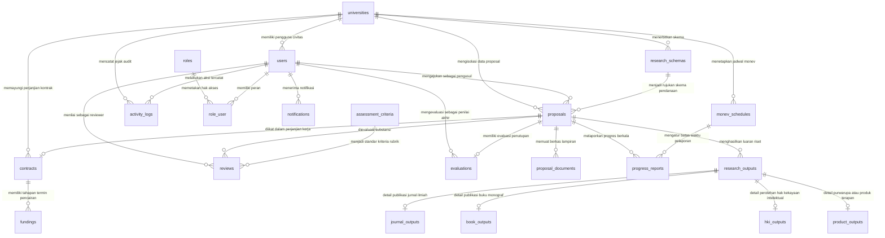

# Kamus Data & Skema Basis Data: Sistem Penelitian Terintegrasi Standalone

## 1. Ikhtisar Basis Data Bersih 21 Tabel

### 1.1 Metadata Dokumen & Status Pembersihan Total Basis Data

- **Nama Dokumen**: Spesifikasi Kamus Data dan Skema Basis Data Relasional (*Clean Database Specification & Data Dictionary*)
- **Versi Rujukan**: 2.0.0-STANDALONE
- **Status Dokumen**: Disetujui (Approved Baseline)
- **Tanggal Efektif**: 15 Oktober 2026
- **Klasifikasi Basis Data**: Relational Database Management System (RDBMS) - MySQL 8.0+ / MariaDB 10.5+ / PostgreSQL 15+
- **Karakter Set & Kolasi Default**: `utf8mb4` dengan kolasi `utf8mb4_unicode_ci` (dukungan penuh teks multibahasa dan simbol ilmiah)
- **Dokumen Referensi Utama**: [Product Requirement Document (PRD) Standalone](../PRD_Sistem_Penelitian_Terintegrasi_Standalone.md) Bab 6 (Kamus Data & ERD)

Dokumentasi ini menetapkan arsitektur basis data relasional mandiri hasil pembersihan total (*clean purge*) dari basis kode gabungan sebelumnya. Seluruh tabel peninggalan modul warisan JurnalMu (seperti `accreditations`, `coaching_periods`, `journal_coaches`, `institutional_evaluations`, `review_rubrics_old`) serta modul Submission System OJS / Kelas G (seperti `articles`, `journals`, `issues`, `submission_files`, `review_assignments`, `copyedits`, `galleys`, `article_authors`) telah dieliminasi secara penuh dari repositori ini.

Hasil proses dekopling ini menghasilkan **21 tabel domain bersih dan mandiri** yang secara khusus dan terisolasi melayani tata kelola 6 fase siklus hidup penelitian Lembaga Penelitian dan Pengabdian kepada Masyarakat (LPPM) perguruan tinggi.

Sistem menerapkan arsitektur *Shared Database, Separate Tenancy* yang mengandalkan kolom kunci `university_id` pada seluruh entitas transaksional institusi, dipadukan dengan penguncian global scope Eloquent (`TenantScope`) untuk menjamin isolasi data mutlak antar-perguruan tinggi tanpa risiko kebocoran data (*data leakage*).

---

### 1.2 Standar Konvensi Penamaan (Naming Conventions)

Untuk memastikan konsistensi kode SQL, migrasi Laravel, serta pemetaan Model Eloquent, sistem menerapkan konvensi penamaan standar berikut:

1. **Penamaan Tabel (Table Names)**:
   - Seluruh nama tabel menggunakan format huruf kecil jamak (*plural snake_case*), seperti `research_schemas`, `proposal_documents`, `journal_outputs`, `progress_reports`, dan `assessment_criteria`.
   - Tabel pivot relasi banyak-ke-banyak (*many-to-many*) menggabungkan nama bentuk tunggal dari kedua entitas secara alfabetis atau hierarkis sesuai standar Laravel, yaitu `role_user`.
2. **Kunci Utama (Primary Key)**:
   - Setiap tabel domain wajib memiliki satu kolom kunci utama bernama `id` dengan tipe data `BIGINT UNSIGNED AUTO_INCREMENT`.
   - Pengecualian berlaku untuk tabel pivot murni `role_user` yang menggunakan kunci komposit utama (*composite primary key*) `(user_id, role_id)`.
3. **Kunci Asing (Foreign Keys)**:
   - Kolom kunci asing pada entitas sistem dan otorisasi menggunakan pola `{tabel_singular}_id` (misalnya `university_id`, `role_id`, `user_id`).
   - Kolom kunci asing pada entitas domain riset menggunakan pola terstandarisasi `id_{tabel_singular}` (misalnya `id_pengusul`, `id_skema_pendanaan`, `id_proposal`, `id_contract`, `id_monev_schedule`, `id_research_output`, `id_evaluator`) untuk memperjelas konteks fungsional entitas dalam domain penelitian.
4. **Pencatatan Waktu (Timestamps)**:
   - Seluruh tabel domain memuat kolom standar `created_at` dan `updated_at` bertipe `TIMESTAMP NULLABLE` yang dikelola secara otomatis oleh framework Eloquent.
5. **Penghapusan Lunak (Soft Deletes)**:
   - Entitas berisiko tinggi dan bernilai audit hukum mengimplementasikan kolom `deleted_at` bertipe `TIMESTAMP NULLABLE` (`universities`, `users`, `contracts`, `fundings`, `research_outputs`) untuk mencegah kehilangan data permanen akibat ketidaksengajaan operator.

---

### 1.3 Standar Tipe Data & Presisi Moneter

1. **Presisi Moneter Mutlak (Monetary Fields)**:
   - Seluruh kolom yang merepresentasikan nominal dana (pagu anggaran skema, usulan anggaran, dana yang disetujui, dan nominal pencairan termin) **WAJIB** menggunakan tipe data `DECIMAL(15,2)`.
   - Penggunaan tipe data `FLOAT` atau `DOUBLE` dilarang keras untuk mencegah galat pembulatan floating-point (*rounding errors*) pada rekonsiliasi keuangan perbankan. Skema `DECIMAL(15,2)` mendukung transaksi hingga Rp999.999.999.999.999,99 (ratusan triliun rupiah) dengan presisi 2 digit sen.
2. **Skor Penilaian & Evaluasi**:
   - Kolor skor penilaian reviewer (`skor_total`), skor monitoring (`skor_monev`), dan skor akhir kelulusan (`skor_akhir_substansi`) menggunakan tipe data `DECIMAL(5,2)` dengan rentang nilai valid 0.00 hingga 100.00.
3. **Persentase Capaian & Kemajuan**:
   - Kolom persentase kemajuan pelaksanaan (`persentase_kemajuan`), persentase pencairan termin (`persentase_dana`), dan capaian luaran (`persentase_capaian_luaran`) menggunakan tipe data `INT UNSIGNED` dengan batas nilai valid 0 hingga 100.
4. **Teks Pendek, Dokumen, dan Penomoran**:
   - Kode institusi, nomor telepon, dan nomor identitas akademik (NIDN) menggunakan `VARCHAR(50)`.
   - Nomor kontrak perjanjian dan nomor Surat Keterangan Tanda Selesai (SKTS) menggunakan `VARCHAR(100)` dengan indeks keunikan (*UNIQUE*).
   - Judul riset, nama skema, nama berkas, jalur URL penyimpanan berkas (*file path*), dan nama naratif menggunakan `VARCHAR(255)`.
5. **Teks Panjang & Narasi Ilmiah**:
   - Catatan evaluasi, catatan revisi, deskripsi skema, dan alamat institusi menggunakan `TEXT`.
   - Naskah abstrak usulan riset, latar belakang komprehensif, dan ringkasan hasil akhir penelitian menggunakan `LONGTEXT` untuk menampung narasi ilmiah panjang tanpa pemotongan karakter (*truncation*).
6. **Data Terstruktur Dinamis (JSON)**:
   - Rubrik penilaian kriteria reviewer (`komponen_penilaian` pada tabel `reviews`) dan metadata notifikasi sistem (`data` pada tabel `notifications`) menggunakan tipe data native `JSON` untuk fleksibilitas skema tanpa mengubah struktur fisik tabel.
7. **Tanggal & Siklus Waktu**:
   - Periode batas awal dan batas akhir skema, tanggal pengajuan proposal, tanggal penandatanganan kontrak, dan tanggal pencairan dana menggunakan tipe data `DATE` (`YYYY-MM-DD`).
   - Riwayat audit dan kejadian sistem menggunakan `TIMESTAMP` (`YYYY-MM-DD HH:MM:SS`).
8. **Status Mesin State (Enumeration)**:
   - Transisi status siklus hidup proposal, review, kontrak, pencairan dana, laporan kemajuan, verifikasi luaran, dan evaluasi akhir diikat secara kaku menggunakan tipe data `ENUM` pada level mesin basis data.

---

## 2. Diagram Relasi Entitas Komprehensif (Mermaid ERD)

### 2.1 Diagram Relasi Seluruh 21 Tabel Basis Data

Diagram relasi entitas berikut memetakan keterhubungan struktural antara entitas multi-tenancy, autentikasi pengguna, 6 modul fungsional siklus hidup riset, serta hierarki tabel turunan luaran penelitian.



---

### 2.2 Penjelasan Topologi Relasi & Kardinalitas

Topologi relasi basis data Sistem Penelitian Terintegrasi Standalone disusun berdasarkan prinsip integritas referensial dan pembagian domain fungsional:

1. **Topologi Multi-Tenancy Institusi**:
   - Entitas `universities` berperan sebagai akar (*root tenant*) bagi seluruh data operasional kampus. Setiap universitas memiliki relasi satu-ke-banyak (*one-to-many*, `1:N`) terhadap `users`, `research_schemas`, `proposals`, `contracts`, `monev_schedules`, dan `activity_logs`.
   - Data antar-universitas terisolasi secara logis pada level basis data melalui keberadaan kolom `university_id`.
2. **Topologi Otorisasi Multi-Peran**:
   - Entitas `users` terhubung dengan entitas `roles` melalui tabel pivot perantara `role_user` dengan kardinalitas banyak-ke-banyak (*many-to-many*, `M:N`).
   - Setiap pengguna dapat mengemban lebih dari satu peran (misalnya seorang dosen dapat menjadi `Peneliti` sekaligus `Reviewer` pada proposal yang berbeda), sementara kolom `role_id` pada tabel `users` dipertahankan sebagai peran utama (*primary role*) demi kompatibilitas seeder dan rute legacy.
3. **Topologi Aliran Siklus Hidup Penelitian (Fase 1 hingga Fase 6)**:
   - **Skema ke Usulan (1:N)**: Satu `research_schemas` dapat menaungi banyak `proposals`. Penghapusan skema dilarang (`RESTRICT`) jika telah memiliki usulan terkait.
   - **Usulan ke Dokumen (1:N)**: Satu `proposals` dapat memiliki banyak `proposal_documents` (dokumen proposal utama, surat pernyataan, dan dokumen pendukung). Penghapusan usulan akan menghapus seluruh berkas dokumen secara beruntun (`CASCADE`).
   - **Usulan ke Penilaian Peer-Review (1:N)**: Satu `proposals` dapat dinilai oleh 1 hingga 2 reviewer independen yang tercatat pada baris terpisah di tabel `reviews`.
   - **Usulan ke Kontrak (1:1)**: Satu `proposals` yang berstatus `Lolos_Didanai` tepat memiliki 1 (satu) entitas `contracts`. Relasi ini ditegakkan dengan batasan keunikan (*UNIQUE constraint*) pada kolom `contracts.id_proposal`.
   - **Kontrak ke Pencairan Termin (1:N)**: Satu `contracts` memiliki tepat 2 entitas `fundings` (Termin 1 sebesar 70% dan Termin 2 sebesar 30%).
   - **Jadwal Monev ke Laporan Kemajuan (1:N)**: Satu `monev_schedules` mengatur periode pengunggahan banyak `progress_reports`.
   - **Usulan ke Laporan Kemajuan (1:N)**: Satu `proposals` dapat melaporkan beberapa tahapan kemajuan sesuai jadwal monev institusi.
   - **Usulan ke Evaluasi Akhir (1:1)**: Satu `proposals` tepat memiliki 1 (satu) berkas penutupan pada tabel `evaluations` yang ditandai dengan batasan keunikan (*UNIQUE constraint*) pada `evaluations.id_proposal`.
4. **Topologi Polimorfisme Spesifik Luaran Riset (Class-Table Inheritance)**:
   - Entitas `research_outputs` berfungsi sebagai tabel induk luaran umum yang mencatat metadata proposal, klasifikasi luaran (`tipe_luaran`), status target (`target_status`), dan status verifikasi LPPM (`status_verifikasi`).
   - Rincian spesifik untuk setiap jenis luaran dipisahkan ke dalam 4 tabel anak independen: `journal_outputs`, `book_outputs`, `hki_outputs`, dan `product_outputs`.
   - Hubungan antara tabel induk `research_outputs` dan masing-masing tabel anak ditegakkan secara eksklusif dengan relasi 1:1 melalui batasan keunikan (*UNIQUE constraint*) pada kolom kunci asing `id_research_output`.

---

## 3. Kamus Data Rinci 21 Tabel Bersih (*Clean Database Dictionary*)

Berikut adalah kamus data komprehensif untuk seluruh 21 tabel aplikasi bersih, yang dikelompokkan ke dalam 7 klaster fungsional.

---

### 3.1 Klaster 1: Inti Sistem, Tenancy, Multi-Peran & Audit (6 Tabel)

Klaster ini menangani data master universitas, manajemen pengguna, hak akses berbasis peran, jejak audit aktivitas, serta sistem notifikasi pengguna.

#### 1. Tabel `universities`
- **Fungsi**: Menyimpan master data institusi perguruan tinggi yang terafiliasi sebagai tenant sistem penelitian.
- **Strategi Soft Delete**: Ya (`deleted_at`).

| Nama Kolom | Tipe Data & Panjang | Nullable | Nilai Default | Batasan & Keterangan Fungsional |
|---|---|---|---|---|
| `id` | BIGINT UNSIGNED | Tidak | AUTO_INCREMENT | Kunci utama institusi perguruan tinggi. |
| `name` | VARCHAR(255) | Tidak | - | Nama resmi perguruan tinggi. |
| `code` | VARCHAR(50) | Tidak | - | Kode unik perguruan tinggi (misal: 'UMM', 'UAD', 'UMS'). Bersifat UNIQUE. |
| `address` | TEXT | Ya | NULL | Alamat kantor pusat atau kampus utama perguruan tinggi. |
| `logo` | VARCHAR(255) | Ya | NULL | Jalur penyimpanan berkas logo universitas untuk kop surat dan antarmuka. |
| `contact_email` | VARCHAR(255) | Ya | NULL | Alamat surel resmi institusi untuk korespondensi administratif. |
| `created_at` | TIMESTAMP | Ya | NULL | Waktu pembuatan rekaman data universitas. |
| `updated_at` | TIMESTAMP | Ya | NULL | Waktu pembaruan rekaman data universitas. |
| `deleted_at` | TIMESTAMP | Ya | NULL | Penanda waktu penghapusan lunak (soft delete). |

---

#### 2. Tabel `roles`
- **Fungsi**: Menyimpan referensi peran otorisasi pengguna dalam sistem (RBAC).
- **Nilai Baku Default**: `Super Admin`, `Admin Kampus`, `Admin Keuangan`, `Reviewer`, `Peneliti`.

| Nama Kolom | Tipe Data & Panjang | Nullable | Nilai Default | Batasan & Keterangan Fungsional |
|---|---|---|---|---|
| `id` | BIGINT UNSIGNED | Tidak | AUTO_INCREMENT | Kunci utama identitas peran. |
| `name` | VARCHAR(100) | Tidak | - | Nama unik peran sistem. Bersifat UNIQUE. |
| `guard_name` | VARCHAR(50) | Tidak | 'web' | Nama pengawal otentikasi Laravel (default 'web'). |
| `display_name` | VARCHAR(255) | Ya | NULL | Label penamaan peran ramah pengguna untuk tampilan visual. |
| `description` | TEXT | Ya | NULL | Penjelasan ruang lingkup kewenangan peran dalam sistem. |
| `created_at` | TIMESTAMP | Ya | NULL | Waktu registrasi peran. |
| `updated_at` | TIMESTAMP | Ya | NULL | Waktu modifikasi peran. |

---

#### 3. Tabel `users`
- **Fungsi**: Menyimpan kredensial otentikasi dan profil akademik civitas akademika seluruh universitas tenant.
- **Strategi Soft Delete**: Ya (`deleted_at`).

| Nama Kolom | Tipe Data & Panjang | Nullable | Nilai Default | Batasan & Keterangan Fungsional |
|---|---|---|---|---|
| `id` | BIGINT UNSIGNED | Tidak | AUTO_INCREMENT | Kunci utama pengguna civitas. |
| `university_id` | BIGINT UNSIGNED | Ya | NULL | Kunci asing ke `universities.id`. ON DELETE SET NULL. Induk isolasi tenant. |
| `role_id` | BIGINT UNSIGNED | Ya | NULL | Kunci asing ke `roles.id`. ON DELETE SET NULL. Peran primer (legacy compatibility). |
| `name` | VARCHAR(255) | Tidak | - | Nama lengkap pengguna beserta gelar akademik. |
| `email` | VARCHAR(255) | Tidak | - | Alamat surel pengguna untuk proses login. Bersifat UNIQUE. |
| `email_verified_at` | TIMESTAMP | Ya | NULL | Waktu verifikasi alamat surel. |
| `password` | VARCHAR(255) | Tidak | - | Hash sandi akun pengguna (Bcrypt / Argon2id). |
| `nidn` | VARCHAR(50) | Ya | NULL | Nomor Induk Dosen Nasional (khusus pengguna dosen/peneliti). |
| `phone` | VARCHAR(50) | Ya | NULL | Nomor kontak WhatsApp atau seluler aktif untuk koordinasi darurat. |
| `faculty` | VARCHAR(150) | Ya | NULL | Nama fakultas penugasan dosen di universitas terkait. |
| `study_program` | VARCHAR(150) | Ya | NULL | Nama program studi homebase dosen di universitas terkait. |
| `avatar_url` | VARCHAR(255) | Ya | NULL | Jalur penyimpanan berkas foto profil pengguna. |
| `is_active` | BOOLEAN | Tidak | TRUE | Status keaktifan akun pengguna (TRUE: Aktif, FALSE: Dinonaktifkan). |
| `is_reviewer` | BOOLEAN | Tidak | FALSE | Penanda eksplisit kualifikasi dosen sebagai reviewer bersertifikasi. |
| `last_login_at` | TIMESTAMP | Ya | NULL | Jejak waktu pencatatan aktivitas login terakhir pengguna ke dalam sistem. |
| `remember_token` | VARCHAR(100) | Ya | NULL | Token sesi login berulang (Remember Me). |
| `created_at` | TIMESTAMP | Ya | NULL | Waktu pembuatan akun pengguna. |
| `updated_at` | TIMESTAMP | Ya | NULL | Waktu pembaruan data pengguna. |
| `deleted_at` | TIMESTAMP | Ya | NULL | Penanda waktu penghapusan lunak (soft delete). |

---

#### 4. Tabel `role_user`
- **Fungsi**: Tabel pivot pemetaan relasi banyak-ke-banyak (*many-to-many*) antara pengguna dan peran yang diemban.
- **Kunci Utama Komposit**: `(user_id, role_id)`.

| Nama Kolom | Tipe Data & Panjang | Nullable | Nilai Default | Batasan & Keterangan Fungsional |
|---|---|---|---|---|
| `user_id` | BIGINT UNSIGNED | Tidak | - | Kunci asing ke `users.id`. ON DELETE CASCADE. Bagian dari komposit primary key. |
| `role_id` | BIGINT UNSIGNED | Tidak | - | Kunci asing ke `roles.id`. ON DELETE CASCADE. Bagian dari komposit primary key. |
| `assigned_at` | TIMESTAMP | Ya | NULL | Waktu penugasan peran kepada pengguna. |
| `assigned_by` | BIGINT UNSIGNED | Ya | NULL | Kunci asing ke `users.id` administrator yang memberikan peran. ON DELETE SET NULL. |

---

#### 5. Tabel `activity_logs`
- **Fungsi**: Menyimpan jejak audit sistem (*audit trail*) atas setiap aksi administratif dan transaksional pengguna.

| Nama Kolom | Tipe Data & Panjang | Nullable | Nilai Default | Batasan & Keterangan Fungsional |
|---|---|---|---|---|
| `id` | BIGINT UNSIGNED | Tidak | AUTO_INCREMENT | Kunci utama rekaman jejak aktivitas audit. |
| `user_id` | BIGINT UNSIGNED | Ya | NULL | Kunci asing ke `users.id`. ON DELETE SET NULL (jejak audit tidak boleh hilang). |
| `university_id` | BIGINT UNSIGNED | Ya | NULL | Kunci asing ke `universities.id`. ON DELETE SET NULL. Isolasi log tenant. |
| `activity` | TEXT | Tidak | - | Uraian naratif tindakan yang dilakukan (misal: "Mengubah status usulan ID 45"). |
| `ip_address` | VARCHAR(45) | Ya | NULL | Alamat protokol internet klien (mendukung format IPv4 dan IPv6). |
| `user_agent` | TEXT | Ya | NULL | Informasi identitas peramban web dan sistem operasi pengguna. |
| `created_at` | TIMESTAMP | Ya | NULL | Waktu eksekusi tindakan tercatat. |
| `updated_at` | TIMESTAMP | Ya | NULL | Waktu pembaruan rekaman audit (jika ada). |

---

#### 6. Tabel `notifications`
- **Fungsi**: Menyimpan notifikasi pesan internal sistem kepada pengguna terkait progres usulan dan tugas peninjauan.

| Nama Kolom | Tipe Data & Panjang | Nullable | Nilai Default | Batasan & Keterangan Fungsional |
|---|---|---|---|---|
| `id` | BIGINT UNSIGNED | Tidak | AUTO_INCREMENT | Kunci utama rekaman notifikasi. |
| `user_id` | BIGINT UNSIGNED | Tidak | - | Kunci asing ke `users.id`. ON DELETE CASCADE. Pengguna penerima notifikasi. |
| `title` | VARCHAR(255) | Tidak | - | Judul ringkas subjek notifikasi. |
| `message` | TEXT | Tidak | - | Rincian lengkap pesan pengumuman atau instruksi tindak lanjut. |
| `data` | JSON | Ya | NULL | Payload terstruktur (misal URL tujuan: `{"url": "/proposals/12", "id": 12}`). |
| `is_read` | BOOLEAN | Tidak | FALSE | Status keterbacaan pesan (FALSE: Belum dibaca, TRUE: Sudah dibaca). |
| `created_at` | TIMESTAMP | Ya | NULL | Waktu pengiriman notifikasi. |
| `updated_at` | TIMESTAMP | Ya | NULL | Waktu pembaruan status notifikasi. |

---

### 3.2 Klaster 2: Modul 1 - Pengelolaan Skema & Proposal Riset (3 Tabel)

Klaster ini menangani penerbitan skema pendanaan hibah oleh LPPM, pengajuan berkas usulan riset dosen, serta pengunggahan dokumen lampiran proposal berformat PDF.

#### 7. Tabel `research_schemas`
- **Fungsi**: Menyimpan konfigurasi skema pendanaan penelitian tahunan yang diterbitkan oleh LPPM universitas.

| Nama Kolom | Tipe Data & Panjang | Nullable | Nilai Default | Batasan & Keterangan Fungsional |
|---|---|---|---|---|
| `id` | BIGINT UNSIGNED | Tidak | AUTO_INCREMENT | Kunci utama skema pendanaan riset. |
| `university_id` | BIGINT UNSIGNED | Tidak | - | Kunci asing ke `universities.id`. ON DELETE CASCADE. Isolasi skema milik tenant. |
| `nama_skema` | VARCHAR(255) | Tidak | - | Nama skema hibah (misal: 'Penelitian Dasar Dosen Pemula 2026'). |
| `deskripsi` | TEXT | Ya | NULL | Penjelasan tujuan, sasaran penerima, dan luaran yang diharapkan dari skema. |
| `biaya_maksimal` | DECIMAL(15,2) | Tidak | 0.00 | Batas maksimal pagu pendanaan yang dapat diusulkan oleh dosen pengusul. |
| `tanggal_mulai` | DATE | Tidak | - | Tanggal awal pembukaan periode pengajuan usulan proposal. |
| `tanggal_selesai` | DATE | Tidak | - | Tanggal batas akhir penutupan pengajuan usulan proposal (*submission deadline*). |
| `file_panduan` | VARCHAR(255) | Ya | NULL | Jalur penyimpanan berkas panduan pelaksanaan hibah format PDF. |
| `is_active` | BOOLEAN | Tidak | TRUE | Status keaktifan skema (TRUE: Terbuka untuk usulan, FALSE: Ditutup/Arsip). |
| `created_at` | TIMESTAMP | Ya | NULL | Waktu publikasi skema hibah. |
| `updated_at` | TIMESTAMP | Ya | NULL | Waktu pembaruan informasi skema hibah. |

---

#### 8. Tabel `proposals`
- **Fungsi**: Entitas transaksi inti yang mencatat usulan penelitian yang diajukan oleh dosen pengusul.
- **Daftar Nilai State `status_proposal`**:
  - `Draft`: Usulan sedang disusun oleh dosen dan belum dikirimkan secara resmi ke LPPM.
  - `Submitted`: Usulan telah diajukan secara resmi dan berkas dikunci dari proses penyuntingan dosen.
  - `Administrasi_Valid`: Berkas lolos verifikasi kelayakan administratif LPPM dan siap diplot ke reviewer.
  - `Ditolak`: Usulan gugur pada tahap evaluasi kelayakan administratif atau penilaian substansi.
  - `Lolos_Didanai`: Usulan disetujui untuk didanai dan berhak melangkah ke penerbitan kontrak riset.

| Nama Kolom | Tipe Data & Panjang | Nullable | Nilai Default | Batasan & Keterangan Fungsional |
|---|---|---|---|---|
| `id` | BIGINT UNSIGNED | Tidak | AUTO_INCREMENT | Kunci utama usulan penelitian. |
| `university_id` | BIGINT UNSIGNED | Tidak | - | Kunci asing ke `universities.id`. ON DELETE CASCADE. Isolasi data tenant. |
| `id_pengusul` | BIGINT UNSIGNED | Tidak | - | Kunci asing ke `users.id`. ON DELETE CASCADE. Dosen ketua tim pengusul riset. |
| `id_skema_pendanaan`| BIGINT UNSIGNED | Tidak | - | Kunci asing ke `research_schemas.id`. ON DELETE RESTRICT (skema aktif dilarang dihapus). |
| `judul_penelitian` | VARCHAR(255) | Tidak | - | Judul usulan penelitian ilmiah yang diajukan. |
| `abstrak` | TEXT | Tidak | - | Ringkasan eksekutif latar belakang, metode, dan target penelitian. |
| `latar_belakang` | LONGTEXT | Ya | NULL | Uraian lengkap landasan teori, roadmap, dan metodologi pelaksanaan riset. |
| `biaya_yang_diusulkan`| DECIMAL(15,2)| Tidak | 0.00 | Total anggaran biaya yang diajukan oleh peneliti dalam Rencana Anggaran Biaya (RAB). |
| `status_proposal` | ENUM | Tidak | 'Draft' | State proposal: 'Draft', 'Submitted', 'Administrasi_Valid', 'Ditolak', 'Lolos_Didanai'. |
| `catatan_administrasi`| TEXT | Ya | NULL | Catatan telaah administratif oleh operator LPPM (alasan perbaikan/penolakan berkas). |
| `tanggal_pengajuan` | DATE | Ya | NULL | Tanggal resmi saat pengusul menekan tombol submit usulan riset. |
| `created_at` | TIMESTAMP | Ya | NULL | Waktu pembuatan draf usulan penelitian. |
| `updated_at` | TIMESTAMP | Ya | NULL | Waktu modifikasi terakhir rekaman proposal. |

---

#### 9. Tabel `proposal_documents`
- **Fungsi**: Menyimpan metadata berkas lampiran pendukung usulan penelitian (format PDF, ukuran maks 10MB).
- **Daftar Nilai `tipe_dokumen`**: `Proposal_Utama`, `Surat_Pernyataan`, `Lampiran`.

| Nama Kolom | Tipe Data & Panjang | Nullable | Nilai Default | Batasan & Keterangan Fungsional |
|---|---|---|---|---|
| `id` | BIGINT UNSIGNED | Tidak | AUTO_INCREMENT | Kunci utama rekaman dokumen berkas. |
| `id_proposal` | BIGINT UNSIGNED | Tidak | - | Kunci asing ke `proposals.id`. ON DELETE CASCADE. Induk usulan penelitian. |
| `nama_file` | VARCHAR(255) | Tidak | - | Nama asli berkas dokumen saat diunggah oleh pengusul. |
| `file_path` | VARCHAR(255) | Tidak | - | Jalur relatif penyimpanan berkas PDF pada storage privat sistem. |
| `file_size` | BIGINT UNSIGNED | Tidak | - | Ukuran fisik berkas dalam satuan byte (maksimal 10.485.760 byte atau 10MB). |
| `tipe_dokumen` | ENUM | Tidak | 'Proposal_Utama' | Kategori berkas: 'Proposal_Utama', 'Surat_Pernyataan', 'Lampiran'. |
| `created_at` | TIMESTAMP | Ya | NULL | Waktu pengunggahan berkas. |
| `updated_at` | TIMESTAMP | Ya | NULL | Waktu pembaruan berkas. |

---

### 3.3 Klaster 3: Modul 2 - Seleksi Kriteria & Penilaian Peer-Review (2 Tabel)

Klaster ini menangani instrumen rubrik penilaian berbobot dan penugasan penilai ahli (*peer-review*) untuk mengevaluasi usulan riset yang lolos seleksi administratif.

#### 10. Tabel `assessment_criteria`
- **Fungsi**: Menyimpan master data butir-butir rubrik kriteria evaluasi substansi yang ditetapkan oleh LPPM.

| Nama Kolom | Tipe Data & Panjang | Nullable | Nilai Default | Batasan & Keterangan Fungsional |
|---|---|---|---|---|
| `id` | BIGINT UNSIGNED | Tidak | AUTO_INCREMENT | Kunci utama butir kriteria penilaian. |
| `nama_kriteria` | VARCHAR(255) | Tidak | - | Judul kriteria penilaian (misal: 'Kebaruan & Orisinalitas', 'Kesesuaian Roadmap'). |
| `bobot` | INT UNSIGNED | Tidak | - | Persentase bobot kriteria dalam skala 1 - 100 (total seluruh kriteria = 100). |
| `deskripsi` | TEXT | Ya | NULL | Panduan indikator deskriptor bagi reviewer dalam menentukan rentang skor. |
| `urutan` | INT UNSIGNED | Tidak | 1 | Urutan tata letak tampilan butir kriteria pada formulir penilaian reviewer. |
| `created_at` | TIMESTAMP | Ya | NULL | Waktu registrasi butir kriteria rubrik. |
| `updated_at` | TIMESTAMP | Ya | NULL | Waktu pembaruan butir kriteria rubrik. |

---

#### 11. Tabel `reviews`
- **Fungsi**: Menyimpan penugasan reviewer dan lembar hasil penilaian substansi usulan riset.
- **Daftar Nilai State `status_review`**:
  - `Assigned`: Penilai telah ditunjuk oleh LPPM dan periode penilaian telah dibuka.
  - `In_Progress`: Penilai telah membuka berkas dan mulai mengisikan draf skor rubrik kriteria.
  - `Completed`: Penilaian final telah dikunci dan diserahkan secara resmi ke LPPM.
- **Daftar Nilai `keputusan_rekomendasi`**: `Diterima`, `Ditolak`, `Revisi`.

| Nama Kolom | Tipe Data & Panjang | Nullable | Nilai Default | Batasan & Keterangan Fungsional |
|---|---|---|---|---|
| `id` | BIGINT UNSIGNED | Tidak | AUTO_INCREMENT | Kunci utama rekaman penugasan telaah review. |
| `id_proposal` | BIGINT UNSIGNED | Tidak | - | Kunci asing ke `proposals.id`. ON DELETE CASCADE. Usulan riset yang dinilai. |
| `id_reviewer` | BIGINT UNSIGNED | Tidak | - | Kunci asing ke `users.id`. ON DELETE CASCADE. Dosen yang bertindak sebagai penilai. |
| `tanggal_mulai_review` | DATE | Tidak | - | Batas awal reviewer diperkenankan mengakses berkas dan memberi skor. |
| `tanggal_selesai_review`| DATE | Tidak | - | Batas tenggat akhir penyerahan hasil telaah (*review deadline*). |
| `komponen_penilaian` | JSON | Ya | NULL | Rincian skor butir kriteria rubrik format JSON (misal `{"1": 85, "2": 90, "3": 80}`). |
| `skor_total` | DECIMAL(5,2) | Tidak | 0.00 | Skor akumulasi berbobot hasil kalkulasi rubrik (rentang skala 0.00 hingga 100.00). |
| `catatan_evaluasi` | TEXT | Ya | NULL | Uraian masukan kualitatif, kritik metodologi, dan saran penyempurnaan riset. |
| `keputusan_rekomendasi`| ENUM | Ya | NULL | Rekomendasi penilai: 'Diterima', 'Ditolak', 'Revisi'. |
| `status_review` | ENUM | Tidak | 'Assigned' | State review: 'Assigned', 'In_Progress', 'Completed'. |
| `created_at` | TIMESTAMP | Ya | NULL | Waktu penunjukan reviewer oleh operator LPPM. |
| `updated_at` | TIMESTAMP | Ya | NULL | Waktu pembaruan rekaman evaluasi telaah. |

---

### 3.4 Klaster 4: Modul 3 - Kontrak Penelitian & Pendanaan Bertahap (2 Tabel)

Klaster ini menangani pembuatan surat perjanjian kerja/kontrak penelitian bagi usulan yang disetujui didanai, serta pembagian jadwal pencairan dana bertahap (Termin 1: 70% dan Termin 2: 30%).

#### 12. Tabel `contracts`
- **Fungsi**: Menyimpan dokumen kontrak perjanjian kerja penelitian berpenomoran unik institusional.
- **Strategi Soft Delete**: Ya (`deleted_at`).
- **Kardinalitas Proposal**: 1:1 terhadap `proposals` (`id_proposal` UNIQUE).
- **Daftar Nilai State `status_kontrak`**:
  - `Draft`: Draf kontrak baru diterbitkan dan menunggu verifikasi kelengkapan berkas.
  - `Signed`: Kontrak telah ditandatangani oleh kedua belah pihak (Ketua LPPM & Ketua Peneliti).
  - `Active`: Riset sedang berjalan aktif dan tahap pembiayaan termin telah dimulai.
  - `Closed`: Seluruh kewajiban riset selesai dan SKTS telah diterbitkan.

| Nama Kolom | Tipe Data & Panjang | Nullable | Nilai Default | Batasan & Keterangan Fungsional |
|---|---|---|---|---|
| `id` | BIGINT UNSIGNED | Tidak | AUTO_INCREMENT | Kunci utama rekaman kontrak penelitian. |
| `university_id` | BIGINT UNSIGNED | Tidak | - | Kunci asing ke `universities.id`. ON DELETE CASCADE. Isolasi data tenant. |
| `id_proposal` | BIGINT UNSIGNED | Tidak | - | Kunci asing ke `proposals.id`. ON DELETE CASCADE. Bersifat UNIQUE (1:1). |
| `nomor_kontrak` | VARCHAR(100) | Tidak | - | Nomor resmi surat perjanjian kontrak institusi. Bersifat UNIQUE. |
| `judul_kontrak` | VARCHAR(255) | Tidak | - | Judul perjanjian penugasan pelaksanaan penelitian. |
| `dana_disetujui` | DECIMAL(15,2) | Tidak | - | Total alokasi dana final yang disetujui pasca-penyesuaian anggaran. |
| `tanggal_kontrak` | DATE | Tidak | - | Tanggal resmi penandatanganan surat perjanjian kerja. |
| `file_dokumen_kontrak`| VARCHAR(255) | Ya | NULL | Jalur penyimpanan berkas dokumen kontrak tertandatangani format PDF. |
| `status_kontrak` | ENUM | Tidak | 'Draft' | State kontrak: 'Draft', 'Signed', 'Active', 'Closed'. |
| `created_at` | TIMESTAMP | Ya | NULL | Waktu penerbitan draf kontrak. |
| `updated_at` | TIMESTAMP | Ya | NULL | Waktu pembaruan rekaman kontrak. |
| `deleted_at` | TIMESTAMP | Ya | NULL | Penanda waktu penghapusan lunak (soft delete). |

---

#### 13. Tabel `fundings`
- **Fungsi**: Menyimpan rincian tahapan termin pencairan dana hibah penelitian beserta bukti transfer perbankan.
- **Strategi Soft Delete**: Ya (`deleted_at`).
- **Ketentuan Alokasi Termin**: Termin 1 = 70% dari `dana_disetujui`, Termin 2 = 30% dari `dana_disetujui`.
- **Daftar Nilai State `status_pencairan`**:
  - `Pending`: Termin pendanaan dijadwalkan namun belum diproses oleh bagian keuangan.
  - `Disbursed`: Dana telah ditransfer oleh Admin Keuangan dan bukti transfer diunggah.
  - `Verified`: Peneliti telah mengonfirmasi penerimaan dana pada rekening operasional riset.

| Nama Kolom | Tipe Data & Panjang | Nullable | Nilai Default | Batasan & Keterangan Fungsional |
|---|---|---|---|---|
| `id` | BIGINT UNSIGNED | Tidak | AUTO_INCREMENT | Kunci utama rekaman termin pendanaan. |
| `id_contract` | BIGINT UNSIGNED | Tidak | - | Kunci asing ke `contracts.id`. ON DELETE CASCADE. Induk kontrak penelitian. |
| `termin_ke` | INT UNSIGNED | Tidak | - | Urutan termin pencairan (1 untuk Termin Pertama, 2 untuk Termin Kedua). |
| `persentase_dana` | INT UNSIGNED | Tidak | - | Persentase nominal termin terhadap kontrak (70 untuk Termin 1, 30 untuk Termin 2). |
| `nominal_dana` | DECIMAL(15,2) | Tidak | - | Nilai moneter riil yang dicairkan dalam Rupiah (`dana_disetujui * persentase / 100`). |
| `tanggal_pencairan` | DATE | Ya | NULL | Tanggal riil saat proses transfer perbankan dieksekusi. |
| `bukti_transfer_path`| VARCHAR(255) | Ya | NULL | Jalur penyimpanan berkas bukti transfer bank resmi format PDF/JPG/PNG. |
| `status_pencairan` | ENUM | Tidak | 'Pending' | State pencairan: 'Pending', 'Disbursed', 'Verified'. |
| `catatan_keuangan` | TEXT | Ya | NULL | Catatan rincian transfer atau informasi rekening bank penerima dari staf keuangan. |
| `created_at` | TIMESTAMP | Ya | NULL | Waktu pembuatan jadwal termin pendanaan. |
| `updated_at` | TIMESTAMP | Ya | NULL | Waktu pembaruan status pencairan termin. |
| `deleted_at` | TIMESTAMP | Ya | NULL | Penanda waktu penghapusan lunak (soft delete). |

---

### 3.5 Klaster 5: Modul 4 - Monitoring dan Evaluasi (Monev) Pelaksanaan (2 Tabel)

Klaster ini menangani penjadwalan periode monev berkala oleh LPPM, pengunggahan laporan kemajuan riset, pencatatan logbook aktivitas harian, serta penerapan mekanisme gerbang pengunci monev (*Monev Gatekeeper Lock*).

#### 14. Tabel `monev_schedules`
- **Fungsi**: Menyimpan penetapan periode pelaksanaan monitoring dan evaluasi kemajuan riset oleh LPPM.

| Nama Kolom | Tipe Data & Panjang | Nullable | Nilai Default | Batasan & Keterangan Fungsional |
|---|---|---|---|---|
| `id` | BIGINT UNSIGNED | Tidak | AUTO_INCREMENT | Kunci utama jadwal monev. |
| `university_id` | BIGINT UNSIGNED | Tidak | - | Kunci asing ke `universities.id`. ON DELETE CASCADE. Isolasi jadwal tenant. |
| `nama_tahap` | VARCHAR(255) | Tidak | - | Nama tahapan monev (misal: 'Monev Tengah Tahun Anggaran 2026'). |
| `tanggal_mulai` | DATE | Tidak | - | Tanggal awal pembukaan akses pengunggahan berkas laporan kemajuan. |
| `tanggal_selesai` | DATE | Tidak | - | Tanggal batas akhir penyerahan berkas laporan kemajuan (*monev deadline*). |
| `deskripsi` | TEXT | Ya | NULL | Petunjuk teknis pelaksanaan monev dan berkas yang wajib disertakan. |
| `is_active` | BOOLEAN | Tidak | TRUE | Status keaktifan jadwal (TRUE: Aktif/Terbuka, FALSE: Berakhir/Terkunci). |
| `created_at` | TIMESTAMP | Ya | NULL | Waktu pembuatan jadwal monev. |
| `updated_at` | TIMESTAMP | Ya | NULL | Waktu pembaruan jadwal monev. |

---

#### 15. Tabel `progress_reports`
- **Fungsi**: Menyimpan berkas laporan kemajuan, catatan kendala, berkas logbook aktivitas, dan skor penilaian monev.
- **Daftar Nilai State `status_laporan`**:
  - `Submitted`: Peneliti telah menyerahkan laporan kemajuan dan logbook sebelum tenggat jadwal.
  - `Approved`: Reviewer monev telah menilai dan menyetujui laporan kemajuan (membuka kunci pencairan Termin 2).
  - `Revision`: Laporan kemajuan memerlukan perbaikan dokumen substansi sebelum disetujui.

| Nama Kolom | Tipe Data & Panjang | Nullable | Nilai Default | Batasan & Keterangan Fungsional |
|---|---|---|---|---|
| `id` | BIGINT UNSIGNED | Tidak | AUTO_INCREMENT | Kunci utama rekaman laporan kemajuan riset. |
| `id_proposal` | BIGINT UNSIGNED | Tidak | - | Kunci asing ke `proposals.id`. ON DELETE CASCADE. Usulan riset yang dilaporkan. |
| `id_monev_schedule`| BIGINT UNSIGNED | Tidak | - | Kunci asing ke `monev_schedules.id`. ON DELETE RESTRICT (jadwal aktif dilarang dihapus). |
| `persentase_kemajuan`| INT UNSIGNED | Tidak | 0 | Estimasi persentase kemajuan pelaksanaan riil di lapangan (skala 1 - 100). |
| `ringkasan_progres` | TEXT | Tidak | - | Uraian naratif aktivitas penelitian yang telah berhasil diselesaikan hingga tahap ini. |
| `catatan_kendala` | TEXT | Ya | NULL | Penjelasan tantangan teknis, pengadaan instrumen, atau kendala lapangan. |
| `file_laporan_kemajuan`| VARCHAR(255)| Tidak | - | Jalur penyimpanan berkas naskah laporan kemajuan format PDF. |
| `file_logbook` | VARCHAR(255) | Ya | NULL | Jalur penyimpanan berkas catatan harian aktivitas riset (*logbook*) format PDF. |
| `skor_monev` | DECIMAL(5,2) | Ya | NULL | Skor evaluasi hasil visitasi atau telaah oleh reviewer monev (skala 0.00 - 100.00). |
| `catatan_reviewer_monev`| TEXT | Ya | NULL | Rekomendasi perbaikan atau arahan tindak lanjut pelaksanaan riset dari penilai monev. |
| `status_laporan` | ENUM | Tidak | 'Submitted' | State laporan: 'Submitted', 'Approved', 'Revision'. |
| `created_at` | TIMESTAMP | Ya | NULL | Waktu penyerahan berkas laporan kemajuan. |
| `updated_at` | TIMESTAMP | Ya | NULL | Waktu evaluasi atau pembaruan status laporan kemajuan. |

---

### 3.6 Klaster 6: Modul 5 - Pelaporan & Validasi Luaran Ilmiah (5 Tabel)

Klaster ini menangani pencatatan dan validasi luaran penelitian terklasifikasi (jurnal ilmiah, buku ber-ISBN, sertifikat HKI, dan produk teknologi terapan) menggunakan arsitektur tabel induk-anak (*Class-Table Inheritance*).

#### 16. Tabel `research_outputs` (Tabel Induk Luaran)
- **Fungsi**: Menyimpan metadata umum klasifikasi luaran penelitian, target kewajiban, dan status verifikasi oleh LPPM.
- **Strategi Soft Delete**: Ya (`deleted_at`).
- **Daftar Nilai `tipe_luaran`**: `Journal`, `Book`, `Hki`, `Product`.
- **Daftar Nilai `target_status`**: `Wajib` (syarat mutlak kelulusan riset), `Tambahan` (capaian ekstra).
- **Daftar Nilai State `status_verifikasi`**:
  - `Draft`: Luaran dicatat oleh peneliti dan berkas lampiran belum lengkap.
  - `Submitted`: Luaran telah diajukan ke LPPM untuk diverifikasi bukti fisiknya.
  - `Verified`: Bukti fisik dan substansi luaran telah disahkan valid oleh tim verifikator LPPM.
  - `Rejected`: Luaran ditolak karena ketidaksesuaian klaim, duplikasi, atau bukti tidak absah.

| Nama Kolom | Tipe Data & Panjang | Nullable | Nilai Default | Batasan & Keterangan Fungsional |
|---|---|---|---|---|
| `id` | BIGINT UNSIGNED | Tidak | AUTO_INCREMENT | Kunci utama rekaman luaran penelitian. |
| `id_proposal` | BIGINT UNSIGNED | Tidak | - | Kunci asing ke `proposals.id`. ON DELETE CASCADE. Induk usulan riset. |
| `tipe_luaran` | ENUM | Tidak | - | Klasifikasi tipe: 'Journal', 'Book', 'Hki', 'Product'. |
| `target_status` | ENUM | Tidak | 'Wajib' | Status target pemenuhan: 'Wajib', 'Tambahan'. |
| `status_verifikasi`| ENUM | Tidak | 'Draft' | State verifikasi: 'Draft', 'Submitted', 'Verified', 'Rejected'. |
| `catatan_verifikasi`| TEXT | Ya | NULL | Masukan hasil penelaahan bukti fisik oleh verifikator luaran LPPM. |
| `tanggal_pelaporan`| DATE | Ya | NULL | Tanggal resmi luaran dilaporkan oleh peneliti ke dalam sistem. |
| `created_at` | TIMESTAMP | Ya | NULL | Waktu pendaftaran luaran riset. |
| `updated_at` | TIMESTAMP | Ya | NULL | Waktu verifikasi atau modifikasi luaran riset. |
| `deleted_at` | TIMESTAMP | Ya | NULL | Penanda waktu penghapusan lunak (soft delete). |

---

#### 17. Tabel `journal_outputs` (Tabel Anak: Artikel Jurnal Ilmiah)
- **Fungsi**: Menyimpan detail spesifik publikasi naskah artikel pada berkala ilmiah / jurnal bereputasi.
- **Kardinalitas**: 1:1 terhadap `research_outputs` (`id_research_output` UNIQUE).
- **Daftar Nilai `indeksasi`**: `Scopus`, `Sinta_1`, `Sinta_2`, `Sinta_3`, `Sinta_4`, `Internasional`, `Nasional`.
- **Daftar Nilai `status_publikasi`**: `Submitted`, `Accepted`, `Published`.

| Nama Kolom | Tipe Data & Panjang | Nullable | Nilai Default | Batasan & Keterangan Fungsional |
|---|---|---|---|---|
| `id` | BIGINT UNSIGNED | Tidak | AUTO_INCREMENT | Kunci utama detail artikel jurnal. |
| `id_research_output`| BIGINT UNSIGNED | Tidak | - | Kunci asing ke `research_outputs.id`. ON DELETE CASCADE. Bersifat UNIQUE. |
| `nama_jurnal` | VARCHAR(255) | Tidak | - | Nama lengkap penerbit berkala ilmiah / jurnal ilmiah. |
| `judul_artikel` | VARCHAR(255) | Tidak | - | Judul lengkap artikel ilmiah yang diterbitkan. |
| `issn` | VARCHAR(50) | Ya | NULL | International Standard Serial Number jurnal (p-ISSN atau e-ISSN). |
| `indeksasi` | ENUM | Tidak | - | Basis pengindeksan reputasi: 'Scopus', 'Sinta_1' s.d. 'Sinta_4', 'Internasional', 'Nasional'. |
| `status_publikasi`| ENUM | Tidak | 'Submitted' | State penerbitan: 'Submitted', 'Accepted', 'Published'. |
| `doi_url` | VARCHAR(255) | Ya | NULL | Tautan pengenal objek digital resmi (Digital Object Identifier) artikel jurnal. |
| `file_artikel_path`| VARCHAR(255) | Ya | NULL | Jalur penyimpanan berkas salinan naskah / naskah akhir format PDF. |
| `created_at` | TIMESTAMP | Ya | NULL | Waktu perekaman rincian jurnal. |
| `updated_at` | TIMESTAMP | Ya | NULL | Waktu pembaruan status publikasi artikel. |

---

#### 18. Tabel `book_outputs` (Tabel Anak: Buku Ilmiah / Monograf)
- **Fungsi**: Menyimpan detail spesifik penerbitan buku monograf, buku referensi, atau buku teks ber-ISBN.
- **Kardinalitas**: 1:1 terhadap `research_outputs` (`id_research_output` UNIQUE).

| Nama Kolom | Tipe Data & Panjang | Nullable | Nilai Default | Batasan & Keterangan Fungsional |
|---|---|---|---|---|
| `id` | BIGINT UNSIGNED | Tidak | AUTO_INCREMENT | Kunci utama detail publikasi buku. |
| `id_research_output`| BIGINT UNSIGNED | Tidak | - | Kunci asing ke `research_outputs.id`. ON DELETE CASCADE. Bersifat UNIQUE. |
| `judul_buku` | VARCHAR(255) | Tidak | - | Judul lengkap buku hasil penelitian yang diterbitkan. |
| `isbn` | VARCHAR(50) | Tidak | - | International Standard Book Number resmi terbitan perpusnas. |
| `penerbit` | VARCHAR(255) | Tidak | - | Nama lembaga penerbit buku resmi (*publisher*). |
| `tahun_terbit` | YEAR | Tidak | - | Tahun kalender penerbitan buku ilmiah (format YYYY). |
| `jumlah_halaman` | INT UNSIGNED | Ya | NULL | Total jumlah halaman isi buku yang diterbitkan. |
| `file_cover_path` | VARCHAR(255) | Ya | NULL | Jalur penyimpanan berkas pemindaian sampul depan dan halaman hak cipta format PDF/JPG. |
| `created_at` | TIMESTAMP | Ya | NULL | Waktu perekaman rincian buku. |
| `updated_at` | TIMESTAMP | Ya | NULL | Waktu pembaruan rekaman buku. |

---

#### 19. Tabel `hki_outputs` (Tabel Anak: Hak Kekayaan Intelektual)
- **Fungsi**: Menyimpan detail spesifik pendaftaran hak cipta, paten, atau desain industri hasil riset.
- **Kardinalitas**: 1:1 terhadap `research_outputs` (`id_research_output` UNIQUE).
- **Daftar Nilai `jenis_hki`**: `Hak_Cipta`, `Paten`, `Desain_Industri`.

| Nama Kolom | Tipe Data & Panjang | Nullable | Nilai Default | Batasan & Keterangan Fungsional |
|---|---|---|---|---|
| `id` | BIGINT UNSIGNED | Tidak | AUTO_INCREMENT | Kunci utama detail kekayaan intelektual. |
| `id_research_output`| BIGINT UNSIGNED | Tidak | - | Kunci asing ke `research_outputs.id`. ON DELETE CASCADE. Bersifat UNIQUE. |
| `judul_ciptaan` | VARCHAR(255) | Tidak | - | Nama karya cipta atau judul invensi teknologi yang dilindungi. |
| `jenis_hki` | ENUM | Tidak | - | Kategori hak kekayaan intelektual: 'Hak_Cipta', 'Paten', 'Desain_Industri'. |
| `nomor_pendaftaran`| VARCHAR(100)| Ya | NULL | Nomor agenda pendaftaran permohonan ke DJKI Kemenkumham RI. |
| `nomor_sertifikat` | VARCHAR(100)| Ya | NULL | Nomor surat pencatatan ciptaan atau nomor sertifikat paten yang diterbitkan. |
| `file_sertifikat_path`| VARCHAR(255)| Ya | NULL | Jalur penyimpanan berkas pindaian sertifikat resmi DJKI format PDF. |
| `created_at` | TIMESTAMP | Ya | NULL | Waktu perekaman rincian HKI. |
| `updated_at` | TIMESTAMP | Ya | NULL | Waktu pembaruan status perolehan sertifikat HKI. |

---

#### 20. Tabel `product_outputs` (Tabel Anak: Produk Teknologi / Purwarupa)
- **Fungsi**: Menyimpan detail purwarupa teruji (*prototype*), rekayasa sistem, atau produk inovasi bernilai komersial.
- **Kardinalitas**: 1:1 terhadap `research_outputs` (`id_research_output` UNIQUE).

| Nama Kolom | Tipe Data & Panjang | Nullable | Nilai Default | Batasan & Keterangan Fungsional |
|---|---|---|---|---|
| `id` | BIGINT UNSIGNED | Tidak | AUTO_INCREMENT | Kunci utama detail produk inovasi. |
| `id_research_output`| BIGINT UNSIGNED | Tidak | - | Kunci asing ke `research_outputs.id`. ON DELETE CASCADE. Bersifat UNIQUE. |
| `nama_produk` | VARCHAR(255) | Tidak | - | Nama komersial atau sebutan teknis produk inovasi yang dihasilkan. |
| `deskripsi_produk` | TEXT | Tidak | - | Uraian spesifikasi teknis, fungsi operasional, dan keunggulan produk. |
| `tingkat_kesiapan_teknologi`| INT UNSIGNED| Tidak| 1 | Indikator Technology Readiness Level / TKT (skala 1 sampai 9). |
| `dokumentasi_produk_path`| VARCHAR(255)| Ya | NULL | Jalur penyimpanan berkas laporan uji coba atau dokumentasi visual produk format PDF. |
| `created_at` | TIMESTAMP | Ya | NULL | Waktu perekaman rincian produk inovasi. |
| `updated_at` | TIMESTAMP | Ya | NULL | Waktu pembaruan status purwarupa. |

---

### 3.7 Klaster 7: Modul 6 - Evaluasi Akhir Penelitian & SKTS (1 Tabel)

Klaster ini menangani penilaian komprehensif atas laporan akhir 100%, verifikasi seluruh luaran wajib, penentuan status kelulusan penelitian, serta penerbitan Surat Keterangan Tanda Selesai (SKTS) berpenomoran unik institusi yang mengunci berkas menjadi arsip baca-saja (*Read-Only Archive*).

#### 21. Tabel `evaluations`
- **Fungsi**: Menyimpan evaluasi akhir penutupan penelitian dan metadata penerbitan surat tanda selesai (SKTS).
- **Kardinalitas Proposal**: 1:1 terhadap `proposals` (`id_proposal` UNIQUE).
- **Daftar Nilai `rekomendasi_kelulusan`**: `Lulus_Memuaskan`, `Lulus_Cukup`, `Tidak_Lulus`.
- **Daftar Nilai State `status_penelitian`**:
  - `Dalam_Evaluasi`: Berkas laporan akhir sedang ditinjau oleh evaluator penutupan LPPM.
  - `Selesai`: Penelitian dinyatakan lulus, SKTS diterbitkan, dan seluruh berkas dikunci secara permanen.
  - `Gagal`: Penelitian tidak memenuhi target luaran wajib atau batas waktu yang ditentukan.

| Nama Kolom | Tipe Data & Panjang | Nullable | Nilai Default | Batasan & Keterangan Fungsional |
|---|---|---|---|---|
| `id` | BIGINT UNSIGNED | Tidak | AUTO_INCREMENT | Kunci utama rekaman evaluasi penutupan riset. |
| `id_proposal` | BIGINT UNSIGNED | Tidak | - | Kunci asing ke `proposals.id`. ON DELETE CASCADE. Bersifat UNIQUE (1:1). |
| `id_evaluator` | BIGINT UNSIGNED | Ya | NULL | Kunci asing ke `users.id`. ON DELETE SET NULL. Dosen penilai akhir dari LPPM. |
| `file_laporan_akhir`| VARCHAR(255) | Tidak | - | Jalur penyimpanan berkas naskah laporan akhir penelitian 100% format PDF. |
| `ringkasan_hasil` | LONGTEXT | Tidak | - | Uraian eksekutif komprehensif mengenai temuan ilmiah, kontribusi, dan kesimpulan. |
| `persentase_capaian_luaran`| INT UNSIGNED| Tidak| 0 | Persentase pemenuhan luaran wajib dan tambahan (skala 0 - 100). |
| `skor_akhir_substansi`| DECIMAL(5,2)| Tidak | 0.00 | Skor penilaian akhir gabungan laporan dan luaran (skala 0.00 - 100.00). |
| `rekomendasi_kelulusan`| ENUM | Ya | NULL | Putusan kelulusan: 'Lulus_Memuaskan', 'Lulus_Cukup', 'Tidak_Lulus'. |
| `nomor_skts` | VARCHAR(100) | Ya | NULL | Nomor resmi Surat Keterangan Tanda Selesai institusi. Bersifat UNIQUE. |
| `file_skts_path` | VARCHAR(255) | Ya | NULL | Jalur penyimpanan berkas sertifikat SKTS berstempel digital resmi format PDF. |
| `status_penelitian`| ENUM | Tidak | 'Dalam_Evaluasi' | State akhir: 'Dalam_Evaluasi', 'Selesai', 'Gagal'. |
| `created_at` | TIMESTAMP | Ya | NULL | Waktu penyerahan laporan akhir oleh peneliti. |
| `updated_at` | TIMESTAMP | Ya | NULL | Waktu pengesahan kelulusan dan penerbitan nomor SKTS. |

---

## 4. Strategi Kunci Asing, Batasan Integritas, & Indeks

### 4.1 Matriks Aturan Aksi Kunci Asing (*Foreign Key Action Matrix*)

Integritas referensial antar-tabel dalam Sistem Penelitian Terintegrasi Standalone diatur menggunakan tiga aksi kunci asing eksplisit: `CASCADE`, `RESTRICT`, dan `SET NULL`. Pemilihan aksi disesuaikan dengan derajat dependensi data dan perlindungan hukum atas data audit.

| Tabel Asal (Child) | Kolom Kunci Asing | Tabel Rujukan (Parent) | Kolom Induk | Aksi onDelete | Rasional Desain Arsitektural |
|---|---|---|---|---|---|
| `users` | `university_id` | `universities` | `id` | `SET NULL` | Mencegah terhapusnya akun peneliti jika tenant universitas diarsipkan/dinonaktifkan secara administratif. |
| `users` | `role_id` | `roles` | `id` | `SET NULL` | Menjaga integritas akun pengguna jika referensi peran primer sistem mengalami reorganisasi. |
| `role_user` | `user_id` | `users` | `id` | `CASCADE` | Hak akses pengguna wajib dihapus secara otomatis jika akun pengguna dihapus permanen. |
| `role_user` | `role_id` | `roles` | `id` | `CASCADE` | Pemetaan peran pada seluruh pengguna wajib terhapus jika suatu definisi peran dihapus. |
| `role_user` | `assigned_by` | `users` | `id` | `SET NULL` | Rekaman pemberian peran tetap dipertahankan meskipun administrator yang memberi peran telah dihapus. |
| `activity_logs` | `user_id` | `users` | `id` | `SET NULL` | Jejak audit kepatuhan hukum (*compliance trail*) tidak boleh terhapus meski akun pengguna telah dihapus. |
| `activity_logs` | `university_id` | `universities` | `id` | `SET NULL` | Rekaman log historis institusi dipertahankan untuk kebutuhan audit forensik. |
| `notifications` | `user_id` | `users` | `id` | `CASCADE` | Notifikasi pribadi milik pengguna terhapus otomatis saat akun pengguna dihapus. |
| `research_schemas`| `university_id` | `universities` | `id` | `CASCADE` | Skema hibah dihapus beruntun jika entitas universitas induk dihapus dari sistem. |
| `proposals` | `university_id` | `universities` | `id` | `CASCADE` | Seluruh arsip usulan tenant terhapus beruntun jika universitas induk dihapus. |
| `proposals` | `id_pengusul` | `users` | `id` | `CASCADE` | Usulan yang melekat langsung pada dosen terhapus jika akun ketua peneliti dihapus. |
| `proposals` | `id_skema_pendanaan`| `research_schemas` | `id` | `RESTRICT` | **DILARANG MENGHAPUS SKEMA** jika sudah memiliki rekaman proposal aktif untuk mencegah proposal yatim (*orphan data*). |
| `proposal_documents`| `id_proposal` | `proposals` | `id` | `CASCADE` | Dokumen lampiran berkas terhapus otomatis saat rekaman usulan proposal dihapus. |
| `reviews` | `id_proposal` | `proposals` | `id` | `CASCADE` | Rekaman telaah reviewer terhapus otomatis jika proposal induk dihapus. |
| `reviews` | `id_reviewer` | `users` | `id` | `CASCADE` | Penugasan review terhapus otomatis jika akun reviewer yang bersangkutan dihapus. |
| `contracts` | `university_id` | `universities` | `id` | `CASCADE` | Rekaman kontrak tenant terhapus beruntun jika universitas induk dihapus. |
| `contracts` | `id_proposal` | `proposals` | `id` | `CASCADE` | Rekaman kontrak perjanjian kerja terhapus otomatis saat proposal induk dihapus. |
| `fundings` | `id_contract` | `contracts` | `id` | `CASCADE` | Seluruh termin pencairan dana terhapus beruntun saat rekaman kontrak induk dihapus. |
| `monev_schedules` | `university_id` | `universities` | `id` | `CASCADE` | Jadwal monev tenant terhapus beruntun jika universitas induk dihapus. |
| `progress_reports`| `id_proposal` | `proposals` | `id` | `CASCADE` | Rekaman laporan kemajuan terhapus beruntun saat proposal penelitian induk dihapus. |
| `progress_reports`| `id_monev_schedule`| `monev_schedules`| `id` | `RESTRICT` | **DILARANG MENGHAPUS JADWAL MONEV** jika telah terdapat laporan kemajuan dosen yang merujuknya. |
| `research_outputs`| `id_proposal` | `proposals` | `id` | `CASCADE` | Seluruh luaran penelitian terhapus beruntun jika rekaman proposal induk dihapus. |
| `journal_outputs` | `id_research_output`| `research_outputs`| `id` | `CASCADE` | Rincian artikel jurnal terhapus beruntun jika rekaman induk luaran dihapus. |
| `book_outputs` | `id_research_output`| `research_outputs`| `id` | `CASCADE` | Rincian buku monograf terhapus beruntun jika rekaman induk luaran dihapus. |
| `hki_outputs` | `id_research_output`| `research_outputs`| `id` | `CASCADE` | Rincian kekayaan intelektual terhapus beruntun jika rekaman induk luaran dihapus. |
| `product_outputs` | `id_research_output`| `research_outputs`| `id` | `CASCADE` | Rincian purwarupa/produk terhapus beruntun jika rekaman induk luaran dihapus. |
| `evaluations` | `id_proposal` | `proposals` | `id` | `CASCADE` | Rekaman evaluasi penutupan terhapus beruntun saat proposal penelitian dihapus. |
| `evaluations` | `id_evaluator` | `users` | `id` | `SET NULL` | Rekaman evaluasi akhir dan status SKTS tetap sah tersimpan meskipun evaluator keluar/dihapus. |

---

### 4.2 Batasan Keunikan (*Unique Constraints & Integrity Rules*)

Batasan keunikan ditegakkan secara ketat pada mesin basis data untuk menjamin validitas hukum penomoran dokumen resmi serta mencegah tabrakan data:

1. **Keunikan Identitas Global Institusi**:
   - `universities.code` (UNIQUE): Kode universitas wajib unik secara global (misal: 'UMM', 'UAD') untuk memastikan rute subdomain atau penanda tenant tidak berbenturan.
2. **Keunikan Autentikasi Pengguna**:
   - `users.email` (UNIQUE): Alamat surel wajib unik untuk keperluan identitas otentikasi login tunggal.
   - `roles.name` (UNIQUE): Nama peran sistem tidak boleh mengalami duplikasi.
3. **Keunikan Dokumen Perjanjian Hukum & Sertifikasi**:
   - `contracts.nomor_kontrak` (UNIQUE): Nomor registrasi kontrak perjanjian penelitian wajib unik dalam lingkup nasional untuk mencegah duplikasi pembiayaan hibah ganda.
   - `evaluations.nomor_skts` (UNIQUE): Nomor Surat Keterangan Tanda Selesai wajib unik untuk menjamin keaslian sertifikasi kelulusan riset dosen.
4. **Keunikan Kardinalitas Relasi 1:1**:
   - `contracts.id_proposal` (UNIQUE): Satu usulan proposal penelitian hanya diperbolehkan memiliki tepat satu kontrak induk pendanaan.
   - `evaluations.id_proposal` (UNIQUE): Satu usulan proposal penelitian hanya diperbolehkan memiliki tepat satu berkas evaluasi akhir dan SKTS.
   - `journal_outputs.id_research_output` (UNIQUE): Satu baris luaran bertipe jurnal hanya memiliki satu rincian metadata artikel.
   - `book_outputs.id_research_output` (UNIQUE): Satu baris luaran bertipe buku hanya memiliki satu rincian metadata buku.
   - `hki_outputs.id_research_output` (UNIQUE): Satu baris luaran bertipe HKI hanya memiliki satu rincian metadata kekayaan intelektual.
   - `product_outputs.id_research_output` (UNIQUE): Satu baris luaran bertipe produk hanya memiliki satu rincian metadata purwarupa.
5. **Kunci Komposit Pencegah Duplikasi Peran**:
   - `role_user(user_id, role_id)` (PRIMARY KEY): Mencegah penetapan peran yang sama berulang kali kepada pengguna yang sama.

---

### 4.3 Strategi Pengindeksan & Komposit Indeks Performa

Untuk menjamin waktu respons query tetap optimal (*latency < 100ms*) pada beban kueri multi-tenant ribuan proposal, sistem mengimplementasikan komposit indeks berkinerja tinggi:

1. **Komposit Indeks Filter Multi-Tenant Proposal**:
   - **Indeks**: `idx_proposals_tenant_status` pada `proposals (university_id, status_proposal)`
   - **Rasional**: Kueri pada dasbor LPPM dan daftar pengajuan peneliti selalu memfilter data berdasarkan tenant universitas dan menyaring status usulan (misal: mengambil seluruh usulan berstatus `Submitted` pada kampus ID 3). Komposit indeks ini mengeliminasi pemindaian tabel penuh (*full table scan*).
2. **Komposit Indeks Penjaga Gerbang Monev (*Monev Gatekeeper*)**:
   - **Indeks**: `idx_progress_reports_proposal_status` pada `progress_reports (id_proposal, status_laporan)`
   - **Rasional**: Sebelum mengeksekusi pencairan dana Termin 2 (30%), modul keuangan selalu memvalidasi apakah laporan kemajuan proposal berstatus `Approved`. Indeks ini mempercepat validasi kondisi prasyarat secara instan.
3. **Komposit Indeks Skema & Jadwal Aktif Tenant**:
   - **Indeks**: `idx_research_schemas_tenant_active` pada `research_schemas (university_id, is_active)`
   - **Indeks**: `idx_monev_schedules_tenant_active` pada `monev_schedules (university_id, is_active)`
   - **Rasional**: Mempercepat perenderan dropdown formulir dan filter katalog skema hibah yang sedang membuka pendaftaran usulan aktif.
4. **Komposit Indeks Plotting Reviewer**:
   - **Indeks**: `idx_reviews_proposal_reviewer` pada `reviews (id_proposal, id_reviewer)`
   - **Rasional**: Digunakan oleh logika validasi *Conflict of Interest Guard* dan controller plotting untuk memverifikasi penugasan ganda secara instan.
5. **Komposit Indeks Jadwal Termin Pencairan**:
   - **Indeks**: `idx_fundings_contract_termin` pada `fundings (id_contract, termin_ke)`
   - **Rasional**: Menjamin pengurutan dan pencarian cepat data tahapan pencairan dana Termin 1 versus Termin 2 pada rincian kontrak.
6. **Komposit Indeks Verifikasi Luaran Wajib**:
   - **Indeks**: `idx_research_outputs_prop_tipe_target` pada `research_outputs (id_proposal, tipe_luaran, target_status, status_verifikasi)`
   - **Rasional**: Mempercepat komputasi evaluasi akhir kelulusan riset (Modul 6) untuk memeriksa apakah minimal 1 luaran `Wajib` telah berstatus `Verified`.

---

## 5. Pemetaan Model Eloquent & Accessors

### 5.1 Struktur & Registrasi 21 Kelas Model Eloquent

Seluruh 21 tabel aplikasi bersih dipetakan ke dalam kelas Model Eloquent pada direktori `app/Models/`. Setiap model mengimplementasikan trait standar keamanan, audit, dan casting atribut.

| No | Nama Tabel Basis Data | Nama Berkas Model Eloquent | Trait Utama yang Digunakan |
|---|---|---|---|
| 1 | `universities` | `app/Models/University.php` | `HasFactory`, `SoftDeletes` |
| 2 | `roles` | `app/Models/Role.php` | `HasFactory` |
| 3 | `users` | `app/Models/User.php` | `HasFactory`, `Notifiable`, `SoftDeletes` |
| 4 | `role_user` | Dikelola via relasi `User::roles()` / `RoleUser` | Eloquent Pivot |
| 5 | `activity_logs` | `app/Models/ActivityLog.php` | `HasFactory` |
| 6 | `notifications` | `app/Models/Notification.php` | `HasFactory` (Inherit DatabaseNotification) |
| 7 | `research_schemas` | `app/Models/ResearchSchema.php` | `HasFactory` |
| 8 | `proposals` | `app/Models/Proposal.php` | `HasFactory` |
| 9 | `proposal_documents`| `app/Models/ProposalDocument.php` | `HasFactory` |
| 10 | `assessment_criteria`| `app/Models/AssessmentCriteria.php` | `HasFactory` |
| 11 | `reviews` | `app/Models/Review.php` | `HasFactory` |
| 12 | `contracts` | `app/Models/Contract.php` | `HasFactory`, `SoftDeletes` |
| 13 | `fundings` | `app/Models/Funding.php` | `HasFactory`, `SoftDeletes` |
| 14 | `monev_schedules` | `app/Models/MonevSchedule.php` | `HasFactory` |
| 15 | `progress_reports` | `app/Models/ProgressReport.php` | `HasFactory` |
| 16 | `research_outputs` | `app/Models/ResearchOutput.php` | `HasFactory`, `SoftDeletes` |
| 17 | `journal_outputs` | `app/Models/JournalOutput.php` | `HasFactory` |
| 18 | `book_outputs` | `app/Models/BookOutput.php` | `HasFactory` |
| 19 | `hki_outputs` | `app/Models/HkiOutput.php` | `HasFactory` |
| 20 | `product_outputs` | `app/Models/ProductOutput.php` | `HasFactory` |
| 21 | `evaluations` | `app/Models/Evaluation.php` | `HasFactory` |

---

### 5.2 Peta Relasi Model (*Eloquent Relationship Mapping*)

Tabel berikut merangkum seluruh metode relasi Eloquent yang menghubungkan model domain:

| Model Utama | Nama Method Relasi | Jenis Relasi Eloquent | Model Target | Kunci Asing (FK) | Kunci Lokal (PK) |
|---|---|---|---|---|---|
| `University` | `users()` | `hasMany` | `User` | `university_id` | `id` |
| `University` | `researchSchemas()` | `hasMany` | `ResearchSchema` | `university_id` | `id` |
| `University` | `proposals()` | `hasMany` | `Proposal` | `university_id` | `id` |
| `University` | `contracts()` | `hasMany` | `Contract` | `university_id` | `id` |
| `University` | `monevSchedules()` | `hasMany` | `MonevSchedule` | `university_id` | `id` |
| `User` | `university()` | `belongsTo` | `University` | `university_id` | `id` |
| `User` | `role()` | `belongsTo` | `Role` | `role_id` | `id` |
| `User` | `roles()` | `belongsToMany` | `Role` | `user_id` / `role_id` | `id` |
| `User` | `proposals()` | `hasMany` | `Proposal` | `id_pengusul` | `id` |
| `User` | `reviews()` | `hasMany` | `Review` | `id_reviewer` | `id` |
| `User` | `evaluations()` | `hasMany` | `Evaluation` | `id_evaluator` | `id` |
| `ResearchSchema` | `university()` | `belongsTo` | `University` | `university_id` | `id` |
| `ResearchSchema` | `proposals()` | `hasMany` | `Proposal` | `id_skema_pendanaan` | `id` |
| `Proposal` | `university()` | `belongsTo` | `University` | `university_id` | `id` |
| `Proposal` | `pengusul()` / `user()` | `belongsTo` | `User` | `id_pengusul` | `id` |
| `Proposal` | `schema()` | `belongsTo` | `ResearchSchema` | `id_skema_pendanaan` | `id` |
| `Proposal` | `documents()` | `hasMany` | `ProposalDocument` | `id_proposal` | `id` |
| `Proposal` | `reviews()` | `hasMany` | `Review` | `id_proposal` | `id` |
| `Proposal` | `contract()` | `hasOne` | `Contract` | `id_proposal` | `id` |
| `Proposal` | `progressReports()` | `hasMany` | `ProgressReport` | `id_proposal` | `id` |
| `Proposal` | `researchOutputs()` | `hasMany` | `ResearchOutput` | `id_proposal` | `id` |
| `Proposal` | `evaluation()` | `hasOne` | `Evaluation` | `id_proposal` | `id` |
| `ProposalDocument`| `proposal()` | `belongsTo` | `Proposal` | `id_proposal` | `id` |
| `Review` | `proposal()` | `belongsTo` | `Proposal` | `id_proposal` | `id` |
| `Review` | `reviewer()` | `belongsTo` | `User` | `id_reviewer` | `id` |
| `Contract` | `university()` | `belongsTo` | `University` | `university_id` | `id` |
| `Contract` | `proposal()` | `belongsTo` | `Proposal` | `id_proposal` | `id` |
| `Contract` | `fundings()` | `hasMany` | `Funding` | `id_contract` | `id` |
| `Funding` | `contract()` | `belongsTo` | `Contract` | `id_contract` | `id` |
| `MonevSchedule` | `university()` | `belongsTo` | `University` | `university_id` | `id` |
| `MonevSchedule` | `progressReports()` | `hasMany` | `ProgressReport` | `id_monev_schedule` | `id` |
| `ProgressReport`| `proposal()` | `belongsTo` | `Proposal` | `id_proposal` | `id` |
| `ProgressReport`| `monevSchedule()` | `belongsTo` | `MonevSchedule` | `id_monev_schedule` | `id` |
| `ResearchOutput`| `proposal()` | `belongsTo` | `Proposal` | `id_proposal` | `id` |
| `ResearchOutput`| `journalOutput()` | `hasOne` | `JournalOutput` | `id_research_output`| `id` |
| `ResearchOutput`| `bookOutput()` | `hasOne` | `BookOutput` | `id_research_output`| `id` |
| `ResearchOutput`| `hkiOutput()` | `hasOne` | `HkiOutput` | `id_research_output`| `id` |
| `ResearchOutput`| `productOutput()` | `hasOne` | `ProductOutput` | `id_research_output`| `id` |
| `JournalOutput` | `researchOutput()` | `belongsTo` | `ResearchOutput` | `id_research_output`| `id` |
| `BookOutput` | `researchOutput()` | `belongsTo` | `ResearchOutput` | `id_research_output`| `id` |
| `HkiOutput` | `researchOutput()` | `belongsTo` | `ResearchOutput` | `id_research_output`| `id` |
| `ProductOutput` | `researchOutput()` | `belongsTo` | `ResearchOutput` | `id_research_output`| `id` |
| `Evaluation` | `proposal()` | `belongsTo` | `Proposal` | `id_proposal` | `id` |
| `Evaluation` | `evaluator()` | `belongsTo` | `User` | `id_evaluator` | `id` |

---

### 5.3 Kebijakan Konversi Tipe Data (*Attribute Casting*)

Untuk memastikan tipe data dari basis data terkonversi secara otomatis ke objek PHP native saat diakses melalui Eloquent, seluruh model wajib mendefinisikan array `$casts` atau metode `casts()`:

1. **Konversi JSON Otomatis**:
   - `Review::$casts`: `'komponen_penilaian' => 'array'` (mengonversi skor rubrik kriteria JSON menjadi PHP associative array secara otomatis).
   - `Notification::$casts`: `'data' => 'array'` (mengonversi payload metadata notifikasi menjadi array PHP).
2. **Konversi Presisi Desimal (Moneter & Skor)**:
   - `ResearchSchema::$casts`: `'biaya_maksimal' => 'decimal:2'`
   - `Proposal::$casts`: `'biaya_yang_diusulkan' => 'decimal:2'`
   - `Review::$casts`: `'skor_total' => 'decimal:2'`
   - `Contract::$casts`: `'dana_disetujui' => 'decimal:2'`
   - `Funding::$casts`: `'nominal_dana' => 'decimal:2'`
   - `ProgressReport::$casts`: `'skor_monev' => 'decimal:2'`
   - `Evaluation::$casts`: `'skor_akhir_substansi' => 'decimal:2'`
3. **Konversi Tanggal & Waktu**:
   - `ResearchSchema::$casts`: `'tanggal_mulai' => 'date'`, `'tanggal_selesai' => 'date'`
   - `Proposal::$casts`: `'tanggal_pengajuan' => 'date'`
   - `Review::$casts`: `'tanggal_mulai_review' => 'date'`, `'tanggal_selesai_review' => 'date'`
   - `Contract::$casts`: `'tanggal_kontrak' => 'date'`
   - `Funding::$casts`: `'tanggal_pencairan' => 'date'`
   - `MonevSchedule::$casts`: `'tanggal_mulai' => 'date'`, `'tanggal_selesai' => 'date'`
   - `ResearchOutput::$casts`: `'tanggal_pelaporan' => 'date'`
4. **Konversi Boolean**:
   - `User::$casts`: `'is_active' => 'boolean'`, `'is_reviewer' => 'boolean'`
   - `Notification::$casts`: `'is_read' => 'boolean'`
   - `ResearchSchema::$casts`: `'is_active' => 'boolean'`
   - `MonevSchedule::$casts`: `'is_active' => 'boolean'`

---

### 5.4 Accessor, Mutator & Dukungan Keselarasan Modul (*Backward Compatibility*)

Sesuai aturan arsitektur sistem (Project Rule 3 dan Rule 5 pada `.agents/AGENTS.md`), jika terdapat perbedaan antara penamaan kolom fisik basis data dengan kebutuhan komponen antarmuka React pada modul lain, pengembang **WAJIB** menambahkan alias virtual menggunakan Eloquent Accessors (`$appends` dan getter methods) daripada merombak total migrasi database.

Contoh implementasi standar accessor pada model Eloquent:

#### 1. Format Mata Uang Rupiah Terstandarisasi
Menyediakan format teks rupiah yang siap disajikan langsung pada antarmuka pengguna tanpa pergeseran layout (*zero CLS*):

```php
// Pada Contract.php
public function getDanaDisetujuiRupiahAttribute(): string
{
    return 'Rp ' . number_format((float) $this->dana_disetujui, 0, ',', '.');
}

// Pada Funding.php
public function getNominalDanaRupiahAttribute(): string
{
    return 'Rp ' . number_format((float) $this->nominal_dana, 0, ',', '.');
}

// Pada Proposal.php
public function getBiayaDiusulkanRupiahAttribute(): string
{
    return 'Rp ' . number_format((float) $this->biaya_yang_diusulkan, 0, ',', '.');
}
```

#### 2. Format Tanggal Indonesia
Menyediakan representasi tanggal ramah pengguna dalam Bahasa Indonesia baku (contoh: "15 Oktober 2026"):

```php
// Pada Contract.php
public function getTanggalKontrakFormattedAttribute(): string
{
    return \Carbon\Carbon::parse($this->tanggal_kontrak)->translatedFormat('d F Y');
}
```

#### 3. Alias Penyelarasan Frontend (Penyelarasan Bahasa Kolom)
Menjaga kompatibilitas antara komponen antarmuka yang membaca properti berbahasa Inggris atau Indonesia:

```php
// Pada Proposal.php
protected $appends = [
    'title',
    'biaya_diusulkan_rupiah',
];

public function getTitleAttribute(): ?string
{
    return $this->judul_penelitian;
}

public function setTitleAttribute(?string $value): void
{
    $this->attributes['judul_penelitian'] = $value;
}
```

#### 4. Pemetaan Lencana Status & Warna Visual
Menyediakan label deskriptif dan token warna lencana (*badge color*) yang siap dirender pada komponen React:

```php
// Pada Proposal.php
public function getStatusLabelAttribute(): string
{
    return match ($this->status_proposal) {
        'Draft' => 'Draf Usulan',
        'Submitted' => 'Diajukan ke LPPM',
        'Administrasi_Valid' => 'Lolos Administrasi',
        'Ditolak' => 'Ditolak',
        'Lolos_Didanai' => 'Disetujui Didanai',
        default => $this->status_proposal,
    };
}

public function getStatusColorAttribute(): string
{
    return match ($this->status_proposal) {
        'Draft' => 'slate',
        'Submitted' => 'blue',
        'Administrasi_Valid' => 'indigo',
        'Ditolak' => 'red',
        'Lolos_Didanai' => 'emerald',
        default => 'gray',
    };
}
```
