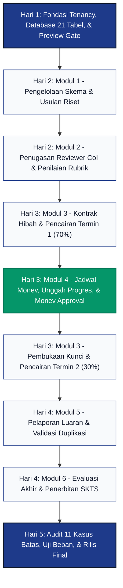

# Tahapan Pengembangan & Roadmap Rilis Sistem (Development Stages)

## 1. Gambaran Umum & Sasaran Rilis 20 Oktober 2026

### 1.1 Visi Penyelesaian Sistem Mandiri (Standalone)
Dokumen ini menetapkan cetak biru tahapan rekayasa perangkat lunak (*engineering stages*) untuk menyelesaikan pembangunan Sistem Penelitian Terintegrasi Multi-Kampus (*Multi-Institution Research Management System* / SIM-Penelitian) hingga siap masuk ke lingkungan produksi (*production-ready*) pada tanggal **20 Oktober 2026 pukul 23.59 WIB**.

Pembangunan sistem mengacu secara utuh pada spesifikasi yang telah dibakukan:
- [PRD Sistem Penelitian Terintegrasi Standalone](../PRD_Sistem_Penelitian_Terintegrasi_Standalone.md)
- [Cetak Biru Arsitektur Sistem](./architecture.md)
- [Kamus Data & Skema Basis Data 21 Tabel](./schema.md)
- [Sistem Desain Antarmuka Hybrid Scholarly Enterprise](./design.md)
- [Aturan Bisnis, Penanganan Kasus Batas, & Keamanan](./rules.md)

### 1.2 Parameter & Batasan Waktu Sprint 5 Hari
- **Tanggal Mulai**: 15 Oktober 2026 (Pukul 08.00 WIB)
- **Tenggat Waktu Rilis Final**: 20 Oktober 2026 (Pukul 23.59 WIB)
- **Durasi Efektif**: 5 Hari Kerja Intensif (120 Jam Siklus Rilis)
- **Strategi Pentahapan**: *Vertical Slice per Siklus Riset* (Opsi 1)
- **Standar Mutu**: Bebas dari Galat Kompilasi (*Zero Compilation Error*), Bebas dari Kebocoran Data Multi-Tenancy, Bebas dari Simbol Emoji (*Strict Zero Emoji Invariant*), dan 100% Lolos Uji Fitur Backend (*PHPUnit Feature Tests*).

---

## 2. Analisis Jalur Kritis & Matriks Ketergantungan Modul

### 2.1 Diagram Ketergantungan Alur Siklus Riset (Critical Path Graph)

Alur pengembangan sistem penelitian bersifat sekuensial dan berantai. Setiap fase memerlukan artefak data yang valid dari fase sebelumnya:

### 2.2 Titik Kritis Penentu Kelulusan (Hard Blockers & Gates)

1. **Design System Preview Gate (Hari 1)**:
   - Pengembang dilarang langsung menyusun layar antarmuka modul riset sebelum seluruh 6 komponen pakai-ulang (`StatusBadge`, `PDFUploader`, `TabularFigure`, `MetricCard`, `PageHeader`, `SplitScreenViewer`) teruji dan terisolasi pada rute `/design-system-preview`.
2. **Conflict of Interest (CoI) Guard (Hari 2)**:
   - Pengalokasian reviewer usulan riset wajib memvalidasi `id_reviewer != id_pengusul` dan menolak reviewer yang tercatat dalam tabel anggota tim usulan (`proposal_members`).
3. **Monev Gatekeeper Lock (Hari 3)**:
   - Endpoint pencairan Termin 2 (`POST /finance/fundings/{id}/disburse`) wajib mengunci dan menolak permintaan (HTTP 422) jika laporan kemajuan Monev terkait belum berstatus `Approved`.
4. **Output Deduplication Guard (Hari 4)**:
   - Pelaporan luaran wajib memvalidasi keunikan nomor registrasi kanonikal (DOI URL, ISBN-10/13, nomor pendaftaran/sertifikat HKI) pada lingkup institusi untuk mencegah klaim luaran ganda.
5. **Read-Only Archive Lock (Hari 4)**:
   - Penerbitan Surat Keterangan Tanda Selesai (SKTS) mengunci permanen seluruh mutasi data proposal, dokumen kontrak, laporan kemajuan, dan luaran menjadi arsip baca-saja.

---

## 3. Rencana Kerja Harian Terperinci (5-Day Vertical Slice Breakdown)

---

### Hari 1: Fondasi Multi-Tenancy, 21 Tabel Bersih, & Design System Preview Gate
**Rentang Waktu**: Kamis, 15 Oktober 2026 (08.00 - 24.00 WIB)

#### 1. Sasaran Utama (Daily Objective)
Membangun fondasi komputasi yang bersih dan stabil mencakup ekosistem multi-kampus (*Shared Database, Separate Tenancy*), pembersihan migrasi warisan OJS/JurnalMu, penyiapan 21 tabel domain penelitian aktif, serta pembuktian sistem desain *Hybrid Scholarly Enterprise* pada halaman katalog pratinjau komponen.

#### 2. Rincian Tugas Backend (Engineering Deliverables)
- **Pembersihan & Migrasi Basis Data**:
  - Mengonfirmasi seluruh 21 tabel domain bersih telah aktif: `universities`, `users`, `roles`, `role_user`, `research_schemas`, `proposals`, `proposal_members`, `proposal_documents`, `reviews`, `contracts`, `fundings`, `monev_schedules`, `progress_reports`, `research_outputs`, `journal_outputs`, `book_outputs`, `hki_outputs`, `product_outputs`, `evaluations`, `notifications`, `activity_logs`.
  - Memastikan seluruh tabel legacy OJS/JurnalMu telah terhapus tanpa meninggalkan jejak *foreign key orphaned*.
- **Model Eloquent & Tenancy Engine**:
  - Memastikan 21 berkas model di `app/Models/` memiliki relasi lengkap, `$casts` tipe data presisi, dan Eloquent Accessors (`$appends`).
  - Mengimplementasikan `App\Models\Scopes\TenantScope` pada entitas tenant-aware (`ResearchSchema`, `Proposal`, `Contract`, `MonevSchedule`).
  - Menerapkan pengecualian bypass global bagi peran `Super Admin`.
- **RBAC Helper & Middleware**:
  - Memastikan `User::hasRole($role)` dan `User::hasAnyRole(array $roles)` memeriksa kolom `role_id` legacy dan relasi pivot `roles()` secara hibrida (Project Rule 3).
  - Mengonfigurasi middleware otentikasi rute `role:XXX` dan `CheckTenantActive`.
- **Database Seeder**:
  - Menyusun `DatabaseSeeder.php` yang menginjeksi 3 tenant universitas contoh, 5 akun pengguna per peran, dan 2 skema riset dasar.

#### 3. Rincian Tugas Frontend (UI/UX Deliverables)
- **Token Desain & Layout Shell**:
  - Mengonfigurasi token warna *Cool Slate* pada Tailwind CSS (`surface-base` #F8FAFC, `surface-card` #FFFFFF, `brand-primary` #1E3A8A, `brand-accent` #059669, `text-primary` #0F172A).
  - Mengonfigurasi kelas tipografi ganda: `font-serif` (Merriweather / Newsreader) dan `font-sans` (Plus Jakarta Sans / Inter).
  - Menyusun shell layout utama `AuthenticatedLayout.tsx` dengan sidebar navigasi responsif bebas emoji (ikon Lucide React 1.5-2.0px stroke).
- **Halaman Katalog Pratinjau Komponen**:
  - Membangun rute internal `GET /design-system-preview` -> `DesignSystemPreview.tsx`.
  - Mengimplementasikan 6 komponen pakai-ulang siap produksi:
    1. `StatusBadge`: Lencana status terstandarisasi untuk 14 state dengan format teks terstruktur `[STATUS]`.
    2. `PDFUploader`: Komponen drag-and-drop khusus PDF dengan batas validasi 10MB (10.485.760 bytes).
    3. `TabularFigure`: Format angka berporos tetap (`tabular-nums`) untuk mata uang Rupiah dan skor nilai desimal.
    4. `MetricCard`: Kartu dasbor bento 12 kolom dengan label editorial dan mikro-ikon semantik.
    5. `PageHeader`: Header halaman terstandarisasi memadukan breadcrumbs, judul serif, dan area CTA.
    6. `SplitScreenViewer`: Kontainer layout terbagi 60% viewer dokumen PDF dan 40% panel aksi interaktif.

#### 4. Gerbang Pengujian Kualitas Hari 1 (Quality Gate)
- Perintah `php artisan migrate:fresh --seed` berjalan 100% tanpa galat foreign key.
- Perintah `npm run build` menyelesaikan kompilasi TypeScript dan Tailwind tanpa galat.
- Rute `/design-system-preview` dapat dirender di peramban dan menampilkan seluruh 6 komponen secara interaktif.
- Audit larangan emoji: regex `[\uD83C-\uDBFF\uDC00-\uDFFF]` menghasilkan 0 kecocokan.

---

### Hari 2: Modul 1 (Skema & Usulan Riset) & Modul 2 (Penugasan Reviewer & Penilaian)
**Rentang Waktu**: Jumat, 16 Oktober 2026 (08.00 - 24.00 WIB)

#### 1. Sasaran Utama (Daily Objective)
Menuntaskan alur hulu siklus penelitian: penerbitan skema hibah oleh LPPM, pengusulan proposal riset multi-langkah oleh dosen peneliti, plotting penilai ahli bebas konflik kepentingan, serta ruang kerja penilaian reviewer berbasis layar terbagi (*split-screen*).

#### 2. Rincian Tugas Backend (Engineering Deliverables)
- **Modul 1: Skema & Usulan Riset**:
  - FormRequest: `StoreSchemaRequest`, `UpdateSchemaRequest`, `StoreProposalRequest`, `UpdateProposalRequest`.
  - Controller: `SchemaController.php` (CRUD skema, filter tenant), `ProposalController.php` (alur usulan, unggah berkas proposal PDF).
  - Validasi Kritis:
    - Pengecekan batas waktu skema aktif: `now() <= schema.tanggal_selesai` (Mencegah *Deadline Race Condition*).
    - Keunikan proposal per dosen per tahun anggaran (`id_user` + `tahun_anggaran` + `judul`).
    - Penguncian draf usulan saat status berubah menjadi `Submitted`.
- **Modul 2: Penugasan & Penilaian Reviewer**:
  - FormRequest: `AssignReviewerRequest`, `StoreReviewScoreRequest`.
  - Controller: `Admin/AssignController.php` (plotting 1-2 reviewer per proposal), `Reviewer/ReviewController.php` (evaluasi rubrik kriteria).
  - Validasi Kritis:
    - *Conflict of Interest Guard*: Membatalkan penugasan jika `id_reviewer == id_pengusul` atau reviewer terdaftar di `proposal_members`.
    - Rubrik skor berbobot skala 0 - 100 yang disimpan dalam kolom `kriteria_penilaian` berformat JSON.
    - Kalkulasi disparitas skor: memicu peringatan `[DISCREPANCY WARNING]` jika selisih nilai antar-reviewer > 30 poin, serta alur penunjukan reviewer ke-3 (*tie-breaker*).
    - Penetapan keputusan akhir oleh LPPM: `Lolos_Didanai`, `Revisi`, atau `Ditolak`.

#### 3. Rincian Tugas Frontend (UI/UX Deliverables)
- **Antarmuka Modul 1 (Dosen & LPPM)**:
  - Halaman LPPM: `Admin/Schema/Index.tsx`, `Admin/Schema/CreateEditModal.tsx`.
  - Dasbor Dosen: `Dashboard/Researcher.tsx` (bento-grid 12 kolom dengan ringkasan status proposal aktif).
  - Linear Wizard Dosen: `Proposal/Wizard.tsx` (alur 4 langkah: Identitas Usulan -> Anggota Tim Dosen -> Rincian Anggaran Biaya Tabular -> Unggah Berkas Proposal PDF via `PDFUploader`).
  - Fitur Formulir: Tombol submit terkunci saat `processing === true`, perlindungan `isDirty` saat navigasi, validasi inline on-blur.
- **Antarmuka Modul 2 (Reviewer & LPPM)**:
  - Halaman Penugasan LPPM: `Admin/Proposal/AssignModal.tsx` dengan indikator deteksi konflik kepentingan.
  - Workspace Reviewer: `Reviewer/Workspace.tsx` memanfaatkan komponen `SplitScreenViewer` (panel kiri 60% viewer PDF usulan, panel kanan 40% rubrik penilaian interaktif dengan kalkulasi skor total *real-time*).

#### 4. Gerbang Pengujian Kualitas Hari 2 (Quality Gate)
- PHPUnit Feature Test `ProposalSubmissionTest`: Pengujian skenario usulan berhasil, gagal jika deadline lewat, dan gagal jika berkas bukan PDF.
- PHPUnit Feature Test `ReviewAssignmentCoITest`: Pengujian pembatalan plotting jika terdapat konflik kepentingan pengusul/anggota.
- UI Test: Pengisian form rubrik reviewer memperbarui kalkulasi skor akhir tanpa pergeseran layout (*Zero CLS*).

---

### Hari 3: Modul 3 (Kontrak & Keuangan 70:30) & Modul 4 (Monev Pelaksanaan Riset)
**Rentang Waktu**: Sabtu, 17 Oktober 2026 (08.00 - 24.00 WIB)

#### 1. Sasaran Utama (Daily Objective)
Menuntaskan alur transaksi finansial dan pemantauan kinerja tengah periode: penerbitan kontrak hibah dengan penyesuaian pagu dana, pencairan dana bertahap (Termin 1 sebesar 70%), pelaksanaan seminar monev, pelaporan logbook dosen, serta penegakan absolut *Monev Gatekeeper Lock* sebelum pencairan Termin 2 (30%).

#### 2. Rincian Tugas Backend (Engineering Deliverables)
- **Modul 3: Kontrak & Pencairan Dana**:
  - FormRequest: `StoreContractRequest`, `DisburseFundingRequest`.
  - Controller: `ContractController.php` (penerbitan kontrak otomatis untuk usulan berstatus `Lolos_Didanai`), `FundingController.php` (pengelolaan termin pencairan).
  - Validasi Kritis:
    - Pemisahan tegas antara `proposals.biaya_yang_diusulkan` dengan `contracts.dana_disetujui` (*Budget Cut Adjustment*).
    - Perhitungan otomatis termin dana: Termin 1 (70%) dan Termin 2 (30%) dari `dana_disetujui`.
    - Verifikasi bukti transfer bank resmi (`bukti_transfer_path`) dan nomor referensi transaksi sebelum status termin menjadi `Disbursed`.
- **Modul 4: Monitoring dan Evaluasi (Monev)**:
  - FormRequest: `StoreMonevScheduleRequest`, `StoreProgressReportRequest`, `EvaluateMonevRequest`.
  - Controller: `Admin/MonevScheduleController.php` (konfigurasi rentang jadwal Monev aktif), `ProgressController.php` (pelaporan kemajuan riset oleh dosen), `Reviewer/MonevEvaluationController.php` (penilaian reviewer Monev).
  - Validasi Kritis:
    - Pelaporan hanya diizinkan dalam rentang tanggal jadwal Monev aktif (`tanggal_mulai <= today <= tanggal_selesai`).
    - Input capaian pekerjaan riil dalam persentase valid (1% - 100%).
    - **Monev Gatekeeper Lock**: `FundingController@disburse` melempar HTTP 422 (*Unprocessable Content*) jika ada permintaan pencairan Termin 2 padahal laporan kemajuan Monev belum berstatus `Approved`.

#### 3. Rincian Tugas Frontend (UI/UX Deliverables)
- **Antarmuka Modul 3 (Admin Keuangan & Dosen)**:
  - Halaman Keuangan: `Finance/Contract/Index.tsx`, `Finance/Funding/Index.tsx`.
  - Modal Pencairan Dana: `Finance/Funding/DisburseModal.tsx` dengan formulir unggah bukti transfer dan indikator status gembok Monev.
  - Tampilan Dosen: `Contract/Show.tsx` dengan visualisasi linier alur termin (kartu Termin 1 hijau/cair, kartu Termin 2 terkunci/gembok).
- **Antarmuka Modul 4 (Dosen & Reviewer Monev)**:
  - Halaman Dosen: `Progress/Create.tsx` (formulir pelaporan capaian, ringkasan progres, catatan kendala, unggah laporan kemajuan PDF, dan unggah berkas logbook).
  - Halaman Evaluasi Monev: `Reviewer/Monev/Evaluate.tsx` (penilaian kelayakan kemajuan dan tombol rekomendasi persetujuan Monev).

#### 4. Gerbang Pengujian Kualitas Hari 3 (Quality Gate)
- PHPUnit Feature Test `MonevGatekeeperTest`: Memvalidasi bahwa percobaan pencairan Termin 2 ditolak mentah-mentah (HTTP 422) jika laporan Monev belum `Approved`.
- PHPUnit Feature Test `ContractFundingCalculationTest`: Memvalidasi bahwa alokasi 70% dan 30% dihitung presisi dari `dana_disetujui`.
- UI Test: Kartu Termin 2 pada antarmuka dosen menampilkan lencana `[TERKUNCI MONEV]` dan tombol pencairan dinonaktifkan.

---

### Hari 4: Modul 5 (Luaran Riset) & Modul 6 (Evaluasi Akhir & Penerbitan SKTS)
**Rentang Waktu**: Minggu, 18 Oktober 2026 (08.00 - 24.00 WIB)

#### 1. Sasaran Utama (Daily Objective)
Menuntaskan alur hilir siklus penelitian: pelaporan 4 klaster luaran ilmiah, verifikasi substansi luaran oleh LPPM dengan pencegahan klaim ganda, evaluasi laporan akhir penelitian 100%, penerbitan Surat Keterangan Tanda Selesai (SKTS) berpenomoran unik institusi, serta penguncian permanen seluruh berkas riset ke dalam arsip baca-saja (*Read-Only Archive*).

#### 2. Rincian Tugas Backend (Engineering Deliverables)
- **Modul 5: Pelaporan & Verifikasi Luaran Riset**:
  - FormRequest: `StoreResearchOutputRequest`, `VerifyOutputRequest`.
  - Controller: `OutputController.php` (CRUD luaran pada 4 tabel anak: `journal_outputs`, `book_outputs`, `hki_outputs`, `product_outputs`), `Admin/OutputVerifyController.php` (verifikasi administratif/substansi LPPM).
  - Validasi Kritis:
    - Kewajiban pemenuhan minimal 1 luaran berkategori `Wajib` per proposal.
    - *Output Deduplication Guard*: Pengecekan keunikan kanonikal nomor registrasi sistem (DOI URL, ISBN, nomor pendaftaran/sertifikat HKI) pada level basis data per universitas untuk mencegah klaim ganda (*double claim*).
- **Modul 6: Evaluasi Akhir & Penerbitan SKTS**:
  - FormRequest: `StoreFinalEvaluationRequest`, `GenerateSktsRequest`.
  - Controller: `EvaluationController.php` (pelaporan akhir 100%, penilaian evaluator/LPPM), `Admin/SktsController.php` (penerbitan sertifikat digital SKTS).
  - Validasi Kritis:
    - Prasyarat evaluasi akhir: Laporan akhir telah 100% dan seluruh luaran `Wajib` telah berstatus `Verified`.
    - Rekomendasi kelulusan: `Lulus_Memuaskan`, `Lulus_Cukup`, atau `Tidak_Lulus`.
    - **Read-Only Archive Lock**: Mutasi status menjadi selesai/SKTS mengunci secara permanen seluruh operasi edit/hapus pada tabel `proposals`, `proposal_documents`, `contracts`, `progress_reports`, dan `research_outputs`.
    - Penanganan Kasus Khusus: Kasus riset gagal / *Force Majeure* menghasilkan status evaluasi `Gagal` dengan pembatalan sisa dana Termin 2 dan penerbitan surat rekonsiliasi pengembalian dana.

#### 3. Rincian Tugas Frontend (UI/UX Deliverables)
- **Antarmuka Modul 5 (Dosen & LPPM)**:
  - Halaman Dosen: `Output/Index.tsx`, `Output/CreateModal.tsx` (pemilihan jenis luaran Jurnal/Buku/HKI/Produk secara dinamis dengan validasi input spesifik nomor registrasi).
  - Halaman Verifikasi LPPM: `Admin/Output/Verify.tsx` (tabel verifikasi matriks luaran, pratinjau bukti dokumen digital, dan tombol verifikasi/tolak beserta catatan).
- **Antarmuka Modul 6 (Dosen & LPPM)**:
  - Halaman Evaluasi Dosen: `Evaluation/Show.tsx` dengan banner permanen `[ARSIP BACA-SAJA]` saat riset telah ditutup.
  - Halaman SKTS Resmi: `Evaluation/SktsCertificate.tsx` bergaya editorial formal (*font-serif Merriweather*, kop surat resmi universitas, nomor unik SKTS, rincian kelulusan, dan kode QR verifikasi integritas).

#### 4. Gerbang Pengujian Kualitas Hari 4 (Quality Gate)
- PHPUnit Feature Test `OutputDeduplicationTest`: Memvalidasi penolakan sistem saat nomor DOI atau ISBN yang sama didaftarkan pada dua proposal berbeda di universitas yang sama.
- PHPUnit Feature Test `FinalEvaluationPreconditionTest`: Memvalidasi bahwa evaluasi akhir diblokir jika luaran wajib belum berstatus `Verified`.
- PHPUnit Feature Test `ReadOnlyArchiveLockTest`: Memvalidasi bahwa permintaan update proposal atau kontrak setelah terbit SKTS menghasilkan HTTP 403 (*Forbidden*).

---

### Hari 5: Audit 11 Kasus Batas Kritis, Uji Ketahanan, Seeder Demo, & Rilis Final
**Rentang Waktu**: Senin, 19 Oktober 2026 s.d. Selasa, 20 Oktober 2026 (08.00 - 23.59 WIB)

#### 1. Sasaran Utama (Daily Objective)
Melakukan penjaminan mutu menyeluruh (*Quality Assurance & Security Hardening*), verifikasi ketahanan terhadap seluruh 11 kasus batas kritis Bab 9 PRD, pengujian kompatibilitas lintas 5 peran RBAC, optimasi performa kompilasi frontend, penyiapan data seeder demonstrasi, dan penerbitan rilis final sistem operasional (*Production Release Sign-off*).

#### 2. Rincian Tugas Rekayasa & Audit (Engineering Deliverables)
- **Audit Ketahanan 11 Kasus Batas Kritis (Bab 9 PRD)**:
  1. *IDOR Protection*: Verifikasi akses manipulasi URL lintas `university_id` dicegat 100% oleh `TenantScope` dan Laravel Policy (HTTP 403/404).
  2. *CoI Guard*: Pengujian plotting reviewer yang memiliki konflik kepentingan tertolak otomatis.
  3. *Tenant Suspension*: Pengujian penonaktifan universitas langsung mencegat seluruh login civitas kampus terkait.
  4. *Deadline Race Condition*: Pengujian submit usulan pasca-tenggat skema ditolak oleh backend FormRequest.
  5. *Double Submission Prevention*: Pengujian penekanan tombol submit berulang pada koneksi latensi tinggi dicegat oleh atomic cache lock dan unique index.
  6. *Reviewer Ghosting*: Pengujian fungsionalitas penandaan lencana `[OVERDUE]` dan pencabutan tugas (*re-assign*) oleh LPPM.
  7. *Score Discrepancy Reconciliation*: Pengujian notifikasi disparitas skor > 30 poin dan alur penunjukan reviewer ke-3.
  8. *Budget Cut Consistency*: Pengujian konsistensi termin 70:30 dihitung dari `dana_disetujui`.
  9. *Monev Termin Blocker*: Pengujian blokade pencairan dana Termin 2 sebelum Monev approved.
  10. *Duplicate Output Prevention*: Pengujian blokade klaim ganda DOI/ISBN/HKI.
  11. *Force Majeure Protocol*: Pengujian penutupan riset gagal dengan audit pengembalian dana sisa.
- **Pengujian Keamanan & Sanitasi Berkas**:
  - Verifikasi inspeksi berkas PDF: ekstensi wajib `.pdf`, ukuran maks 10MB, dan inspeksi magic bytes (`%PDF-`).
  - Verifikasi keamanan endpoint streaming `/storage/{path}` untuk mencegah *directory path traversal*.
  - Verifikasi proteksi CSRF pada seluruh transmisi data Inertia.js.
- **Seeding Data Demonstrasi Final**:
  - Menyusun skenario data realistis multi-kampus pada `ProductionDemoSeeder.php` yang mencakup usulan pada berbagai status aktif (Draf, Usulan, Review, Kontrak, Monev, Luaran, hingga Terbit SKTS).

#### 3. Rincian Tugas Pengujian Frontend & Build Produksi
- **Kompilasi Frontend Bebas Galat**:
  - Menjalankan `npm run build` dan memverifikasi tidak ada galat TypeScript maupun Tailwind CSS v4.
  - Memverifikasi responsivitas antarmuka pada resolusi Desktop (1280px+), Laptop (1024px), dan Tablet (768px).
- **Audit Larangan Emoji Menyeluruh**:
  - Menjalankan pemindaian otomatis pada seluruh direktori `resources/js/` dan `app/` untuk menjamin tidak ada simbol emoji visual yang lolos ke produksi.

#### 4. Gerbang Pengujian Kualitas Hari 5 & Rilis Final (Release Sign-off)
- Seluruh rangkaian test suite PHPUnit: `php artisan test` menghasilkan **100% PASS** (skenario positif dan negatif).
- Build frontend produksi selesai dengan exit code 0.
- Database migrate and seed siap pakai dalam satu langkah perintah: `php artisan migrate:fresh --seed`.
- **Penerbitan Berita Acara Rilis Final**: Sistem dinyatakan *Production Ready* per 20 Oktober 2026.

---

## 4. Matriks Alokasi Pengujian Lintas Peran (RBAC Coverage Matrix)

| Peran Pengguna | Fokus Pengujian Fungsional | Batasan Otorisasi Kritis | Validasi Kasus Batas Terkait |
| :--- | :--- | :--- | :--- |
| **Peneliti / Dosen** | - Akses Dasbor Riset Bento-Grid - Wizard Pengusulan Proposal (4 Langkah) - Pelaporan Monev & Logbook - Pelaporan Luaran (Jurnal/Buku/HKI/Produk) - Unduh Sertifikat SKTS Resmi | - Tidak dapat mengakses proposal milik peneliti lain. - Tidak dapat mengedit proposal berstatus `Submitted`. - Diblokir dari pengunggahan non-PDF atau berkas > 10MB. | Kasus 1 (IDOR), Kasus 4 (Deadline), Kasus 5 (Double Submit), Kasus 10 (Duplikasi Luaran). |
| **Reviewer** | - Dasbor Tugas Penilaian Usulan - Workspace Split-Screen Penilaian Rubrik (0-100) - Penilaian Pelaksanaan Monev Lapangan | - Hanya dapat mengakses proposal yang ditugaskan resmi kepadanya. - Diblokir dari menilai usulan di mana ia memiliki CoI (pengusul/anggota tim). | Kasus 2 (CoI Guard), Kasus 6 (Reviewer Ghosting), Kasus 7 (Discrepancy Skor > 30). |
| **Admin Kampus (LPPM)** | - Manajemen Master Skema Riset - Seleksi Administrasi Usulan Dosen - Penugasan & Re-assign Reviewer - Penetapan Putusan Kelolosan & Pagu Dana - Penjadwalan Monev & Verifikasi Luaran - Evaluasi Akhir & Penerbitan SKTS | - Terisolasi ketat pada institusinya (`university_id`). - Tidak dapat melihat atau mengintervensi usulan dari universitas lain. | Kasus 1 (IDOR), Kasus 6 (Re-assign Reviewer), Kasus 7 (Tie-Breaker), Kasus 8 (Budget Cut), Kasus 11 (Force Majeure). |
| **Admin Keuangan** | - Penerbitan Perjanjian Kontrak Hibah - Verifikasi Berkas Kontrak Dosen - Pemrosesan Pencairan Termin 1 (70%) - Pemrosesan Pencairan Termin 2 (30%) - Laporan Keuangan Penelitian | - Hanya dapat mencairkan dana untuk proposal berstatus `Lolos_Didanai`. - Diblokir secara absolut mencairkan Termin 2 sebelum laporan Monev disetujui LPPM. | Kasus 8 (Penyesuaian Anggaran 70:30), Kasus 9 (Monev Termin Blocker). |
| **Super Admin** | - Pengelolaan Master Universitas (Multi-Tenant) - Manajemen Pengguna Global & Reset Sandi - Audit Trail Terpusat (`activity_logs`) - Pengaturan Global Sistem | - Memiliki hak bypass global terhadap `TenantScope`. - Dapat mengaktifkan atau menonaktifkan tenant universitas secara instan. | Kasus 3 (Tenant Suspension). |

---

## 5. Protokol Mitigasi Risiko & Rencana Kontinjensi 5 Hari

Dalam siklus pengembangan ketat 5 hari kerja, potensi kendala teknis diantisipasi melalui protokol mitigasi terstandarisasi:

| Potensi Kendala Teknis | Tingkat Risiko | Rencana Mitigasi Cepat (Contingency Action) |
| :--- | :--- | :--- |
| **Integrasi Viewer PDF pada Komponen Split-Screen Mengalami Hambatan Rendering** | Sedang | Komponen `SplitScreenViewer` telah menyediakan fallback tombol sekunder "Buka Berkas di Tab Baru" (*Open in External Tab*) dan tombol "Unduh Berkas" langsung. Fungsionalitas penilaian rubrik tidak boleh terhambat oleh kegagalan render iframe peramban. |
| **Keterlambatan pada Modul 2 (Reviewer Scoring Rubric)** | Tinggi | Backend memprioritaskan penyimpanan format JSON fleksibel untuk kriteria rubrik. Jika antarmuka kalkulasi dinamis rubrik mengalami bug visual, fallback menggunakan input skor angka total (0-100) dan textarea catatan kualitatif tetap menjaga alur bisnis berlanjut ke Modul 3. |
| **Perhitungan Anggaran Pasca-Pemotongan (Budget Cut) Tidak Sinkron dengan Termin** | Kritis | Kolom `contracts.dana_disetujui` menjadi *Single Source of Truth* perhitungan termin 70:30 di level Eloquent Accessor model, mengabaikan nominal awal usulan pada `proposals.biaya_yang_diusulkan`. |
| **Ditemukan Simbol Emoji yang Lolos pada Commit Koding** | Rendah | Skrip audit regex pra-komit dijalankan secara berkala pada setiap akhir fase pengerjaan untuk mendeteksi dan mengganti emoji menjadi lencana teks terstruktur standar. |
| **Waktu Pengujian Menipis Menjelang 20 Oktober** | Tinggi | Hari ke-5 secara penuh didedikasikan sebagai zona penyangga (*buffer zone*). Tidak ada penambahan fitur baru pada Hari ke-5. Seluruh fokus dialokasikan untuk pengetatan keamanan, pengujian skenario kasus batas, dan perbaikan cacat (*bug fixing*). |

---

## 6. Kriteria Penerimaan Rilis Final (Definition of Done / DoD)

Sistem Penelitian Terintegrasi Standalone dinyatakan **Lulus Uji & Siap Rilis Produksi** pada tanggal 20 Oktober 2026 apabila memenuhi seluruh kriteria berikut:

1. **Integritas Fungsional Siklus Riset (End-to-End Integrity)**:
   - Alur pengajuan usulan, seleksi reviewer, kontrak hibah, pencairan termin 1, monitoring monev, pencairan termin 2, pelaporan luaran, hingga penerbitan SKTS berjalan mulus tanpa intervensi manual basis data.
2. **Isolasi Multi-Tenancy Sempurna (Zero Data Leakage)**:
   - Tidak ada kebocoran data usulan, kontrak, dokumen, atau luaran antar-universitas pada kueri basis data, rute API, maupun antarmuka pengguna.
3. **Ketahanan 11 Kasus Batas Kritis (Fault Tolerance)**:
   - Seluruh 11 skenario kasus batas Bab 9 PRD terbukti tertangani secara elegan dengan pesan kesalahan informatif dan kode status HTTP yang semantik (403, 404, 422).
4. **Kualitas Basis Kode & Ekosistem Uji**:
   - Perintah pengujian otomatis backend `php artisan test` mencatat hasil **100% Pass** tanpa ada kegagalan (*zero failure*).
   - Perintah kompilasi aset frontend `npm run build` selesai dengan exit code 0 tanpa peringatan tipe TypeScript.
5. **Kebersihan Repositori & Pembersihan Modul Legacy**:
   - Seluruh berkas yang terdaftar dalam *Purge Manifest* OJS/JurnalMu telah bersih total dari repositori.
6. **Kepatuhan Larangan Emoji Mutlak**:
   - Seluruh antarmuka web, teks notifikasi, respons validasi, berkas sertifikat SKTS, dan dokumentasi sistem bebas mutlak dari simbol visual emoji.
